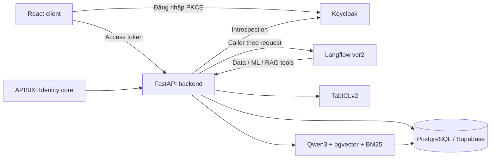

# FlowBridge

Trợ lý AI hỗ trợ mua hàng và đánh giá nhà cung cấp, kết hợp dữ liệu nghiệp vụ,
Langflow, mô hình dự đoán rủi ro và truy hồi tài liệu RAG. Dự án sử dụng kiến trúc
Open-Core/DX-OS, phát triển cho OLP 2026.

**Bắt đầu với [Hướng dẫn chạy](HUONG-DAN-CHAY.md)** để chuẩn bị môi trường và chạy
Keycloak, backend, Langflow và giao diện trong cùng stack Docker. Người dùng đăng
nhập SSO trên giao diện rồi sử dụng nghiệp vụ và chat.

## Chức năng

| Thành phần | Khả năng hiện có |
|---|---|
| Mua hàng | API PostgreSQL/Supabase quản lý NCC, sản phẩm, báo giá, PR, proposal, PO, giao nhận và xác nhận đơn theo contract v0.4.1. |
| Giao diện | `web/`: Agent Hub với shadcn/ui, SSO, chat bất đồng bộ, bảng/biểu đồ và Activities. `clients/sso/` giữ giao diện nghiệp vụ và quản lý tài liệu hiện có. |
| Identity/SSO | Keycloak OIDC/PKCE; kiểm access token qua introspection, kiểm user/grant/quyền tài nguyên tại backend. |
| Chat | Lưu lịch sử, kiểm quyền và idempotency, truyền caller theo request tới Langflow ver2. |
| Agent Hub | API hội thoại/run bất đồng bộ, bảng/biểu đồ, history và SSE Activities; bật qua cấu hình riêng. |
| ML | TabICLv2 chấm kịch bản, xếp hạng NCC và lưu/đọc rủi ro PO; cần checkpoint và context. |
| RAG | Markdown PostgreSQL, Qwen3 embedding, pgvector + BM25/RRF; phiên bản và hàng đợi đồng bộ tài liệu. |
| Gateway | APISIX standalone cho hai API Identity core; API mua hàng/chat hiện dùng backend trực tiếp. |

Nhân viên truy cập PR theo quyền của mình. ADMIN không tự có EMPLOYEE/APPROVER.
AI cung cấp dữ liệu và đề xuất; người có thẩm quyền quyết định phê duyệt.
Thiếu dữ liệu hoặc lỗi công cụ phải được thể hiện trong kết quả.

## Kiến trúc



Backend tổ chức theo `router → service/policy → repository/adapter`. Request dùng
session riêng; thao tác ghi/outbox dùng transaction. Identity sở hữu adapter user/grant
dùng chung schema, độc lập với service mua hàng. [Contracts](contracts/README.md)
giữ OpenAPI, JSON Schema và quy tắc đồng bộ.

Chat đi qua SSO và API chuẩn; browser không giữ API key Langflow. RAG dùng service
token AI_SERVICE và analysis task hợp lệ của PR. Kho tài liệu giữ phiên bản theo
cutoff để truy vết nguồn; model không tự quyết định quyền truy cập.

## Chạy hệ thống

Sau khi chuẩn bị DB, flow Langflow, credential và model theo
[hướng dẫn chạy](HUONG-DAN-CHAY.md):

```powershell
.\chat-docker.cmd doctor
.\chat-docker.cmd up
.\chat-docker.cmd status
```

Mở [FlowBridge](http://127.0.0.1:8761/), đăng nhập bằng user đã được liên kết/cấp
quyền trong DB. ML/RAG bật mặc định và yêu cầu đủ artifact, cấu hình; launcher kiểm
DB head và readiness, không tự seed hoặc tải weights. Dùng `--no-ml --no-rag` để tắt.

## Cấu trúc repository

```text
backend/flowbridge/   Backend, Identity, API nghiệp vụ, ML/RAG và chat
clients/sso/         React client và browser tests
web/                 Agent Hub web với shadcn/ui, OIDC/PKCE và SSE
langflow/            Runtime, component và flow agent
contracts/           OpenAPI, JSON Schema và provenance
alembic/             Migration và SQL
infra/               Compose, IAM, gateway và image manifests
scripts/             Công cụ vận hành, bootstrap, seed và đồng bộ contract
tests/               Unit, SQL integration và E2E
examples/            Fixture RAG và context ML mẫu
docs/                Hướng dẫn kỹ thuật theo thành phần
```

## Tài liệu kỹ thuật

| Chủ đề | Tài liệu |
|---|---|
| Cài đặt, khởi động, tài khoản, xử lý lỗi, E2E | [Hướng dẫn chạy](HUONG-DAN-CHAY.md) |
| Xác thực và cấp quyền | [SSO](docs/SSO.md), [Identity core](docs/IDENTITY-CORE.md) |
| Database và API | [API PostgreSQL/Supabase](docs/SUPABASE-API.md), [Migration](alembic/README.md) |
| Chat và agent | [Backend ↔ Langflow](docs/LANGFLOW-SSO.md), [Langflow](langflow/README.md), [Agent Hub](docs/AGENT-HUB.md) |
| Model và tài liệu | [ML](docs/ML-SERVICE.md), [RAG](docs/RAG.md) |
| Giao diện | [Agent Hub Web](web/README.md), [Client nghiệp vụ](clients/sso/README.md) |
| Hạ tầng | [Gateway](docs/GATEWAY.md), [Container phát triển](docs/DEV-CONTAINERS.md) |

## Phát triển và kiểm tra

Toolchain: Python 3.12, uv; Node >=20 cho client. Dependency khóa trong `uv.lock`,
`clients/sso/package-lock.json` và lockfile Langflow.

```powershell
uv sync --locked --group dev --group build
uv run --locked ruff check backend scripts tests langflow
uv run --locked pytest tests/unit -q
uv build --no-build-isolation
```

Unit dùng mock/fixture để kiểm regression. Kiểm tra hệ thống dùng browser, Keycloak,
PostgreSQL và Langflow thật theo [quy trình E2E](HUONG-DAN-CHAY.md#kiểm-thử-hệ-thống).
Ứng dụng được sử dụng qua stack đầy đủ; các lớp test vẫn được giữ để phát hiện lỗi.

## Giới hạn hiện tại

Workflow phê duyệt, worker phát hành PO/email và object storage chưa kết nối đầy đủ.
Agent Hub có API và giao diện riêng trong `web/`; bật bằng `web/start.ps1`. ML/RAG cần dữ liệu, artifact
và quyền tương ứng; chưa có đánh giá chất lượng/hiệu chuẩn trên dữ liệu sản xuất.
Profile local chưa phải cấu hình triển khai production.

## Đóng góp và giấy phép

Giữ ranh giới module, bổ sung kiểm thử phù hợp và chạy lint/test trước khi gửi PR.
Lịch sử thay đổi: [CHANGELOG.md](CHANGELOG.md).

Mã và cấu hình của nhóm: **GPL-3.0-or-later**, xem [LICENSE](LICENSE). Dependency
giữ giấy phép/notice upstream; dữ liệu, dataset và weights có điều kiện sử dụng riêng.
Không commit `.env`, credential, cache, volume hoặc weights.
