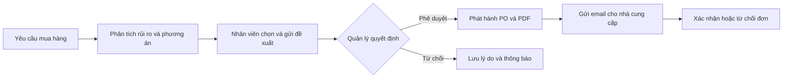
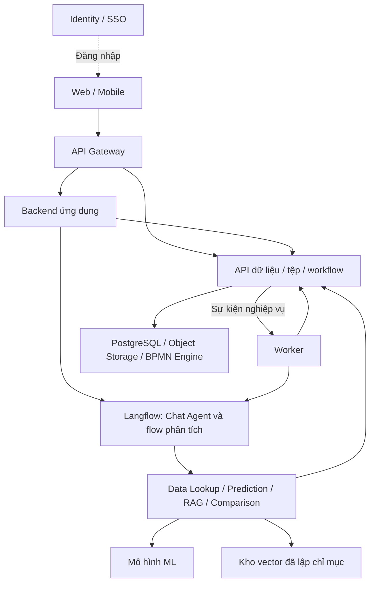

# FlowBridge

**Trợ lý AI quản lý nhà cung cấp, hỗ trợ đánh giá rủi ro giao hàng và quy trình mua hàng có người phê duyệt.**

FlowBridge kết hợp **LLM, Machine Learning và RAG** để hỗ trợ doanh nghiệp từ tra cứu thông tin nhà cung cấp đến lựa chọn phương án mua hàng, phê duyệt và xác nhận đơn. Dự án được phát triển theo kiến trúc DX-OS cho cuộc thi phần mềm nguồn mở OLP 2026.

Nhân viên có thể hỏi bằng ngôn ngữ tự nhiên, xem thông tin nhà cung cấp và nhận đề xuất dựa trên giá, lịch sử giao hàng, kết quả dự đoán ML cùng đánh giá nội bộ. Quản lý xem căn cứ và quyết định phê duyệt; nhà cung cấp xác nhận hoặc từ chối đơn qua liên kết email. Open-Core cung cấp các năng lực nền tảng dùng chung cho toàn bộ quy trình này.

> **Đang phát triển:** Backend hiện có **28 operation Open-Core trả dữ liệu mẫu** khi bật sample mode, cùng mapping route Gateway và ví dụ gọi. Web/mobile, AI và các engine/dữ liệu thật chưa được tích hợp. Xem [hướng dẫn API mẫu](examples/sample-api/README.md) và [trạng thái triển khai](#trạng-thái-và-hướng-phát-triển).

[Chức năng](#chức-năng-chính) · [Kiến trúc](#kiến-trúc-tổng-thể) · [Cài đặt](#cài-đặt-và-chạy-backend) · [Changelog](CHANGELOG.md) · [GPL-3.0-or-later](LICENSE)

## Mục lục

- [Bài toán và người sử dụng](#bài-toán-và-người-sử-dụng)
- [Chức năng chính](#chức-năng-chính)
- [Hai luồng sử dụng chính](#hai-luồng-sử-dụng-chính)
- [Kiến trúc tổng thể](#kiến-trúc-tổng-thể)
- [Dữ liệu và hợp đồng API](#dữ-liệu-và-hợp-đồng-api)
- [Cấu trúc repository](#cấu-trúc-repository)
- [Công nghệ sử dụng](#công-nghệ-sử-dụng)
- [Cài đặt và chạy backend](#cài-đặt-và-chạy-backend)
- [Cấu hình](#cấu-hình)
- [Kiểm thử và build](#kiểm-thử-và-build)
- [Trạng thái và hướng phát triển](#trạng-thái-và-hướng-phát-triển)
- [Đóng góp và báo lỗi](#đóng-góp-và-báo-lỗi)
- [Giấy phép](#giấy-phép)

## Bài toán và người sử dụng

Thông tin phục vụ mua hàng thường nằm ở nhiều nơi: bảng giá, lịch sử đơn hàng, dữ liệu giao nhận và báo cáo đánh giá nội bộ. FlowBridge hướng tới việc tập hợp các căn cứ này để người phụ trách trả lời được: nhà cung cấp nào phù hợp, đơn nào có nguy cơ giao trễ, có phương án thay thế nào và đề xuất đang ở bước phê duyệt nào.

- **Nhân viên mua hàng:** tra cứu dữ liệu, tạo yêu cầu, xem phân tích, so sánh nhà cung cấp và gửi phiếu đề xuất.
- **Quản lý:** xem báo cáo, phê duyệt hoặc từ chối đề xuất và theo dõi lịch sử quyết định.
- **Nhà cung cấp:** xem thông tin đơn được phép truy cập, xác nhận hoặc từ chối đơn qua liên kết riêng.
- **Quản trị viên:** cấu hình danh tính, quyền truy cập và các dịch vụ nền tảng.

## Chức năng chính

Các chức năng dưới đây mô tả mục tiêu sản phẩm.

| Nhóm chức năng | Phạm vi thiết kế |
|---|---|
| Quản lý dữ liệu mua hàng | Xem, lọc và tra cứu nhà cung cấp, sản phẩm, bảng giá, yêu cầu mua hàng, đơn đặt hàng và lịch sử giao hàng. |
| Chat với trợ lý AI | Hỏi trạng thái yêu cầu, giá và lịch sử; hỏi về rủi ro, đánh giá nội bộ hoặc phương án thay thế; xem lại lịch sử phiên chat. |
| Dự đoán rủi ro giao hàng | Dùng mô hình ML và dữ liệu lịch sử trước thời điểm dự đoán để tạo điểm rủi ro, đối chiếu ngưỡng cấu hình và lưu báo cáo. |
| Tra cứu tri thức nội bộ bằng RAG | Tìm đánh giá về chất lượng, xử lý sự cố và cảnh báo nhà cung cấp; trả câu trả lời kèm nguồn tài liệu. |
| So sánh nhà cung cấp | Kết hợp giá, điều kiện mua hàng, lịch sử, điểm rủi ro và đánh giá nội bộ để đề xuất phương án phù hợp. |
| Phân tích theo sự kiện | Tự tạo tác vụ phân tích khi có yêu cầu mua hàng mới; hỗ trợ phân tích lại, theo dõi tiến độ và thông báo kết quả. |
| Phê duyệt và đặt hàng | Nhân viên gửi phiếu đề xuất, quản lý quyết định; sau phê duyệt mới phát hành đơn đặt hàng (PO), sinh PDF và gửi email. |
| Xác nhận và truy vết | Nhà cung cấp xác nhận hoặc từ chối đơn; hệ thống lưu trạng thái, báo cáo, quyết định và kết quả gửi email để tra cứu. |

AI tổng hợp và đề xuất từ dữ liệu do công cụ trả về. Quyền phê duyệt thuộc người có thẩm quyền; việc phát hành PO và gửi email do backend/workflow thực thi sau quyết định hợp lệ. Khi thiếu dữ liệu hoặc công cụ thất bại, hệ thống phải thể hiện phần chưa đủ căn cứ, không tự tạo giá hay điểm rủi ro.

## Hai luồng sử dụng chính

**Chat theo yêu cầu:** Người dùng đặt câu hỏi → backend xác thực và bổ sung ngữ cảnh → Supplier Agent trong Langflow chọn công cụ tra cứu dữ liệu, dự đoán, RAG hoặc so sánh → trả câu trả lời có căn cứ. Agent hỏi bổ sung khi thiếu thông tin; đọc báo cáo đã lưu không bắt buộc chạy lại mô hình.

**Tự động theo sự kiện:** Người dùng tạo yêu cầu mua hàng → backend lưu yêu cầu và phát sự kiện → worker chạy phân tích → lưu báo cáo và thông báo. Khi rủi ro đạt ngưỡng, luồng phân tích tìm thêm phương án thay thế nếu có dữ liệu phù hợp. Người dùng cũng có thể chủ động yêu cầu phân tích lại.

Quy trình mua hàng tiếp nối bằng các thao tác có kiểm tra quyền và trạng thái:



Phạm vi demo theo dõi đến xác nhận đơn. Trạng thái nhà cung cấp đã xác nhận thể hiện việc chấp nhận đặt hàng; theo dõi đầy đủ quá trình giao nhận cần thêm dữ liệu và quy trình tương ứng.

## Kiến trúc tổng thể

Ứng dụng trợ lý nhà cung cấp nằm ở tầng Trí tuệ số của DX-OS và sử dụng các dịch vụ Open-Core ở tầng nền tảng. Các thành phần được tách theo trách nhiệm:

Sơ đồ kiến trúc dự kiến:



| Thành phần | Vai trò |
|---|---|
| Web và mobile | Giao diện dữ liệu, chat, báo cáo, đề xuất và phê duyệt; dùng chung hợp đồng REST/JSON. |
| Backend ứng dụng và worker | Kiểm tra nghiệp vụ, phối hợp API, quản lý tác vụ phân tích, phát hành PO, gửi email và xử lý xác nhận. Worker xử lý công việc kéo dài, có retry và chống tác động trùng. |
| AI và công cụ chuyên biệt | Langflow điều phối Agent và flow phân tích; Data Lookup tra cứu dữ liệu, Prediction Service chạy ML, Knowledge Retrieval truy xuất RAG, Supplier Comparison kết hợp các căn cứ. |
| Open-Core headless | Cung cấp API và policy dùng chung, tích hợp các engine nguồn mở; giao diện người dùng nằm ở tầng ứng dụng. |

Bốn năng lực của Open-Core phục vụ toàn bộ dự án:

- **Identity/SSO:** đăng nhập, xác minh danh tính và ngữ cảnh quyền truy cập.
- **API Gateway:** kiểm tra token, định tuyến và kiểm soát truy cập tại cổng; dịch vụ nhận vẫn kiểm tra quyền trên tài nguyên và tenant.
- **Database/Storage:** quản lý dữ liệu có cấu trúc, tệp, metadata và quyền truy cập qua API.
- **Workflow:** điều phối quy trình và tác vụ phê duyệt, lưu trạng thái cùng lịch sử thực thi.

Backend và các công cụ AI truy cập năng lực lõi qua giao diện dịch vụ phù hợp. LLM không truy vấn SQL tùy ý hoặc tự quyết định quyền truy cập. Schema mua hàng và quy trình demo thuộc ứng dụng; Open-Core giữ khả năng tái sử dụng cho nghiệp vụ khác.

Hướng tích hợp nền tảng gồm Keycloak, Apache APISIX, PostgreSQL, object storage tương thích S3 và engine BPMN. Engine workflow cụ thể còn cần kiểm chứng tích hợp; các engine này chưa được triển khai trong repo hiện tại. Phần AI dự kiến dùng Langflow, mô hình ML cho dữ liệu bảng và kho vector cho RAG; model, dữ liệu và phiên bản triển khai cần được lựa chọn, đánh giá riêng.

## Dữ liệu và hợp đồng API

Dữ liệu có cấu trúc gồm nhà cung cấp, sản phẩm, giá, lịch sử giao hàng và trạng thái mua hàng. Kho đánh giá nội bộ phục vụ RAG; thiết kế demo dùng Markdown được chia đoạn, embedding và nạp trước vào kho vector. Tài liệu PDF là nguồn đầu vào cần bước trích xuất/chuyển đổi trước khi lập chỉ mục. Khi trả lời, hệ thống truy xuất nội dung đã lập chỉ mục và giữ tham chiếu nguồn.

Thiết kế API chia ba nhóm: API nền tảng Open-Core, API ứng dụng cho Web/mobile và worker, API công cụ AI nội bộ. Bản hiện tại triển khai API nền tảng ở **chế độ dữ liệu mẫu**: 2 operation Identity, 16 Data/Storage, 6 Workflow và 4 events/notifications/audit bổ trợ. [Hợp đồng v0.2.0](contracts/README.md) được đóng gói cùng backend; Gateway có mapping method/path/public/internal, chưa chạy APISIX.

Request/response/status theo contract. GET trả fixture tổng hợp ổn định; POST/PATCH/action/DELETE trả kết quả mẫu, chưa lưu thay đổi. Authentication dùng principal mẫu, chưa xác thực OIDC. [Ví dụ đủ 28 operation](examples/sample-api/requests.json) và [cách gọi](examples/sample-api/README.md) phục vụ phát triển tầng ứng dụng trước khi tích hợp dữ liệu thật.

## Cấu trúc repository

```text
FlowBridge/
├── backend/src/flowbridge/   Package backend Python hiện có
├── tests/unit/              Unit test Settings, lifecycle, lỗi/correlation và probes dùng mock
├── tests/sample/            HTTP/contract test cho API mẫu, không dùng engine
├── clients/                 Dành cho giao diện Web/mobile, hiện còn trống
├── langflow/                Dành cho flow/component AI, hiện còn trống
├── contracts/               Provenance và quy tắc đồng bộ snapshot contract trong package
├── infra/gateway/           Hướng dẫn xuất mapping route từ contract
├── examples/sample-api/     Request mẫu và hướng dẫn Swagger/curl
├── scripts/                 Công cụ kiểm tra HTTP server sample
├── platform/opencore/       Scaffold nền tảng, chưa có triển khai
├── pyproject.toml           Manifest và cấu hình build/lint/test
├── uv.lock                  Phiên bản dependency đã khóa
├── .env.example             Mẫu cấu hình backend
├── CHANGELOG.md             Lịch sử thay đổi
└── LICENSE                  Toàn văn GNU GPL v3
```

Git không lưu các thư mục trống; chúng có thể chưa xuất hiện khi clone repo. Các lệnh tiếp theo áp dụng cho backend Python hiện có.

## Công nghệ sử dụng

| Nhóm | Công nghệ | Trạng thái |
|---|---|---|
| Backend | Python 3.12, FastAPI, Starlette, Pydantic, Uvicorn | Đã có khung ứng dụng, lỗi chuẩn, correlation và probes vận hành. |
| Truy cập dữ liệu và HTTP | SQLAlchemy, asyncpg, Alembic, HTTPX | Đã khai báo dependency; có lifecycle HTTP/engine/session, chưa có migration hoặc kết nối DB thật. |
| Công cụ phát triển | uv 0.13.1, Hatchling, Ruff, pytest | Đã cấu hình; dependency khóa trong [uv.lock](uv.lock). |
| Nền tảng Open-Core | Keycloak, Apache APISIX, PostgreSQL, storage tương thích S3, engine BPMN | Hướng tích hợp; chưa triển khai engine. |
| AI | Langflow, LLM, ML cho dữ liệu bảng, RAG và kho vector | Thiết kế; chưa chốt toàn bộ model, phiên bản và dịch vụ. |
| Giao diện | Web và mobile dùng chung REST/JSON | Chưa triển khai, chưa chốt framework. |

Phiên bản thư viện Python cụ thể được khai báo trong [pyproject.toml](pyproject.toml) và khóa trong `uv.lock`. Engine workflow, model và dữ liệu cần được kiểm chứng trước khi tích hợp.

## Cài đặt và chạy backend

### Yêu cầu

- Source FlowBridge có `pyproject.toml` và `uv.lock`; mở terminal tại thư mục gốc repo.
- CPython dòng **3.12** và **uv 0.13.1**. Manifest yêu cầu đúng phiên bản uv.
- Cài uv theo [hướng dẫn upstream](https://docs.astral.sh/uv/getting-started/installation/) hoặc package manager phù hợp.

Bản khung hiện tại chạy development với DSN trống, không cần tạo database. Chưa có lệnh khởi chạy toàn bộ Web/mobile, AI và Open-Core.

### 1. Cài dependency

```sh
uv sync --locked --group build
```

### 2. Chuẩn bị cấu hình

Có thể chạy ngay với mặc định development. Nếu cần tùy chỉnh, sao chép [.env.example](.env.example) thành `.env`. Để chạy không DB, giữ `FLOWBRIDGE_DATABASE_URL` và `FLOWBRIDGE_DATABASE_PASSWORD` trống; không đưa thông tin bí mật vào Git. Để kết nối Supabase và quản lý schema, xem [hướng dẫn SQLAlchemy + Alembic](alembic/README.md).

```sh
# Bash
cp .env.example .env
```

```powershell
# PowerShell
Copy-Item .env.example .env
```

### 3. Chạy ứng dụng

```sh
uv run --locked python -m flowbridge.main
```

Server mặc định nghe tại `127.0.0.1:8000`. `/` trả **404**. Để gọi các endpoint mẫu, bật sample và docs, giữ DSN trống:

```powershell
$env:FLOWBRIDGE_ENVIRONMENT = "development"
$env:FLOWBRIDGE_SAMPLE_MODE = "true"
$env:FLOWBRIDGE_DOCS_ENABLED = "true"
$env:FLOWBRIDGE_DATABASE_URL = ""
$env:FLOWBRIDGE_DATABASE_PASSWORD = ""
uv run --locked python -m flowbridge.main
```

Trên Bash:

```sh
FLOWBRIDGE_ENVIRONMENT=development FLOWBRIDGE_SAMPLE_MODE=true FLOWBRIDGE_DOCS_ENABLED=true FLOWBRIDGE_DATABASE_URL= FLOWBRIDGE_DATABASE_PASSWORD= uv run --locked python -m flowbridge.main
```

Mở [Swagger](http://127.0.0.1:8000/docs) hoặc gọi `GET /api/v1/core/identity/me`, `GET /api/v1/core/data/sample_items`, `GET /api/v1/core/workflow/tasks`. Xem [API mẫu](examples/sample-api/README.md) để upload/download và gọi đủ operation. Không cần token trong sample; schema ghi rõ auth/tác động dữ liệu mô phỏng. Sample tắt mặc định và bị từ chối ở production hoặc khi DSN không trống. Khi sample tắt, các route nghiệp vụ chưa được bật; docs bật riêng sẽ có `paths` rỗng. Các endpoint vận hành được tách khỏi schema nghiệp vụ.

| Endpoint vận hành | Kết quả |
|---|---|
| `GET /_ops/live` | `200` với `status=alive`, `scope=process`; không gọi dịch vụ phụ thuộc. |
| `GET /_ops/ready` | `200` với `scope=backend_runtime` khi HTTP client còn mở và probe DB thành công; `503` khi chưa startup, thiếu DB, lỗi hoặc timeout. Bản bootstrap dùng DSN trống trả `503`, đây là trạng thái dự kiến. |

Readiness chỉ kiểm tra runtime backend, không chứng nhận Identity/Gateway/Storage/Workflow đã sẵn sàng. Các endpoint `/_ops/*` dành cho mạng vận hành; cấu hình gateway ở giai đoạn triển khai phải giữ chúng ngoài route công khai. Chúng hiện dùng chung listener backend, chưa có listener quản trị riêng.

Mọi response HTTP có `X-Correlation-Id`. Header đầu vào được giữ nếu chỉ có một giá trị dài 1–128 ký tự, bắt đầu bằng chữ/số và chỉ chứa chữ/số ASCII, `_`, `-`; giá trị thiếu, sai hoặc trùng được thay bằng ID mới. ID này dùng truy vết, không cấp quyền. Lỗi trả JSON gồm `code`, `message`, `request_id`, `retryable` và `details` khi cần; `request_id` khớp header. JSON lỗi cú pháp trả `400`, lỗi validation tham số/body trả `422`; chi tiết lỗi không phản chiếu input hoặc traceback. Lỗi nội bộ chỉ ghi thông báo cố định và request ID vào logger của FlowBridge; access log mặc định tắt.

Có thể dùng Uvicorn trực tiếp:

```sh
uv run --locked uvicorn flowbridge.main:create_app --factory --host 127.0.0.1 --port 8000 --no-access-log
```

Khi dùng CLI Uvicorn, host/port/log level do tham số CLI quyết định. Với lệnh module Python, các giá trị này lấy từ Settings.

<details>
<summary>Windows: dùng uv và CPython trong thư mục công cụ local</summary>

Nếu uv chưa có trên PATH, có thể cài riêng trong các thư mục bị Git ignore:

```powershell
py -3.12 -m pip install --target .tools/uv "uv==0.13.1"
$env:UV_CACHE_DIR = Join-Path (Get-Location) ".cache/uv"
$env:UV_PYTHON_INSTALL_DIR = Join-Path (Get-Location) ".tools/python"
& ./.tools/uv/bin/uv.exe python install 3.12.15 --install-dir .tools/python --no-bin --no-registry
& ./.tools/uv/bin/uv.exe sync --locked --group build --python 3.12.15 --managed-python
```

Runtime riêng hữu ích khi PATH trỏ tới MSYS/MinGW Python hoặc Python Microsoft Store không tạo được virtualenv trên ổ dự án. Nếu đã có CPython chuẩn hoạt động thì dùng runtime đó. Thư mục `.tools/`, `.cache/` và `.venv/` không thuộc source phát hành.

Với bộ công cụ local, thay `uv` trong các lệnh bằng `& ./.tools/uv/bin/uv.exe`. Sau khi sync, cũng có thể chạy:

```powershell
& ./.venv/Scripts/python.exe -m flowbridge.main
```

</details>

## Cấu hình

[.env.example](.env.example) là mẫu cấu hình. Settings đọc biến `FLOWBRIDGE_*` và `.env` tại thư mục đang chạy. Thứ tự ưu tiên: tham số truyền trực tiếp → biến môi trường → `.env` → giá trị mặc định.

| Biến | Mặc định | Ý nghĩa |
|---|---|---|
| `FLOWBRIDGE_ENVIRONMENT` | `development` | Môi trường chạy; production bắt buộc cấu hình database. |
| `FLOWBRIDGE_HOST` | `127.0.0.1` | Địa chỉ lắng nghe khi chạy module Python. |
| `FLOWBRIDGE_PORT` | `8000` | Cổng khi chạy module Python. |
| `FLOWBRIDGE_LOG_LEVEL` | `INFO` | Mức log khi chạy module Python. |
| `FLOWBRIDGE_DOCS_ENABLED` | `false` | Bật `/docs` và `/openapi.json` trong môi trường phát triển. |
| `FLOWBRIDGE_SAMPLE_MODE` | `false` | Bật 28 operation trả dữ liệu mẫu trong development/test; từ chối production hoặc DSN không trống. |
| `FLOWBRIDGE_SAMPLE_UPLOAD_MAX_BYTES` | `1048576` | Giới hạn bytes upload mẫu, 1–10485760; vượt giới hạn trả 422. |
| `FLOWBRIDGE_DATABASE_URL` | Trống | Development/test hiện chạy không DB; khi tích hợp dùng DSN `postgresql+asyncpg://…`. |
| `FLOWBRIDGE_DATABASE_HOST`, `FLOWBRIDGE_DATABASE_USER`, `FLOWBRIDGE_DATABASE_PASSWORD` | Trống | Thay thế DSN bằng host/user/password riêng; password thô được encode tự động. DSN tường minh được ưu tiên. |
| `FLOWBRIDGE_DATABASE_PORT`, `FLOWBRIDGE_DATABASE_NAME` | `5432`, `postgres` | Cổng và database khi ghép URL từ các trường riêng. |
| `FLOWBRIDGE_DATABASE_SSL` | `require` | SSL của asyncpg: `require`, `verify-full`, hoặc `disable` cho DB local. |
| `FLOWBRIDGE_DATABASE_POOL_MODE` | `queue` | `queue`: pool giới hạn tại backend; `null`: không giữ pool tại backend. Alembic luôn dùng `NullPool`. |
| `FLOWBRIDGE_HTTP_TIMEOUT_SECONDS` | `10` | Timeout HTTP client dùng chung của app. |
| `FLOWBRIDGE_HTTP_MAX_CONNECTIONS` | `100` | Giới hạn pool kết nối HTTP. |
| `FLOWBRIDGE_HEALTH_TIMEOUT_SECONDS` | `2` | Deadline toàn bộ probe DB của readiness, cấu hình lớn hơn 0 và tối đa 30 giây. |

Các tùy chọn pool/timeout database có trong `.env.example`. Nhóm biến OIDC/workflow/S3 đang dành cho adapter ở giai đoạn sau, chưa được khung hiện tại sử dụng.

<details>
<summary>Chi tiết Settings và vòng đời tài nguyên backend</summary>

Factory có thể nhận `Settings(_env_file="/path/to/config.env")` hoặc `_env_file=None`. Khi URL và password trống ở development/test, app không mở DB session. Khi có cấu hình DB, lifespan tạo engine và kiểm tra `SELECT 1`; không kết nối được thì startup thất bại. Dùng `python scripts/check_db.py` trong môi trường đã cài dependency để kiểm chứng kết nối PostgreSQL thật trước khi chạy backend.

Mỗi app quản lý một HTTPX client có timeout/pool giới hạn và đóng tài nguyên khi shutdown hoặc lỗi. `get_session()` cấp session riêng theo request, không tự commit; service quản lý transaction. Task nền phải mở session riêng từ factory. DSN được che trong repr/JSON của Settings.

</details>

### Lỗi thường gặp

| Hiện tượng | Cách xử lý |
|---|---|
| `/` trả 404 hoặc không thấy `/docs` | `/` không có route; bật `FLOWBRIDGE_DOCS_ENABLED=true` và sample để gọi API mẫu trong Swagger. |
| API core trả 404 | Kiểm tra `FLOWBRIDGE_SAMPLE_MODE=true`; collection mẫu là `sample_items`, các ID có trong hướng dẫn API mẫu. |
| uv báo sai phiên bản | Dùng uv 0.13.1 theo yêu cầu của manifest. |
| Không tạo được virtualenv trên Windows | Dùng CPython chuẩn hoặc cách cài runtime local ở trên. |
| Startup báo lỗi PostgreSQL | Bản khung development hiện dùng DSN trống; kiểm tra cấu hình môi trường và `.env`. |
| `/_ops/live` trả 200 nhưng `/_ops/ready` trả 503 | Kiểm tra `details` trong lỗi readiness; DSN trống ở bản bootstrap được ghi là `database/not_configured`. |

## Kiểm thử và build

Chạy các lệnh tại thư mục gốc repo sau khi sync dependency:

```sh
uv lock --check
uv run --locked ruff check .
uv run --locked ruff format --check .
uv run --locked pytest tests/unit -q
uv run --locked pytest tests/sample -q
uv build --no-build-isolation
```

Unit test kiểm tra cấu hình, lifecycle, cấu trúc lỗi, bảo vệ dữ liệu nhạy cảm, correlation giữa request đồng thời và liveness/readiness. Kết nối và dữ liệu được mock; test construction SQLAlchemy engine không mở kết nối. Suite không tạo database, bảng hay migration. Kiểm thử tích hợp PostgreSQL, SSO, gateway, storage, workflow và demo đầu cuối chưa được triển khai.

Suite sample kiểm tra route thực đủ 28 operation, JSON Schema request/response, dữ liệu liên kết, pagination/history, multipart/bytes/hash, tác động ghi chỉ là mẫu và production guard. Test sample chặn tạo DB engine và outbound HTTP; không coi đây là bằng chứng engine hoạt động. Khi server sample đang chạy, kiểm tra HTTP TCP bằng `uv run --locked python scripts/check_sample_api.py`.

Nhóm dependency `build` khóa Hatchling cùng dependency bắc cầu. Sau khi sync nhóm này, `--no-build-isolation` dùng môi trường đã cài theo lockfile để build. Wheel và source tar.gz sinh trong `dist/`, bị Git ignore. Khi chuẩn bị phát hành, cần kiểm chứng cài wheel vào môi trường sạch, chạy ngoài source tree và build lại từ source archive.

## Trạng thái và hướng phát triển

| Hạng mục | Hiện trạng |
|---|---|
| Nền backend | Có package, app factory, Settings, lifecycle, lỗi chuẩn, correlation, probes vận hành và unit test mock. |
| Open-Core | Có 28 operation trả mẫu và mapping Gateway; chưa có migration, dữ liệu hoặc engine thật. |
| Ứng dụng mua hàng | Đã có thiết kế luồng; chưa có API nghiệp vụ và giao diện. |
| AI và tự động hóa | Đã có thiết kế chat, ML/RAG, so sánh và worker; chưa triển khai. |
| Demo và phát hành | Chưa có demo đầu cuối; version package 0.1.0 chưa phải release công khai. |

Các giai đoạn tiếp theo:

- Sau mốc API mẫu, tích hợp Identity/Gateway và phát triển dữ liệu thật, migration, storage, quyền truy cập, workflow và sự kiện. Giai đoạn mẫu chưa cần database/engine, chưa lưu thay đổi hoặc xác thực OIDC thật.
- Kết nối backend mua hàng, worker, Langflow và công cụ ML/RAG.
- Xây dựng Web/mobile, dữ liệu demo có nguồn gốc rõ ràng và kiểm thử đầu cuối.
- Hoàn thiện tài liệu, kiểm tra dependency/license và phát hành source tar.gz/tar.xz gắn version, tag và commit xác định.

Lịch sử thay đổi nằm trong [CHANGELOG.md](CHANGELOG.md).

## Đóng góp và báo lỗi

Để đóng góp, thiết lập môi trường theo hướng dẫn trên, giữ ranh giới router → service/policy → repository/adapter, bổ sung kiểm thử phù hợp và chạy lint/test trước khi gửi pull request. PR cần mô tả vấn đề, thay đổi và kết quả kiểm tra; mã mới của nhóm áp dụng GPL-3.0-or-later nhất quán với dự án.

Repository được cấu hình tại [FlowBridge trên GitHub](https://github.com/hoanganh-ktpm/FlowBridge). Khả năng truy cập công khai, trạng thái Issues và release chưa được xác minh. Khi tracker sẵn sàng, báo lỗi cần kèm phiên bản, bước tái hiện, kết quả mong đợi/thực tế và log đã loại bỏ thông tin bí mật.

## Giấy phép

Mã và cấu hình do nhóm phát triển áp dụng **GNU GPL version 3 hoặc phiên bản sau — GPL-3.0-or-later**. Giấy phép cho phép sử dụng, nghiên cứu, sửa đổi và phân phối lại theo điều kiện GPL; phần mềm không có bảo hành. Xem toàn văn trong [LICENSE](LICENSE).

Dependency giữ giấy phép, copyright và NOTICE upstream, được lấy qua package manager. Dữ liệu nghiệp vụ, tệp tải lên, tài liệu nguồn, dataset và trọng số mô hình bên ngoài có điều kiện sử dụng riêng; cần xác định nguồn gốc, quyền phân phối và attribution trước khi đưa vào demo hoặc phát hành.
