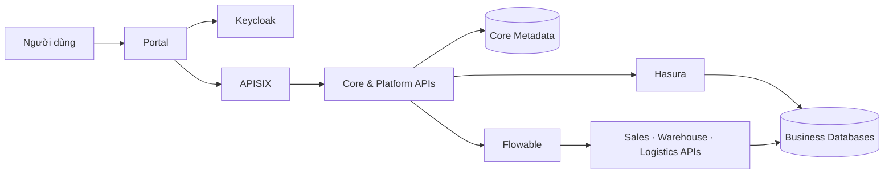

<p align="center">
  
</p>

<h1 align="center">FlowBridge</h1>

<p align="center">
  <strong>DX-OS Open-Core Platform</strong><br>
  Nền tảng tích hợp dữ liệu và điều phối nghiệp vụ cho các ứng dụng doanh nghiệp.
</p>

<p align="center">
  Data Governance · Business APIs · BPMN Workflows
</p>

<p align="center">
  <a href="LICENSE">GPL-3.0-or-later</a> ·
  <a href="docs/ARCHITECTURE.md">Kiến trúc</a> ·
  <a href="docs/DEVELOPMENT.md">Phát triển</a> ·
  <a href="CONTRIBUTING.md">Đóng góp</a>
</p>

## Tổng quan

FlowBridge hướng tới một nền tảng dùng chung để đăng ký ứng dụng, công bố dữ liệu có quản trị và phối hợp quy trình giữa các phòng ban. Dữ liệu nghiệp vụ được giữ tại ứng dụng sở hữu; nền tảng quản lý metadata, hợp đồng dữ liệu, quyền truy cập và các năng lực tích hợp.

Sales, Warehouse và Logistics là ba ứng dụng mẫu cho quy trình Order Fulfillment. Workflow sử dụng các giao diện được cấp quyền để khai thác dữ liệu và thực hiện hành động nghiệp vụ.

Ba lớp quyền độc lập: IT/PLATFORM_ADMIN quản trị DX-OS (gồm publish và cấp/thu quyền); Core + Hasura kiểm quyền đọc dữ liệu theo grant; từng Business API kiểm quyền nghiệp vụ riêng. Vai trò nhân viên/phụ trách phòng ban không tự cấp quyền quản trị nền tảng. Chi tiết tại [API Contracts](docs/API-CONTRACTS.md#authorization-model-three-independent-layers).

## Phạm vi và trạng thái

Dự án đang trong giai đoạn xây dựng nền tảng kiến trúc. Các module được tách theo trách nhiệm để phát triển và kiểm thử độc lập.

| Thành phần | Vai trò | Trạng thái |
|---|---|---|
| Data Core | Registry, Data Products, Governance, Hasura Provisioner | Core HTTP/worker và PostgreSQL adapter; đã kiểm luồng onboarding, publish, đọc theo grant và revoke với Keycloak/Hasura/PostgreSQL thật |
| Platform | Identity, Gateway, Workflow, Audit và HTTP utilities | Identity/HTTP adapters và Workflow Layer 1 đã có live E2E; các tích hợp còn lại đang phát triển |
| Business APIs | Đơn hàng, tồn kho và vận chuyển | Có vertical slice Workflow thật xuyên 3 DB: reservation/packing/handoff/delivery; chưa phải ERP đầy đủ |
| Portal | Giao diện, SSO browser và hiển thị kết quả | Data Workspace dùng Core/PKCE; giao diện chat cũ giữ ở route riêng và preview |
| Data Workspace (Tầng 2) | Adapter cấu hình, analytics, statistical forecast, what-if có kiểm quyền | Service/API và ba màn hình Portal; PostgreSQL riêng; xem [phạm vi và nghiệm thu](docs/DATA-WORKSPACE.md) |
| Infrastructure | PostgreSQL, Hasura, Keycloak, APISIX, Flowable | PostgreSQL 16 local có các DB ứng dụng/metadata, flowable_db và Workspace DB riêng; Hasura/Keycloak/Flowable Docker; Core/worker native |

Native factory `app.core.runtime:create_app` ghép Core HTTP với PostgreSQL thật; worker chạy thành process riêng, không có persistence memory fallback hoặc migration khi startup. Source hiện có 48 bảng ứng dụng/17 revision files: Core 15 bảng, nghiệp vụ 30 bảng và Workspace 3 bảng. Head `core_0006` bổ sung persistence Workflow trên mô hình principal/phòng ban/Data Product/grant. Manifest v1 đăng ký draft và discovery nguồn thật, không sửa schema Core theo tên ứng dụng. [Workflow](docs/WORKFLOW.md) ghi nhận Flowable 7.2.0 trên PostgreSQL local, quy trình Sales → Warehouse → Logistics đến End và event Hasura thật; Core/worker giữ native. Demo dùng [PostgreSQL Docker local](docs/database/README.md), generator 365 ngày và bảy Data Product views; checksum lịch sử được bảo toàn qua E2E. Các profile Supabase trong [Docker Integration](docs/DOCKER.md) là tài liệu môi trường cũ. Xem [Relationship Queries](docs/RELATIONSHIP-QUERIES.md), [Automated Onboarding](docs/AUTOMATED-ONBOARDING.md), [Core Backend P0](docs/CORE-P0.md) và [Database Setup](docs/database/README.md).

## Kiến trúc định hướng



Core quản lý dữ liệu được chia sẻ và quyền khai thác. Business APIs sở hữu thay đổi nghiệp vụ và transaction. Flowable điều phối quy trình; mỗi receiver chịu trách nhiệm xác thực và kiểm quyền phù hợp. Chi tiết tại [tài liệu kiến trúc](docs/ARCHITECTURE.md).

## Cấu trúc repository

```text
FlowBridge/
├── backend/app/
│   ├── core/                   Registry, Data Products, Governance, Core DB
│   └── platform/               Identity, Gateway, Workflow, Audit, HTTP
├── services/
│   ├── data-workspace-api/     Analytics/forecast/simulation qua Core API; DB riêng
│   ├── sales-api/              app/ và migrations/
│   ├── warehouse-api/          app/ và migrations/
│   └── logistics-api/          app/ và migrations/
├── portal/                     Giao diện và cấu hình frontend
├── contracts/                  Schema, giao diện chung và fixtures
├── workflows/                  Quy trình BPMN nghiệp vụ
├── infra/                      Cấu hình triển khai engine
├── scripts/database/           Công cụ quản trị, Alembic bootstrap và demo fixtures
├── tests/                      Domain, Core, Platform và E2E
└── docs/                       Tài liệu kỹ thuật
```

Chỉ giữ module có implementation trong cây active. Xem [Backend](backend/README.md), [Business APIs](services/README.md), [Portal](portal/README.md) và [Infrastructure](infra/README.md).

## Công nghệ

| Phạm vi | Công nghệ |
|---|---|
| Backend | Python 3.12, FastAPI, SQLAlchemy, Alembic |
| Frontend | React, TypeScript, Vite, Tailwind CSS, shadcn/ui |
| Identity và Gateway | Keycloak, OIDC/PKCE, Apache APISIX |
| Data và Workflow | PostgreSQL, Hasura, Flowable BPMN |
| Kiểm thử | pytest, Ruff, Vitest, Playwright |

Dependency Python được khóa tại `pyproject.toml` và `uv.lock`; dependency frontend tại `portal/package.json` và `portal/package-lock.json`.

## Phát triển từ mã nguồn

Yêu cầu: Python 3.12, uv 0.13.1, Node.js >=22.12 và npm.

```sh
git clone https://github.com/hoanganh-ktpm/FlowBridge.git
cd FlowBridge
uv sync --locked --group dev --group build
```

Các lệnh sau chạy từ gốc repository:

```sh
uv run --locked pytest tests/platform -q
uv run --locked ruff check backend tests
uv build --no-build-isolation
```

Chạy Portal trong terminal riêng:

```sh
cd portal
npm ci
npm run dev
```

Portal development tại `http://127.0.0.1:5174`; chế độ preview tại `http://127.0.0.1:5174/?preview=1`. Preview sử dụng dữ liệu tổng hợp. Đăng nhập và API thật cần deployment tương thích; xem [Portal README](portal/README.md).

Kiểm tra frontend:

```sh
cd portal
npm test
npm run build
```

`.env.example` chỉ chứa tên cấu hình và giá trị mẫu. Tạo `.env` cục bộ khi tích hợp Identity vào ứng dụng; không đưa credential vào source.

## Tài liệu

- [Data Workspace: triển khai, mô hình tính, kiểm thử, cách chạy và phần chờ phê duyệt](docs/DATA-WORKSPACE.md)
- [Installer và cấu hình engine Tầng 1](docs/DEPLOYMENT.md)
- [Kiến trúc và ranh giới module](docs/ARCHITECTURE.md)
- [Môi trường phát triển và tiêu chí tích hợp](docs/DEVELOPMENT.md)
- [Quản lý nội dung repository](docs/REPOSITORY.md)
- [Hasura Integration và hướng dẫn phát triển không Docker](backend/app/core/hasura_provisioner/README.md)
- [Declarative onboarding: JSON → Core Contracts → Hasura plan](docs/ONBOARDING.md)
- [Automated onboarding: PostgreSQL runtime, native setup và bằng chứng kiểm thử](docs/AUTOMATED-ONBOARDING.md)
- [Docker integration: Keycloak/Hasura và Supabase hiện có](docs/DOCKER.md)
- [API Contracts và hướng dẫn triển khai contract-first](docs/API-CONTRACTS.md)
- [Core Backend P0 và database integration checklist](docs/CORE-P0.md)
- [Database ownership, migrations và khác biệt schema cần tích hợp](docs/database/README.md)
- [Giấy phép thành phần Hasura Integration](THIRD_PARTY_LICENSES.md)
- [Hướng dẫn đóng góp](CONTRIBUTING.md)
- [Lịch sử thay đổi](CHANGELOG.md)

## Giấy phép

Mã nguồn và cấu hình do dự án phát triển được cấp phép theo **GPL-3.0-or-later**, xem [LICENSE](LICENSE). Các thành phần bên thứ ba giữ giấy phép và attribution riêng, bao gồm [thành phần giao diện](portal/THIRD-PARTY-NOTICES.md). Dữ liệu, tài liệu và model bên ngoài có điều kiện sử dụng riêng.
