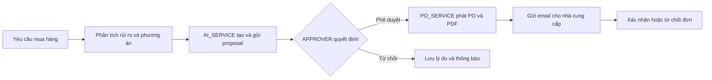
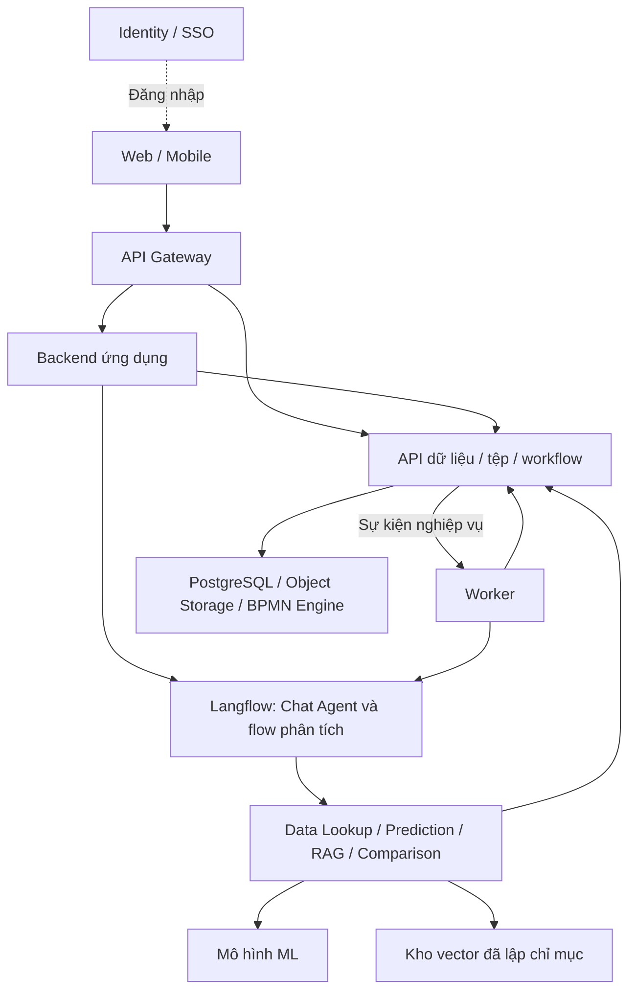

# FlowBridge

Gateway Identity core dùng APISIX standalone, với TLS/OIDC và bộ kiểm thử Docker
riêng: [thiết lập và nghiệm thu](docs/GATEWAY.md). Trạng thái hiện hành và phần
còn mở được ghi trong [bằng chứng Gateway](docs/GATEWAY-TEST-RESULTS.md).

**Trợ lý AI quản lý nhà cung cấp, hỗ trợ đánh giá rủi ro giao hàng và quy trình mua hàng có người phê duyệt.**

FlowBridge kết hợp **LLM, Machine Learning và RAG** để hỗ trợ doanh nghiệp từ tra cứu thông tin nhà cung cấp đến lựa chọn phương án mua hàng, phê duyệt và xác nhận đơn. Dự án được phát triển theo kiến trúc DX-OS cho cuộc thi phần mềm nguồn mở OLP 2026.

Nhân viên lập PR cá nhân nhiều dòng và có thể hỏi trợ lý bằng ngôn ngữ tự nhiên. Theo schema v0.4.1, AI_SERVICE phân tích và tự tạo/gửi proposal; người có APPROVER trong phạm vi phòng ban và đúng workflow quyết định phê duyệt. PO_SERVICE phát đơn sau duyệt; nhà cung cấp xác nhận hoặc từ chối qua liên kết email. Open-Core cung cấp các năng lực nền tảng dùng chung.

> **Đang phát triển:** API nghiệp vụ có chế độ PostgreSQL/Supabase thật theo contract **v0.4.1**: đọc/ghi PR, analysis, proposal, PO, receipt, supplier confirmation và phân quyền ứng dụng. Xem [hướng dẫn API database](docs/SUPABASE-API.md). Identity/SSO dùng Keycloak, xem [hướng dẫn SSO](docs/SSO.md); hai API Identity core bật bằng binding tenant/application theo [Identity core](docs/IDENTITY-CORE.md); workflow approval, email worker, chat/model và kho tài liệu chưa được nối. Backend chỉ phục vụ API PostgreSQL/Supabase; nhánh API sample đã được loại bỏ.

RAG đã có ingestion 6 hồ sơ Markdown, Qwen3 + Chroma/BM25/RRF, CLI và endpoint retrieval development bật riêng trên loopback. Xem [cách chạy CLI/Postman/PowerShell](examples/rag/README.md) và [báo cáo triển khai](docs/rag-local-report.md); document store, ACL thật và Langflow chưa được nối.

ML đã có API riêng để chấm kịch bản, xếp hạng NCC và lưu/đọc rủi ro PO bằng TabICLv2.
Rủi ro đại diện PO lấy điểm cao nhất của các món còn phải giao, kèm món/deadline quyết định.
Bật bằng `FLOWBRIDGE_ML_ENABLED=true` sau khi cài extra `ml`, chuẩn bị checkpoint/context
và cấu hình Identity. Xem [hướng dẫn ML và custom node Langflow](docs/ML-SERVICE.md).
Context giả lập chỉ dùng smoke test; chưa có đánh giá chất lượng hoặc hiệu chuẩn trên dữ liệu thật.

[Chức năng](#chức-năng-chính) · [Kiến trúc](#kiến-trúc-tổng-thể) · [Cài đặt](#cài-đặt-và-chạy-backend) · [Changelog](CHANGELOG.md) · [GPL-3.0-or-later](LICENSE)

## Mục lục

- [Bài toán và người sử dụng](#bài-toán-và-người-sử-dụng)
- [Chức năng chính](#chức-năng-chính)
- [Hai luồng sử dụng chính](#hai-luồng-sử-dụng-chính)
- [Kiến trúc tổng thể](#kiến-trúc-tổng-thể)
- [Dữ liệu và hợp đồng API](#dữ-liệu-và-hợp-đồng-api)
- [Cấu trúc repository](#cấu-trúc-repository)
- [Công nghệ sử dụng](#công-nghệ-sử-dụng)
- [Cài đặt và chạy backend](#cài-đặt-và-chạy-backend)
- [Cấu hình](#cấu-hình)
- [Kiểm thử và build](#kiểm-thử-và-build)
- [Trạng thái và hướng phát triển](#trạng-thái-và-hướng-phát-triển)
- [Đóng góp và báo lỗi](#đóng-góp-và-báo-lỗi)
- [Giấy phép](#giấy-phép)

## Bài toán và người sử dụng

Thông tin phục vụ mua hàng thường nằm ở nhiều nơi: bảng giá, lịch sử đơn hàng, dữ liệu giao nhận và báo cáo đánh giá nội bộ. FlowBridge hướng tới việc tập hợp các căn cứ này để người phụ trách trả lời được: nhà cung cấp nào phù hợp, đơn nào có nguy cơ giao trễ, có phương án thay thế nào và đề xuất đang ở bước phê duyệt nào.

- **Nhân viên mua hàng:** tra cứu dữ liệu và lập/sửa/gửi PR cá nhân theo trạng thái; xem phân tích và proposal liên quan. Cùng phòng ban không tự cho quyền xem PR đồng nghiệp.
- **Người phê duyệt:** có APPROVER trong department grant, nhận task workflow và quyết định proposal hiện hành. ADMIN không tự có quyền duyệt.
- **Nhà cung cấp:** xem thông tin đơn được phép truy cập, xác nhận hoặc từ chối đơn qua liên kết riêng.
- **Quản trị viên:** cấu hình danh tính, quyền truy cập và các dịch vụ nền tảng.

## Chức năng chính

Các chức năng dưới đây mô tả mục tiêu sản phẩm.

| Nhóm chức năng | Phạm vi thiết kế |
|---|---|
| Quản lý dữ liệu mua hàng | Xem, lọc và tra cứu nhà cung cấp, sản phẩm, bảng giá, yêu cầu mua hàng, đơn đặt hàng và lịch sử giao hàng. |
| Chat với trợ lý AI | Hỏi trạng thái yêu cầu, giá và lịch sử; hỏi về rủi ro, đánh giá nội bộ hoặc phương án thay thế; xem lại lịch sử phiên chat. |
| Dự đoán rủi ro giao hàng | Dùng mô hình ML và dữ liệu lịch sử trước thời điểm dự đoán để tạo điểm rủi ro, đối chiếu ngưỡng cấu hình và lưu báo cáo. |
| Tra cứu tri thức nội bộ bằng RAG | Tìm đánh giá về chất lượng, xử lý sự cố và cảnh báo nhà cung cấp; trả câu trả lời kèm nguồn tài liệu. |
| So sánh nhà cung cấp | Kết hợp giá, điều kiện mua hàng, lịch sử, điểm rủi ro và đánh giá nội bộ để đề xuất phương án phù hợp. |
| Phân tích theo sự kiện | Tự tạo tác vụ phân tích khi có yêu cầu mua hàng mới; hỗ trợ phân tích lại, theo dõi tiến độ và thông báo kết quả. |
| Phê duyệt và đặt hàng | AI_SERVICE tự tạo/gửi proposal nhiều dòng; APPROVER quyết định; PO_SERVICE phát PO theo supplier + currency sau duyệt, sinh PDF và gửi email. |
| Xác nhận và truy vết | Nhà cung cấp xác nhận hoặc từ chối đơn; hệ thống lưu trạng thái, báo cáo, quyết định và kết quả gửi email để tra cứu. |

AI tổng hợp và đề xuất từ dữ liệu do công cụ trả về. Quyền phê duyệt thuộc người có thẩm quyền; việc phát hành PO và gửi email do backend/workflow thực thi sau quyết định hợp lệ. Khi thiếu dữ liệu hoặc công cụ thất bại, hệ thống phải thể hiện phần chưa đủ căn cứ, không tự tạo giá hay điểm rủi ro.

## Hai luồng sử dụng chính

**Chat theo yêu cầu:** Người dùng đặt câu hỏi → backend xác thực và bổ sung ngữ cảnh → Supplier Agent trong Langflow chọn công cụ tra cứu dữ liệu, dự đoán, RAG hoặc so sánh → trả câu trả lời có căn cứ. Agent hỏi bổ sung khi thiếu thông tin; đọc báo cáo đã lưu không bắt buộc chạy lại mô hình.

**Tự động theo sự kiện:** Người dùng tạo yêu cầu mua hàng → backend lưu yêu cầu và phát sự kiện → worker chạy phân tích → lưu báo cáo và thông báo. Khi rủi ro đạt ngưỡng, luồng phân tích tìm thêm phương án thay thế nếu có dữ liệu phù hợp. Người dùng cũng có thể chủ động yêu cầu phân tích lại.

Quy trình mua hàng tiếp nối bằng các thao tác có kiểm tra quyền và trạng thái:



Phạm vi demo theo dõi đến xác nhận đơn. Trạng thái nhà cung cấp đã xác nhận thể hiện việc chấp nhận đặt hàng; theo dõi đầy đủ quá trình giao nhận cần thêm dữ liệu và quy trình tương ứng.

## Kiến trúc tổng thể

Ứng dụng trợ lý nhà cung cấp nằm ở tầng Trí tuệ số của DX-OS và sử dụng các dịch vụ Open-Core ở tầng nền tảng. Các thành phần được tách theo trách nhiệm:

Sơ đồ kiến trúc dự kiến:



| Thành phần | Vai trò |
|---|---|
| Web và mobile | Giao diện dữ liệu, chat, báo cáo, đề xuất và phê duyệt; dùng chung hợp đồng REST/JSON. |
| Backend ứng dụng và worker | Kiểm tra nghiệp vụ, phối hợp API, quản lý tác vụ phân tích, phát hành PO, gửi email và xử lý xác nhận. Worker xử lý công việc kéo dài, có retry và chống tác động trùng. |
| AI và công cụ chuyên biệt | Langflow điều phối Agent và flow phân tích; Data Lookup tra cứu dữ liệu, Prediction Service chạy ML, Knowledge Retrieval truy xuất RAG, Supplier Comparison kết hợp các căn cứ. |
| Open-Core headless | Cung cấp API và policy dùng chung, tích hợp các engine nguồn mở; giao diện người dùng nằm ở tầng ứng dụng. |

Bốn năng lực của Open-Core phục vụ toàn bộ dự án:

- **Identity/SSO:** đăng nhập, xác minh danh tính và ngữ cảnh quyền truy cập.
- **API Gateway:** kiểm tra token, định tuyến và kiểm soát truy cập tại cổng; dịch vụ nhận vẫn kiểm tra quyền trên tài nguyên và tenant.
- **Database/Storage:** quản lý dữ liệu có cấu trúc, tệp, metadata và quyền truy cập qua API.
- **Workflow:** điều phối quy trình và tác vụ phê duyệt, lưu trạng thái cùng lịch sử thực thi.

Backend và các công cụ AI truy cập năng lực lõi qua giao diện dịch vụ phù hợp. LLM không truy vấn SQL tùy ý hoặc tự quyết định quyền truy cập. Schema mua hàng và quy trình demo thuộc ứng dụng; Open-Core giữ khả năng tái sử dụng cho nghiệp vụ khác.

Hướng tích hợp nền tảng gồm Keycloak, Apache APISIX, PostgreSQL, object storage tương thích S3 và engine BPMN. Engine workflow cụ thể còn cần kiểm chứng tích hợp; Keycloak/Supabase đã được tích hợp; Gateway/object storage/BPMN còn chưa nối. Phần AI dự kiến dùng Langflow, mô hình ML cho dữ liệu bảng và kho vector cho RAG; model, dữ liệu và phiên bản triển khai cần được lựa chọn, đánh giá riêng.

## Dữ liệu và hợp đồng API

Dữ liệu có cấu trúc gồm nhà cung cấp, sản phẩm, giá, lịch sử giao hàng và trạng thái mua hàng. Kho đánh giá nội bộ phục vụ RAG; thiết kế demo dùng Markdown được chia đoạn, embedding và nạp trước vào kho vector. Tài liệu PDF là nguồn đầu vào cần bước trích xuất/chuyển đổi trước khi lập chỉ mục. Khi trả lời, hệ thống truy xuất nội dung đã lập chỉ mục và giữ tham chiếu nguồn.

API chia ba nhóm: Open-Core, ứng dụng cho Web/mobile và worker, công cụ AI nội bộ. Runtime có 46 operation ứng dụng/AI theo v0.4.1; Open-Core 0.2.0 có hai endpoint Identity thật khi cấu hình binding (48 operation, 53 nếu bật ML); 26 operation core khác còn là thiết kế. Các [contract](contracts/README.md) được đóng gói cùng backend. Gateway có mapping sinh từ contract; APISIX chưa chạy. Chỉ DTO nghiệp vụ dùng UUID nội bộ; core giữ định danh tổng quát.

Schema ứng dụng gồm 27 bảng: PR/items, task/prediction/report/candidate, proposal/items/approval, PO/items/schedules/receipts, confirmation/version, users/roles/grants và các nguồn hỗ trợ. Quantity và tiền dùng chuỗi `NUMERIC(18,4)`; actor/owner do server gán. Prediction giữ đúng 19 X chung cho PR_CREATED/PO_MONITORING. Endpoint predict theo contract AI cũ vẫn chờ adapter; ML optional có endpoint riêng theo docs/ML-SERVICE.md; dữ liệu tổng hợp trong seed/test không phải kết quả ML. Kho Markdown hiện có chỉ có citation mẫu, không tạo bảng document mới.

Request/response/status theo contract. API đọc/ghi dữ liệu PostgreSQL thật, kiểm quyền từ user/grant trong database và xác minh bearer tại IdP. Xem [cấu hình và các phần còn thiếu](docs/SUPABASE-API.md); không có principal hoặc response sample qua HTTP.

## Cấu trúc repository

```text
FlowBridge/
├── backend/src/flowbridge/   Package backend Python hiện có
├── tests/unit/              Unit test Settings, lifecycle, lỗi/correlation và probes dùng mock
├── tests/integration/       HTTP/SQL với Supabase thật; chỉ tiêm danh tính trong test
├── clients/                 Client SSO A/B và browser tests; UI nghiệp vụ còn thiếu
├── langflow/                Component ML; flow AI hoàn chỉnh còn thiếu
├── contracts/               Provenance, mapping database và quy tắc đồng bộ snapshot
├── infra/gateway/           Hướng dẫn xuất mapping route từ contract
├── scripts/                 Kiểm tra DB, seed và đồng bộ contract
├── pyproject.toml           Manifest và cấu hình build/lint/test
├── uv.lock                  Phiên bản dependency đã khóa
├── .env.example             Mẫu cấu hình backend
├── CHANGELOG.md             Lịch sử thay đổi
└── LICENSE                  Toàn văn GNU GPL v3
```

Data/Files/Events/Workflow core chưa có source triển khai ở checkout này. Các lệnh tiếp theo áp dụng cho backend Python hiện có.

Backend giữ ranh giới `supplier_assistant/router.py` → `database_service.py`/`policy.py` → `repository.py`. `identity/authentication.py` gọi IdP; `models/` đăng ký metadata ORM cho API và Alembic. DTO lấy từ JSON Schema contract, tách ORM. `main.py` ghép router, quản lý HTTP client và database engine; mỗi request dùng session riêng. Identity sở hữu adapter accounts/grants và outbox, dùng chung schema/transaction nhưng không phụ thuộc service mua hàng. OpenAPI có composer và collision checks dùng chung; xem [contract/provenance](contracts/README.md) và [evidence sửa review](docs/CONTRACT-IDENTITY-REVIEW.md).

## Công nghệ sử dụng

| Nhóm | Công nghệ | Trạng thái |
|---|---|---|
| Backend | Python 3.12, FastAPI, Starlette, Pydantic, Uvicorn | Đã có khung ứng dụng, lỗi chuẩn, correlation và probes vận hành. |
| Truy cập dữ liệu và HTTP | SQLAlchemy, asyncpg, Alembic, HTTPX | Có migration và API PostgreSQL/Supabase thật, session theo request và transaction/outbox. |
| Công cụ phát triển | uv 0.13.1, Hatchling, Ruff, pytest | Đã cấu hình; dependency khóa trong [uv.lock](uv.lock). |
| Nền tảng Open-Core | Keycloak, Apache APISIX, PostgreSQL, storage tương thích S3, engine BPMN | Keycloak và Supabase đã tích hợp; các engine còn lại đang triển khai theo roadmap. |
| AI | Qwen3, Chroma, BM25/RRF; Langflow và ML theo thiết kế | RAG có CLI và HTTP development trên fixture; các công cụ AI khác chưa được tích hợp. |
| Giao diện | Web và mobile dùng chung REST/JSON | Chưa triển khai, chưa chốt framework. |

Phiên bản thư viện Python cụ thể được khai báo trong [pyproject.toml](pyproject.toml) và khóa trong `uv.lock`. Engine workflow, model và dữ liệu cần được kiểm chứng trước khi tích hợp.

## Cài đặt và chạy backend

Dùng CPython **3.12** và **uv 0.13.1**, mở terminal tại root FlowBridge.
Cài dependency từ lockfile:

```sh
uv sync --locked --group build
```

Nếu chưa có `.env`, sao chép `.env.example`; giữ nguyên cấu hình riêng đang có.
Điền kết nối Supabase theo [hướng dẫn database](alembic/README.md) và IdP theo
[hướng dẫn API](docs/SUPABASE-API.md). Với database mới, áp dụng migration trước
khi chạy. Database hiện có ở revision head không cần migrate hoặc seed lại.

```sh
uv run --locked python scripts/check_db.py
uv run --locked alembic current
uv run --locked python -m flowbridge.main
```

Server mặc định nghe tại `127.0.0.1:8000`; `/` trả 404. Đặt
`FLOWBRIDGE_DOCS_ENABLED=true` để mở [Swagger](http://127.0.0.1:8000/docs).
Khi có DSN, Swagger hiển thị 46 operation app/AI cùng yêu cầu xác thực.
Development không có DSN mặc định chỉ chạy bootstrap vận hành. Có thể bật riêng RAG development theo [hướng dẫn](examples/rag/README.md); các API sample cũ đã bị loại bỏ.

| Endpoint vận hành | Kết quả |
|---|---|
| `GET /_ops/live` | 200 khi tiến trình còn hoạt động. |
| `GET /_ops/ready` | 200 khi HTTP client còn mở và probe DB đạt; 503 khi thiếu DB, lỗi hoặc timeout. |

Readiness chỉ xác nhận runtime/database, không chứng nhận IdP/workflow/model sẵn sàng.
Giữ `/_ops/*` ngoài gateway công khai; các route admin/internal cần ranh giới truy cập
riêng. Gateway mapping sinh bằng `python -m flowbridge.gateway` chỉ là dữ liệu cấu hình,
chưa thực thi proxy hoặc network policy.

Response có `X-Correlation-Id`. Lỗi trả `code`, `message`, `request_id`, `retryable`
và `details` khi cần; input/token/traceback không được phản chiếu trong lỗi công khai.
Access log mặc định tắt. Có thể chạy bằng Uvicorn:

```sh
uv run --locked uvicorn flowbridge.main:create_app --factory --host 127.0.0.1 --port 8000 --no-access-log
```

Với lệnh module Python, host/port/log level lấy từ Settings; lệnh Uvicorn dùng tham số
CLI. Nếu uv chưa có trên PATH nhưng đã cài bộ công cụ local, thay `uv` bằng
`& ./.tools/uv/bin/uv.exe` trong PowerShell. Không đưa `.tools/`, `.cache/` hoặc `.venv/`
vào source phát hành.

## Cấu hình

[.env.example](.env.example) là mẫu cấu hình. Settings đọc biến `FLOWBRIDGE_*` và `.env` tại thư mục đang chạy. Thứ tự ưu tiên: tham số truyền trực tiếp → biến môi trường → `.env` → giá trị mặc định.

| Biến | Mặc định | Ý nghĩa |
|---|---|---|
| `FLOWBRIDGE_ENVIRONMENT` | `development` | Môi trường chạy; production bắt buộc cấu hình database. |
| `FLOWBRIDGE_HOST` | `127.0.0.1` | Địa chỉ lắng nghe khi chạy module Python. |
| `FLOWBRIDGE_PORT` | `8000` | Cổng khi chạy module Python. |
| `FLOWBRIDGE_LOG_LEVEL` | `INFO` | Mức log khi chạy module Python. |
| `FLOWBRIDGE_DOCS_ENABLED` | `false` | Bật `/docs` và `/openapi.json` trong môi trường phát triển. |
| `FLOWBRIDGE_RAG_DEV_ENABLED` | `false` | Bật HTTP retrieval trên fixture local; chỉ loopback development/test và không cấu hình database. Xem examples/rag. |
| `FLOWBRIDGE_RAG_DEV_CATALOG_PATH` | `examples/rag/catalog.json` | Catalog nguồn Markdown cho RAG development. |
| `FLOWBRIDGE_RAG_DEV_INDEX_PATH`, `FLOWBRIDGE_RAG_DEV_MODEL_CACHE_PATH` | `.cache/rag`, `.cache/models` | Thư mục chỉ mục và model local; HTTP không tự tải model hoặc lập chỉ mục. |
| `FLOWBRIDGE_DATABASE_URL` | Trống | Có DSN để mở API nghiệp vụ; development thiếu DSN mặc định chỉ có probes. DSN `postgresql+asyncpg://…`. |
| `FLOWBRIDGE_DATABASE_HOST`, `FLOWBRIDGE_DATABASE_USER`, `FLOWBRIDGE_DATABASE_PASSWORD` | Trống | Thay thế DSN bằng host/user/password riêng; password thô được encode tự động. DSN tường minh được ưu tiên. |
| `FLOWBRIDGE_DATABASE_PORT`, `FLOWBRIDGE_DATABASE_NAME` | `5432`, `postgres` | Cổng và database khi ghép URL từ các trường riêng. |
| `FLOWBRIDGE_DATABASE_SSL` | `require` | SSL của asyncpg: `require`, `verify-full`, hoặc `disable` cho DB local. |
| `FLOWBRIDGE_DATABASE_POOL_MODE` | `queue` | `queue`: pool giới hạn tại backend; `null`: không giữ pool tại backend. Alembic luôn dùng `NullPool`. |
| `FLOWBRIDGE_HTTP_TIMEOUT_SECONDS` | `10` | Timeout HTTP client dùng chung của app. |
| `FLOWBRIDGE_HTTP_MAX_CONNECTIONS` | `100` | Giới hạn pool kết nối HTTP. |
| `FLOWBRIDGE_HEALTH_TIMEOUT_SECONDS` | `2` | Deadline toàn bộ probe DB của readiness, cấu hình lớn hơn 0 và tối đa 30 giây. |

Các tùy chọn pool/timeout database có trong `.env.example`. Xem [setup/login/SSO và bootstrap user](docs/SSO.md). API database dùng `FLOWBRIDGE_OIDC_ISSUER`, `FLOWBRIDGE_OIDC_AUDIENCE`, `FLOWBRIDGE_OIDC_INTROSPECTION_URL`, `FLOWBRIDGE_OIDC_CLIENT_ID`, `FLOWBRIDGE_OIDC_CLIENT_SECRET` để xác minh bearer tại IdP. URL issuer/introspection bắt buộc HTTPS. Xem [cấu hình và kiểm thử Supabase](docs/SUPABASE-API.md).

<details>
<summary>Chi tiết Settings và vòng đời tài nguyên backend</summary>

Factory có thể nhận `Settings(_env_file="/path/to/config.env")` hoặc `_env_file=None`. Khi URL và password trống ở development/test, app không mở DB session. Khi có cấu hình DB, lifespan tạo engine và kiểm tra `SELECT 1`; không kết nối được thì startup thất bại. Dùng `python scripts/check_db.py` trong môi trường đã cài dependency để kiểm chứng kết nối PostgreSQL thật trước khi chạy backend.

Mỗi app quản lý một HTTPX client có timeout/pool giới hạn và đóng tài nguyên khi shutdown hoặc lỗi. `get_session()` cấp session riêng theo request, không tự commit; service quản lý transaction. Task nền phải mở session riêng từ factory. DSN được che trong repr/JSON của Settings.

</details>

### Lỗi thường gặp

| Hiện tượng | Cách xử lý |
|---|---|
| `/` trả 404 hoặc không thấy `/docs` | `/` không có route; bật `FLOWBRIDGE_DOCS_ENABLED=true`; cấu hình DSN để mở API trong Swagger. |
| API core cũ trả 404 | Nhánh API sample đã bỏ; runtime chỉ giữ API Supabase. |
| API trả 401/403/503 | Kiểm bearer, IdP, mapping user/grant và dependency theo [hướng dẫn](docs/SUPABASE-API.md#cần-bổ-sung-để-api-không-bị-chặn). |
| uv báo sai phiên bản | Dùng uv 0.13.1 theo yêu cầu của manifest. |
| Không tạo được virtualenv trên Windows | Dùng CPython chuẩn hoặc cách cài runtime local ở trên. |
| Startup báo lỗi PostgreSQL | Kiểm tra DSN/SSL/kết nối Supabase trong `.env`. |
| `/_ops/live` trả 200 nhưng `/_ops/ready` trả 503 | Kiểm tra `details` trong lỗi readiness; DSN trống ở bản bootstrap được ghi là `database/not_configured`. |

## Chạy nhanh bằng container

Backend + Keycloak local, client A/B và test lifecycle có [hướng dẫn container](docs/DEV-CONTAINERS.md).
Đã build và chạy IAM/API/clients trên Docker Linux, 280 unit và SQL Identity pass.
Cần Docker Linux containers + Compose>=2.35.0
và DB development riêng đã cấu hình; không tự migrate/seed hoặc ghi đè `.env`.

```powershell
# Xem cấu hình dự kiến, không cần Docker.
python scripts/dev_stack.py up --dry-run --env-file .env
# Sau khi đã cài/bật Docker:
python scripts/dev_stack.py doctor --env-file .env
python scripts/dev_stack.py up --env-file .env --clients
python scripts/dev_stack.py unit
python scripts/dev_stack.py down
```

`test-sso` tự quản lý IAM/API/fixture/browser/cleanup trong project test riêng;
revision DB phải khớp trước khi ghi fixture. DB0003 chưa có migration trong checkout
vẫn là blocker của SQL nghiệp vụ/SSO. Mặc định API ở18082, IAM HTTPS19444, clients8761/8762.
Source Docker/Compose không thay nghiệm thu Gateway, Files, Workflow hoặc production.

## Kiểm thử và build

Chạy các lệnh tại thư mục gốc repo sau khi sync dependency:

```sh
uv lock --check
uv run --locked ruff check .
uv run --locked ruff format --check .
uv run --locked pytest tests/unit -q
uv build --no-build-isolation
```

Unit mặc định kiểm tra cấu hình, lifecycle, lỗi, correlation và hợp đồng bằng mock/fixture.
Chọn integration suite theo dịch vụ đã chuẩn bị; không chạy gộp `tests/integration`
khi thiếu IAM/model/index hoặc fixture tương ứng:

```sh
# SQL Identity: dùng .env hiện có, tự tạo fixture riêng và rollback; không cần bật API/IAM.
uv run --locked pytest tests/integration/test_identity_accounts_database.py -m integration -q
# SQL nghiệp vụ: chỉ chạy khi DB khớp Alembic head của source.
uv run --locked pytest tests/integration/test_supplier_database.py -m integration -q
```

Suite nghiệp vụ tiêm danh tính để cô lập SQL/policy; có case commit qua API và đọc
bằng kết nối độc lập, rồi dọn đúng fixture. Source đã bổ sung migration gốc
`0003_core_knowledge`; revision DB phải khớp chính xác Alembic heads trước fixture.
Ngày 17/10/2026: toàn suite đạt **19 passed**, không migrate/stamp/seed database.
Nguồn và giới hạn kiểm tra tại [đối chiếu migration](docs/MIGRATION-0003-RECONCILIATION.md).
SSO/browser cần profile và IAM/API theo [SSO.md](docs/SSO.md); ML và Chroma cần
artifacts/engine riêng. Regression SQL không thay bằng chứng IAM/gateway/storage/workflow/model.

Unit kiểm tra đủ 46 route theo contract, checksum/snapshot, security trong Swagger, validation trước command và việc cờ sample cũ không thể bật principal giả. Đây là test offline; bằng chứng persistence/quyền thực tế nằm ở suite Supabase.

Để chạy đầy đủ unit, dùng `uv sync --locked --group dev --group build`; NumPy/BM25 tối thiểu đã thuộc nhóm dev. Không cần cài toàn ML/RAG extras cho unit. Test HTTP dùng retrieval có kiểm soát; chất lượng Qwen và Chroma thật có kiểm tra riêng và cần extra `rag`.

Nhóm dependency `build` khóa Hatchling cùng dependency bắc cầu. Sau khi sync nhóm này, `--no-build-isolation` dùng môi trường đã cài theo lockfile để build. Wheel và source tar.gz sinh trong `dist/`, bị Git ignore. Khi chuẩn bị phát hành, cần kiểm chứng cài wheel vào môi trường sạch, chạy ngoài source tree và build lại từ source archive.

## Trạng thái và hướng phát triển

| Hạng mục | Hiện trạng |
|---|---|
| Nền backend | Có package, app factory, Settings, lifecycle, lỗi chuẩn, correlation, probes vận hành và unit test mock. |
| Open-Core | Giữ thiết kế; endpoint core mẫu đã bỏ, Identity có Keycloak/SSO local; gateway/storage/workflow chờ tích hợp. |
| Ứng dụng mua hàng | Chỉ có API PostgreSQL thật; một số chức năng chờ workflow/IdP/chat, chưa có giao diện. |
| AI và tự động hóa | API database giữ 6 tools theo contract; RAG local có CLI và HTTP development riêng. Chưa tích hợp document store/ACL production, Langflow, model dự đoán và worker. |
| Demo và phát hành | Chưa có demo đầu cuối; version package 0.1.0 chưa phải release công khai. |

Các giai đoạn tiếp theo:

- Tiếp theo: cấu hình Identity/Gateway thật, bổ sung workflow/email outbox worker, storage và model. API PostgreSQL đã có persistence; cần hoàn tất các dependency nêu trong hướng dẫn.
- Kết nối backend mua hàng, worker, Langflow và công cụ ML/RAG.
- Xây dựng Web/mobile, dữ liệu demo có nguồn gốc rõ ràng và kiểm thử đầu cuối.
- Hoàn thiện tài liệu, kiểm tra dependency/license và phát hành source tar.gz/tar.xz gắn version, tag và commit xác định.

Lịch sử thay đổi nằm trong [CHANGELOG.md](CHANGELOG.md).

## Đóng góp và báo lỗi

Để đóng góp, thiết lập môi trường theo hướng dẫn trên, giữ ranh giới router → service/policy → repository/adapter, bổ sung kiểm thử phù hợp và chạy lint/test trước khi gửi pull request. PR cần mô tả vấn đề, thay đổi và kết quả kiểm tra; mã mới của nhóm áp dụng GPL-3.0-or-later nhất quán với dự án.

Repository được cấu hình tại [FlowBridge trên GitHub](https://github.com/hoanganh-ktpm/FlowBridge). Khả năng truy cập công khai, trạng thái Issues và release chưa được xác minh. Khi tracker sẵn sàng, báo lỗi cần kèm phiên bản, bước tái hiện, kết quả mong đợi/thực tế và log đã loại bỏ thông tin bí mật.

## Giấy phép

Mã và cấu hình do nhóm phát triển áp dụng **GNU GPL version 3 hoặc phiên bản sau — GPL-3.0-or-later**. Giấy phép cho phép sử dụng, nghiên cứu, sửa đổi và phân phối lại theo điều kiện GPL; phần mềm không có bảo hành. Xem toàn văn trong [LICENSE](LICENSE).

Dependency giữ giấy phép, copyright và NOTICE upstream, được lấy qua package manager. Dữ liệu nghiệp vụ, tệp tải lên, tài liệu nguồn, dataset và trọng số mô hình bên ngoài có điều kiện sử dụng riêng; cần xác định nguồn gốc, quyền phân phối và attribution trước khi đưa vào demo hoặc phát hành.
