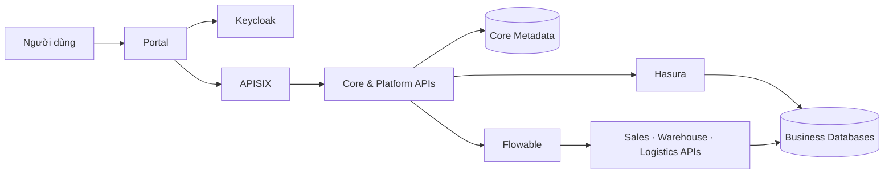

<p align="center">
  
</p>

<h1 align="center">FlowBridge</h1>

<p align="center">
  <strong>DX-OS Open-Core Platform</strong><br>
  Nền tảng tích hợp dữ liệu và điều phối nghiệp vụ cho các ứng dụng doanh nghiệp.
</p>

<p align="center">
  Data Governance · AI Agent Tools · BPMN Workflows
</p>

<p align="center">
  <a href="LICENSE">GPL-3.0-or-later</a> ·
  <a href="docs/ARCHITECTURE.md">Kiến trúc</a> ·
  <a href="docs/DEVELOPMENT.md">Phát triển</a> ·
  <a href="CONTRIBUTING.md">Đóng góp</a>
</p>

## Tổng quan

FlowBridge hướng tới một nền tảng dùng chung để đăng ký ứng dụng, công bố dữ liệu có quản trị và phối hợp quy trình giữa các phòng ban. Dữ liệu nghiệp vụ được giữ tại ứng dụng sở hữu; nền tảng quản lý metadata, hợp đồng dữ liệu, quyền truy cập và các năng lực tích hợp.

Sales, Warehouse và Logistics là ba ứng dụng mẫu cho quy trình Order Fulfillment. Agent và Workflow sử dụng các giao diện được cấp quyền để khai thác dữ liệu và thực hiện hành động nghiệp vụ.

Ba lớp quyền độc lập: IT/PLATFORM_ADMIN quản trị DX-OS (gồm publish và cấp/thu quyền); Core + Hasura kiểm quyền đọc dữ liệu theo grant; từng Business API kiểm quyền nghiệp vụ riêng. Vai trò nhân viên/phụ trách phòng ban không tự cấp quyền quản trị nền tảng. Chi tiết tại [API Contracts](docs/API-CONTRACTS.md#authorization-model-three-independent-layers).

## Phạm vi và trạng thái

Dự án đang trong giai đoạn xây dựng nền tảng kiến trúc. Các module được tách theo trách nhiệm để phát triển và kiểm thử độc lập.

| Thành phần | Vai trò | Trạng thái |
|---|---|---|
| Data Core | Registry, Data Products, Governance, Hasura Provisioner, Agent/Tools | Core HTTP P0, canonical onboarding, grant/read policy và publication worker đã kiểm thử offline; PostgreSQL adapters và live integration còn thiếu |
| Platform | Identity, Gateway, Workflow, Audit và HTTP utilities | Đã có Identity adapters và HTTP utilities; các tích hợp còn lại đang phát triển |
| Business APIs | Đơn hàng, tồn kho và vận chuyển | Khung ứng dụng và migration directories |
| Portal | Giao diện, SSO browser, chat và hiển thị kết quả | Đã có UI, PKCE/theme và preview; API client cần thích nghi với Core mới |
| Infrastructure | PostgreSQL, Hasura, Keycloak, APISIX, Flowable | Có template Keycloak và cấu hình APISIX nền; chưa có stack tích hợp hoàn chỉnh |

Đã có FastAPI composition tại `backend/app/main.py`, chỉ khởi tạo Core khi được cung cấp adapters phù hợp; không có persistence memory mặc định. Chưa có baseline database hoặc quy trình BPMN tích hợp hoàn chỉnh. Kiểm thử adapter bằng mock và preview UI không thay thế kiểm thử E2E với engine thật. Xem [Core Backend P0](docs/CORE-P0.md) về handlers, wiring và điều kiện tích hợp.

## Kiến trúc định hướng



Core quản lý dữ liệu được chia sẻ và quyền khai thác. Business APIs sở hữu thay đổi nghiệp vụ và transaction. Flowable điều phối quy trình; mỗi receiver chịu trách nhiệm xác thực và kiểm quyền phù hợp. Chi tiết tại [tài liệu kiến trúc](docs/ARCHITECTURE.md).

## Cấu trúc repository

```text
FlowBridge/
├── backend/app/
│   ├── core/                   Registry, Data Products, Governance, Agents, Core DB
│   └── platform/               Identity, Gateway, Workflow, Audit, HTTP
├── services/
│   ├── sales-api/              app/ và migrations/
│   ├── warehouse-api/          app/ và migrations/
│   └── logistics-api/          app/ và migrations/
├── portal/                     Giao diện và cấu hình frontend
├── contracts/                  Schema, giao diện chung và fixtures
├── workflows/                  Quy trình BPMN nghiệp vụ
├── infra/                      Cấu hình triển khai engine
├── tests/                      Domain, Core, Platform và E2E
└── docs/                       Tài liệu kỹ thuật
```

Các thư mục chưa có implementation được giữ trong Git bằng file package hoặc `.gitkeep`. Xem [Backend](backend/README.md), [Business APIs](services/README.md), [Portal](portal/README.md) và [Infrastructure](infra/README.md).

## Công nghệ

| Phạm vi | Công nghệ |
|---|---|
| Backend | Python 3.12, FastAPI, SQLAlchemy, Alembic |
| Frontend | React, TypeScript, Vite, Tailwind CSS, shadcn/ui |
| Identity và Gateway | Keycloak, OIDC/PKCE, Apache APISIX |
| Data và Workflow | PostgreSQL, Hasura, Flowable BPMN |
| Kiểm thử | pytest, Ruff, Vitest, Playwright |

Dependency Python được khóa tại `pyproject.toml` và `uv.lock`; dependency frontend tại `portal/package.json` và `portal/package-lock.json`.

## Phát triển từ mã nguồn

Yêu cầu: Python 3.12, uv 0.13.1, Node.js >=22.12 và npm.

```sh
git clone https://github.com/hoanganh-ktpm/FlowBridge.git
cd FlowBridge
uv sync --locked --group dev --group build
```

Các lệnh sau chạy từ gốc repository:

```sh
uv run --locked pytest tests/platform -q
uv run --locked ruff check backend tests
uv build --no-build-isolation
```

Chạy Portal trong terminal riêng:

```sh
cd portal
npm ci
npm run dev
```

Portal development tại `http://127.0.0.1:5174`; chế độ preview tại `http://127.0.0.1:5174/?preview=1`. Preview sử dụng dữ liệu tổng hợp. Đăng nhập và API thật cần deployment tương thích; xem [Portal README](portal/README.md).

Kiểm tra frontend:

```sh
cd portal
npm test
npm run build
```

`.env.example` chỉ chứa tên cấu hình và giá trị mẫu. Tạo `.env` cục bộ khi tích hợp Identity vào ứng dụng; không đưa credential vào source.

## Tài liệu

- [Kiến trúc và ranh giới module](docs/ARCHITECTURE.md)
- [Phát triển song song và tiêu chí bàn giao](docs/DEVELOPMENT.md)
- [Quản lý nội dung repository](docs/REPOSITORY.md)
- [Hasura Integration và hướng dẫn phát triển không Docker](backend/app/core/hasura_provisioner/README.md)
- [Declarative onboarding: JSON → Core Contracts → Hasura plan](docs/ONBOARDING.md)
- [API Contracts và hướng dẫn triển khai contract-first](docs/API-CONTRACTS.md)
- [Core Backend P0 và database integration checklist](docs/CORE-P0.md)
- [Giấy phép thành phần Hasura Integration](THIRD_PARTY_LICENSES.md)
- [Hướng dẫn đóng góp](CONTRIBUTING.md)
- [Lịch sử thay đổi](CHANGELOG.md)

## Giấy phép

Mã nguồn và cấu hình do dự án phát triển được cấp phép theo **GPL-3.0-or-later**, xem [LICENSE](LICENSE). Các thành phần bên thứ ba giữ giấy phép và attribution riêng, bao gồm [thành phần giao diện](portal/THIRD-PARTY-NOTICES.md). Dữ liệu, tài liệu và model bên ngoài có điều kiện sử dụng riêng.
