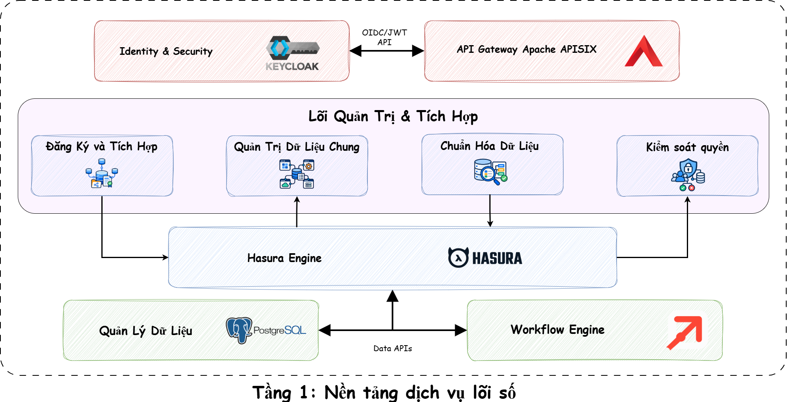

# FlowBridge

**Nền tảng liên thông dữ liệu và điều phối quy trình giữa các hệ thống độc lập**

FlowBridge là nền tảng DX-OS mã nguồn mở, giúp doanh nghiệp kết nối các ứng dụng hiện có, chia sẻ dữ liệu theo chính sách rõ ràng và phối hợp quy trình liên hệ thống mà không phải thay thế phần mềm nghiệp vụ.

> **Trạng thái:** `v0.1.0-beta.1` là bản tiền phát hành phục vụ đánh giá và triển khai phát triển có kiểm soát. **Tầng 1** đang ở mức Beta; **Tầng 2** đang được phát triển. Đây chưa phải tuyên bố sẵn sàng cho môi trường production.

## Mục lục

- [Bài toán](#bài-toán)
- [Giải pháp và điểm nổi bật](#giải-pháp-và-điểm-nổi-bật)
- [Kiến trúc hai tầng](#kiến-trúc-hai-tầng)
- [Phạm vi bản Beta](#phạm-vi-bản-beta)
- [Bắt đầu nhanh](#bắt-đầu-nhanh)
- [Kiểm chứng hệ thống](#kiểm-chứng-hệ-thống)
- [Kịch bản minh họa](#kịch-bản-minh-họa)
- [Cấu trúc dự án](#cấu-trúc-dự-án)
- [Tài liệu](#tài-liệu)
- [Đóng góp và giấy phép](#đóng-góp-và-giấy-phép)

## Bài toán

Trong một tổ chức, hệ thống bán hàng, kho vận và logistics thường có dữ liệu, tài khoản và quy trình riêng. Khi số lượng hệ thống tăng, các kết nối API điểm-điểm trở nên khó quản trị: ai sở hữu dữ liệu, trường nào được chia sẻ, quyền truy cập có còn hiệu lực và thay đổi nào đã xảy ra?

FlowBridge cung cấp một lớp điều khiển dùng chung để đăng ký ứng dụng, công bố dữ liệu có chọn lọc, cấp hoặc thu hồi quyền và điều phối workflow. Dữ liệu nghiệp vụ vẫn thuộc quyền sở hữu của hệ thống nguồn.

## Giải pháp và điểm nổi bật

Tầng 1 hiện thực hóa các khả năng:

- Đăng ký ứng dụng bằng API hoặc cấu hình khai báo, kèm kiểm tra và lập kế hoạch thay đổi.
- Đăng ký nguồn PostgreSQL và khám phá schema.
- Công bố data product và data contract có phiên bản.
- Chiếu cột dữ liệu và kiểm soát quyền đọc thông qua Hasura.
- Xác thực OIDC/JWT bằng Keycloak và phân quyền tại FlowBridge Core.
- Quản lý vòng đời yêu cầu truy cập: gửi, phê duyệt, cấp quyền, hết hạn và thu hồi.
- Điều phối workflow và hành động nằm trong danh sách cho phép qua Flowable.
- Cài đặt Docker có thể tái lập, kèm doctor, smoke test và acceptance test có dọn fixture.

FlowBridge xây dựng lớp quản trị và tích hợp quanh các engine mã nguồn mở; dự án không tái hiện thực PostgreSQL, Keycloak, Hasura hay Flowable.

## Kiến trúc hai tầng

### Tầng 1 — Nền tảng dịch vụ lõi số (Beta)



Sơ đồ trên mô tả kiến trúc định hướng của Tầng 1. Bản `v0.1.0-beta.1` đã tích hợp PostgreSQL, Keycloak, Hasura, Flowable, Core API và Worker. **Apache APISIX/API Gateway là thành phần đang được hoàn thiện, chưa nằm trong cấu hình cài đặt và acceptance đã xác nhận của bản Beta này.**

| Thành phần | Vai trò |
|---|---|
| FlowBridge Core API & Worker | Đăng ký, data contract, chính sách, cấp quyền, đồng bộ cấu hình và tác vụ nền |
| PostgreSQL | Lưu trạng thái Core và dữ liệu của các dịch vụ minh họa; hệ thống nguồn vẫn sở hữu dữ liệu nghiệp vụ |
| Keycloak | Xác thực người dùng và service client bằng OIDC/JWT |
| Hasura | Cung cấp data plane GraphQL theo metadata và quyền được FlowBridge quản trị |
| Flowable | Thực thi BPMN workflow và các hành động được cho phép |
| Apache APISIX | API Gateway trong kiến trúc định hướng; đang phát triển cho luồng ingress thống nhất |

Luồng khái quát:

```text
Sales / Warehouse / Logistics
              │
              ▼
       FlowBridge Core
       ├── Keycloak
       ├── Hasura
       ├── Flowable
       └── PostgreSQL
              │
              ▼
       Data Workspace
```

Xem thêm [kiến trúc và ranh giới tin cậy](docs/ARCHITECTURE.md).

### Tầng 2 — Data Workspace (Đang phát triển)

Tầng 2 hướng tới không gian khai thác dữ liệu đã được Tầng 1 quản trị, phục vụ phân tích, dự báo, mô phỏng và hỗ trợ ra quyết định. Portal/Data Workspace hiện là giao diện thử nghiệm; API legacy của Chat/Agent chưa được xem là đã kết nối ổn định với FlowBridge Core và không thuộc phạm vi phát hành ổn định của bản Beta.

## Phạm vi bản Beta

| Trạng thái | Thành phần |
|---|---|
| **Có trong Tầng 1 Beta** | Core API và Worker, PostgreSQL 16, Keycloak, Hasura, Flowable, cấp phát bảy database, migration, doctor/smoke/acceptance tooling |
| **Thử nghiệm** | Portal UI, bộ cài Windows độc lập, backup/restore mã hóa, tích hợp Data Workspace tùy chọn |
| **Đang phát triển** | Tầng 2, APISIX/API Gateway, ingress/TLS production, nâng cấp và rollback tự động, mô hình PostgreSQL bên ngoài |

Các giới hạn hiện tại được ghi rõ trong [release notes](docs/release/RELEASE_NOTES_v0.1.0-beta.1.md).

## Bắt đầu nhanh

### Yêu cầu

- Windows 11 và Docker Desktop chạy Linux containers (môi trường đã được kiểm chứng), hoặc Docker Engine tương thích.
- Docker Compose v2, tối thiểu 4 GiB RAM cho Docker và 5 GiB dung lượng trống.
- [uv](https://docs.astral.sh/uv/) `0.13.1`; công cụ này cài môi trường Python 3.12 đã khóa phiên bản.
- Các cổng loopback mặc định còn trống, hoặc được thay đổi trong `deployment.yaml`.

Chạy tại thư mục gốc của repository bằng PowerShell:

```powershell
uv sync --frozen --group database
uv run python -m scripts.deployment_cli init --config deployment.yaml
uv run python -m scripts.deployment_cli setup --config deployment.yaml --non-interactive
```

Lệnh `init` tạo `deployment.yaml` và `secrets/deployment.env` (đều bị Git bỏ qua). Hãy kiểm tra cấu hình trước khi chạy `setup`; quy trình setup sẽ build hoặc pull image, cấp phát database, chạy migration, bootstrap Keycloak và khởi động Tầng 1.

### Endpoint phát triển mặc định

| Dịch vụ | URL / cổng |
|---|---|
| Core API và OpenAPI | `http://127.0.0.1:18084` / `/docs` |
| Keycloak | `http://127.0.0.1:18443` |
| Hasura | `http://127.0.0.1:18080` |
| Flowable REST | `http://127.0.0.1:18083/flowable-rest/service` |
| PostgreSQL | `127.0.0.1:55432` |

Portal là ứng dụng phát triển riêng và không được khởi động bởi bộ cài Tầng 1. Xem [hướng dẫn Portal](portal/README.md).

## Kiểm chứng hệ thống

Hai lệnh sau chỉ đọc trạng thái, không thay đổi dữ liệu ứng dụng:

```powershell
uv run python -m scripts.deployment_cli doctor --config deployment.yaml
uv run python -m scripts.deployment_smoke --config deployment.yaml
```

Acceptance runner thực hiện kiểm tra ghi/đọc/cấp/thu hồi quyền thật trên deployment phát triển được chỉ định. Công cụ tạo fixture có kiểm soát và dọn chúng trong khối `finally`. Hãy đọc [hướng dẫn kiểm thử](tests/README.md) trước khi chạy.

## Kịch bản minh họa

Giả sử Sales cần tồn kho hiện tại trước khi xác nhận đơn hàng. Warehouse đăng ký nguồn dữ liệu và chỉ công bố view tồn kho đã duyệt thành một data product. Sales gửi yêu cầu; chủ sở hữu có thẩm quyền phê duyệt; FlowBridge tạo grant theo phạm vi và quyền Hasura tương ứng. Sales chỉ truy vấn được các cột đã cấp. Khi grant bị thu hồi hoặc hết hạn, quyền truy cập cũng được gỡ bỏ. Logistics có thể tham gia qua một data product riêng hoặc workflow nằm trong danh sách cho phép mà không cần chia sẻ tài khoản chủ sở hữu database.

## Cấu trúc dự án

| Đường dẫn | Nội dung |
|---|---|
| `backend/app/core/` | Core API, domain service, persistence, governance và worker runtime |
| `backend/app/platform/` | Adapter dùng chung cho identity, HTTP và workflow |
| `services/` | Dịch vụ mẫu Sales, Warehouse, Logistics và Data Workspace |
| `infra/` | PostgreSQL, render deployment, bootstrap Keycloak và hạ tầng tích hợp |
| `scripts/` | Công cụ deployment, migration, smoke, acceptance, backup và đóng gói |
| `contracts/` | API contract và data contract |
| `portal/` | Portal frontend thử nghiệm |
| `tests/` | Unit, contract, integration, E2E và deployment regression test |
| `docs/` | Tài liệu kiến trúc, triển khai, API, workflow, database và phát hành |

## Tài liệu

- [Kiến trúc](docs/ARCHITECTURE.md)
- [Triển khai](docs/DEPLOYMENT.md)
- [Kiểm thử](tests/README.md)
- [API contracts](docs/API-CONTRACTS.md)
- [Chính sách bảo mật](SECURITY.md)
- [Phát triển](docs/DEVELOPMENT.md)
- [Hướng dẫn đóng góp](CONTRIBUTING.md)
- [Mức độ sẵn sàng phát hành](docs/release/RELEASE_READINESS_v0.1.0-beta.1.md)

## Đóng góp và giấy phép

FlowBridge hoan nghênh issue có phạm vi rõ ràng và pull request tập trung. Hãy cài nhóm dependency phát triển và đọc [CONTRIBUTING.md](CONTRIBUTING.md) trước khi gửi thay đổi. Báo cáo lỗ hổng cần tuân theo [SECURITY.md](SECURITY.md), không tạo issue công khai.

Dự án được cấp phép theo [GNU GPL-3.0-or-later](LICENSE). Các dịch vụ và dependency tích hợp giữ giấy phép riêng; xem [thông báo bên thứ ba](THIRD_PARTY_LICENSES.md) và [thông báo của Portal](portal/THIRD-PARTY-NOTICES.md).
