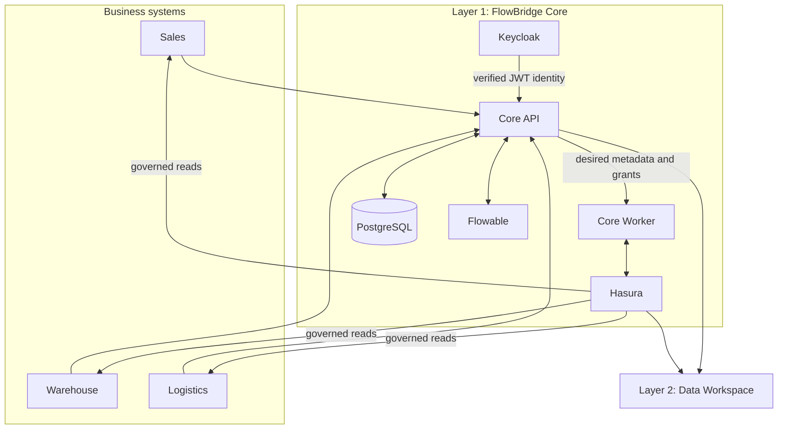

# FlowBridge architecture

## Product boundary

FlowBridge follows a two-layer DX-OS open-core architecture:

- **Layer 1 — FlowBridge Core** is the reusable interoperability and orchestration platform. It owns application registration, source and product metadata, contracts, authorization policy, access lifecycles, integration provisioning, and workers.
- **Layer 2 — Data Workspace** consumes Layer 1 services for analytics, forecasting, simulation, and decision support. It is experimental and is not part of the stable `v0.1.0-beta.1` scope.

## Responsibilities

| Component | Responsibility | Ownership |
|---|---|---|
| Core API | Domain commands, registry, contracts, policies, grants, query boundary | FlowBridge |
| Core Worker | Reconciles publication and Hasura metadata/permissions | FlowBridge |
| Deployment CLI | Validates config, renders a private stack, provisions and verifies Layer 1 | FlowBridge |
| PostgreSQL | Transactional storage for Core and the example systems; seven isolated databases | Third-party engine, FlowBridge schema/migrations |
| Keycloak | OIDC authentication, token issuance, realm/client management | Third-party engine, FlowBridge bootstrap/profile |
| Hasura | GraphQL execution and metadata permission enforcement | Third-party engine, FlowBridge provisioning/policy model |
| Flowable | BPMN process execution | Third-party engine, FlowBridge allow-list/adapters |
| Portal / Data Workspace | Human-facing consumers of Layer 1 | FlowBridge, experimental in this beta |

FlowBridge's contribution is the common domain model and lifecycle that coordinates these engines. Engine-native authentication, SQL execution, GraphQL execution, and BPMN execution remain upstream capabilities.

## Data and control flows

1. An administrator onboards an application and registers a PostgreSQL source.
2. FlowBridge discovers source structure under a least-privilege credential and stores metadata in Core.
3. An owner defines and publishes a versioned data contract. Publication work is processed asynchronously.
4. The Core Worker reconciles the approved source/view and Hasura metadata.
5. A consumer requests access. Core policy authorizes approval and records a bounded grant.
6. Hasura receives the generated role/column permissions; the consumer queries with verified identity context.
7. Revocation or expiry removes effective permission and is reconciled to the data plane.
8. Allow-listed workflow operations may be delegated to Flowable; outbound workflow actions pass through FlowBridge policy and host allow-lists.

Business writes stay behind business APIs. The beta's governed data-product path is read-oriented and does not grant database-owner credentials to consumers.

## Trust boundaries

- Public clients authenticate with Keycloak. Core verifies signature, issuer, audience, time claims, and identity mappings before authorization.
- Hasura's admin secret and PostgreSQL owner credentials are infrastructure secrets, never client credentials.
- Core policy decides who can onboard, publish, approve, grant, revoke, and read; Hasura permissions enforce the resulting read scope.
- Database roles are separated by owner and reader purpose. Provisioning denies superuser, replication, and row-security bypass attributes.
- Published host ports bind to `127.0.0.1` in the development topology. Container traffic uses the private Compose network.
- Production needs external TLS termination, DNS, secret management, monitoring, backup validation, and an operator-controlled upgrade process.

## Deployment topology and state

The supported beta installation is one Compose project containing PostgreSQL, one-shot provision/migration jobs, Keycloak, Hasura, Flowable, Core API, and Core Worker. Persistent application state resides in seven PostgreSQL databases:

`dxos_core_db`, `sales_db`, `warehouse_db`, `logistics_db`, `hasura_metadata_db`, `flowable_db`, and `keycloak_db`.

Only the PostgreSQL data directory is a declared persistent volume in the generated stack. Keycloak, Hasura, and Flowable persist through their databases. The Portal and Data Workspace are not members of this Compose release topology.

## Beta boundaries

Validated on Windows 11 with Docker Desktop: cold installation, database provisioning/migrations, Keycloak bootstrap, doctor, smoke, real acceptance 8/8, repeated acceptance, stop/start, persistence, and setup rerun. Linux installation, production ingress/TLS, disaster-recovery restore, automated upgrades/rollback, and stable Layer 2 behavior are not established by that evidence.

See [Deployment](DEPLOYMENT.md), [Security](../SECURITY.md), [Testing](../tests/README.md), and [release readiness](release/RELEASE_READINESS_v0.1.0-beta.1.md).
