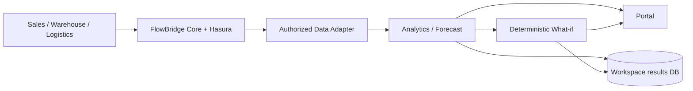

# FlowBridge Data Workspace — triển khai và nghiệm thu

Cập nhật kiểm tra: 25/10/2026. Chưa đánh dấu hoàn thành toàn bộ master prompt:
**Demo 7 cần phê duyệt phần mở rộng Warehouse Business API**, xem mục H.
Không commit/push hoặc triển khai production trong nhiệm vụ này.

Thiết kế giao diện hiện hành và prompt nghiệp vụ ở mục J. Các số liệu live E2E
trong các mục trước là bằng chứng những vòng trước, không thay nghiệm thu live
cho màn hình hoặc Data Product mới ở mục J.

## A. Implemented

- Service độc lập `services/data-workspace-api/app`, public API tại
  `/api/v1/data-workspace`, có Bearer auth, org binding và quyền nguồn qua Core.
- Một adapter cấu hình cho Sales Demand và Logistics Workload; mapping, dimension
  filters, FLOW/STOCK, SUM/COUNT/AVG/LAST/MIN/MAX, D/W/M, timezone, chính sách dữ liệu
  thiếu/trùng, preview trước/sau và kiểm chất lượng. STOCK không cộng snapshot và
  không âm thầm trộn nhiều warehouse/product grain.
- Analytics thực: tổng/giá trị snapshot, MA 7 kỳ, tăng trưởng hai kỳ 7 ngày,
  OLS trend, độ lệch chuẩn và weekday averages khi là dữ liệu ngày.
- Forecast thống kê nhiều chuỗi thực, quantiles có thứ tự, lưu/read PostgreSQL;
  provider Chronos-2 tùy chọn có kiểm artifact/API nhưng chưa chạy inference ML.
- What-if: baseline/proposed, thêm hàng và ngày về, demand multiplier, inbound
  delay, backlog chưa phân bổ, partial fulfillment/holds, deadline theo giờ,
  all-or-nothing và capacity theo bookings. Không chuyển SKU quantity thành dispatch.
- Portal hiện hành: Biểu đồ & dự đoán, Kế hoạch hàng hóa, Phương án nhập hàng,
  Đơn hàng & giao nhận và cấu hình IT; filters, evidence drawer, lưu/mở kết quả, loading/error/empty,
  responsive. Dữ liệu Workspace không dùng fixtures trong luồng live.
- Snapshot vận hành có giới hạn 32 bản, TTL 120 giây, gắn org/owner/forecast/source
  contracts. Chỉ nút Áp dụng phương án mới tính lại, dùng lại đầu vào, không refit forecast. Quyền nguồn vẫn được
  kiểm mỗi lần dùng cache; refresh tạo snapshot mới. Kết quả đã lưu độc lập với cache.

## B. Architecture



Chiều gọi thực thi: Portal → Workspace → Core HTTP → Hasura → database ứng dụng.
Connector gọi `/api/v1/core/me`, `/authorized-data-products` và
`/data-products/{id}/query` bằng JWT người dùng. Core discovery mới lọc theo grants
đã áp dụng, contract hiện hành, membership và trạng thái nguồn; admin không tự có
quyền đọc. Không tạo registry/IdP/grant system thứ hai.

Core Query thực thi bộ lọc `org_id` của deployment và các filters được cấp quyền;
Workspace còn kiểm org của mọi row nhận về. Core xử lý mapping schema, Hasura
credentials, metadata verification và kiểm quyền trước/sau read. Tầng 2 không có
DSN nghiệp vụ, SQL nguồn hay Hasura admin secret; không có fallback đọc database.
Core 5xx được retry tối đa một lần tại cùng boundary. 401/403 không được retry để
vượt quyền. Lỗi dai dẳng trả về lỗi, không tạo dữ liệu thay thế.

Mỗi request giải danh tính qua Core. `org_id` là cấu hình server của một deployment,
không lấy từ header hoặc payload người dùng. Kết quả/configuration lưu riêng theo
org và owner. Đọc lại hoặc liệt kê kết quả kiểm grants nguồn hiện tại; revoke chặn
cả forecast/scenario cũ. Cache chỉ giữ input ngắn hạn, không giữ quyết định cấp quyền.

## C. Database

PostgreSQL 16 hiện có, database **`flowbridge_workspace_db`**, role
**`workspace_owner`**, schema **`data_workspace`**, head **`workspace_0001`**.
URL và migration guard từ chối database/user khác; startup không tự migration.

| Bảng | Nội dung lâu dài |
|---|---|
| `analysis_configs` | Cấu hình bất biến, phiên bản, nguồn và cột cần đọc |
| `forecast_runs` | Config snapshot, phương pháp/provenance, quality và forecast points |
| `simulation_runs` | Giả định, baseline/proposed, metrics, lineage và input SHA256 |

Ba bảng có UUID, `org_id`, `owner_id`, JSONB payload và `created_at`; index theo
org/owner/time. Forecast points được nhúng JSONB vì tối đa 90 kỳ × 50 entities,
không cần thêm một bảng nhỏ. Không lưu business history hoặc model weights.
Runtime dùng SQLAlchemy/asyncpg; migration/admin dùng psycopg đã có. Async psycopg
đã được loại khỏi runtime vì không tương thích Proactor trên Windows.

Để có dữ liệu planning đủ nghĩa, thêm hai migration của **ứng dụng sở hữu**:

| Revision | Chỉ thay đổi giao diện đọc |
|---|---|
| `sales_0004` | Thêm `warehouse_id` vào `v_open_orders` |
| `warehouse_0003` | Thêm `v_order_commitments`: dispatched và active held theo order line |

Đã áp dụng hai revision này local, publish contract Sales open-orders v1.1.0 và
Data Product thứ bảy `warehouse.order_commitments` **bằng Core API/worker**.
Source allowlist/view keys local và SELECT của reader được mở rộng đúng view.
Không sửa revision cũ. Hash toàn bộ business rows trước/sau không đổi:

- Sales: `0b1b712278ec25f71837b0376a4c49e4d8341d07bb15c29b37ac53b4f7d01ce7`
- Warehouse: `c25ec5db29b983f8706fb158b93220d9f7c4bbb48ecf0b940594c7cd23bdc6d4`
- Logistics: `ba0e219cce1e512cfb386c045cc424f57d9553c0e70ce56aa5c84e14851ef53b`

Evidence local: `.tmp/data-workspace/planning-migration-evidence.json`.
Core và engine migration histories không thay đổi.

## D. Frontend

Giữ logo, Be Vietnam Pro, `flowbridge-tokens.css`, navy/blue/cyan/purple và các
surface/border tokens hiện có. Tái sử dụng Button, Input, Sheet/Dialog và Recharts
3.10.1. Không thêm chart library hoặc template dashboard bên ngoài.

Live mặc định là Data Workspace. `#chat`, `#chat/<id>` và `#agents` giữ giao diện cũ;
`?preview=1` vẫn là preview cũ, không phải dữ liệu Workspace thật. Vite định tuyến
Workspace tới port 18090 và Core tới 18000. PKCE dùng browser client hiện có
`flowbridge-web-a`; cấu hình Core local riêng thêm client này vào allowlist bên
cạnh `flowbridge-e2e`, giữ kiểm issuer/audience và grants. Theo yêu cầu khôi phục
form đăng nhập, Keycloak local dùng Login Theme `flowbridge` build từ giao diện
Keycloakify có sẵn; người chưa có phiên được chuyển thẳng tới form bằng PKCE.
Đã thêm consumer local `demo-workspace` với platform role NONE/membership STAFF;
Core metadata bootstrap có audit vì chưa có HTTP handler quản lý principal/membership.
Tài khoản này dùng grants SELECT hiện có của phòng Sales. Không reset realm hoặc
thay credentials tài khoản cũ. Password chỉ nằm trong state local bị ignore.
CLI Portal chỉ lấy URL API/issuer công khai từ cấu hình lưu local; không truyền
saved Core secrets hoặc Workspace DSN sang process Vite.

IT Configuration cần cả PLATFORM_ADMIN và quyền Data Product/membership tương ứng.
Admin không được dùng quyền quản trị làm đường tắt đọc hàng. Consumer có thể chọn
kỳ/SKU, phân tích, forecast và mô phỏng theo grants; không có màn hình IT.
Configuration là private theo owner, không mặc định công khai toàn tổ chức.

Luồng hiện tại ưu tiên người quản lý vận hành: chọn **Nhu cầu bán hàng** hoặc
**Vận chuyển**, sản phẩm/đơn vị và khoảng 30/90/365 ngày. Data Product, cột nguồn,
missing/duplicate policy chỉ xuất hiện trong cấu hình IT hoặc drawer nguồn/công thức.
Ba KPI tập trung tổng phát sinh, thay đổi tuần và tồn có thể dùng/khối lượng gần nhất.
Các thuật ngữ được giải thích qua icon hỗ trợ hover, focus và bấm trên mobile.

Chỉ danh mục/quyền được tải khi vào ứng dụng. Bộ lọc là bản nháp; đổi lựa chọn,
chuyển màn hình hoặc nhập giả định không tự gọi API dữ liệu/tính toán. Bấm **Áp dụng**
mới gọi `/overview` và đọc tồn kho liên quan. Endpoint mới đọc lịch sử một lần qua
Core, lấy phạm vi/đối tượng và chạy analytics trên cùng dữ liệu, thay cho hai lần đọc
ở `/profile` rồi `/analytics`. UI hủy request cũ khi bắt đầu lượt áp dụng mới, vô hiệu
hóa nút trong lúc xử lý và giữ nhãn của lựa chọn đã áp dụng để không gắn nhầm số liệu.

Hai view phát sinh đã công bố GROUP BY theo ngày xác nhận/tiếp nhận. Business report
`published_event_aggregate_v1` dùng 0 cho ngày không phát sinh **trong phạm vi nguồn
đã đọc đầy đủ**. Mapping generic vẫn mặc định báo lỗi, không kế thừa quy tắc này.
Không suy ra số 0 từ lỗi API hoặc nguồn rỗng. Ngày hiện tại chưa hoàn tất bị loại;
khoảng xem tính lùi từ ngày nguồn gần nhất, hiển thị độ cũ riêng. Chẩn đoán lỗi người
dùng: Logistics có 709 rows, CARRIER-1 có 361 rows trong 365 ngày, thiếu 4 ngày phát sinh.
Chế độ strict trả 422; nguồn/API vẫn đọc được. Báo cáo mới xử lý đúng ngữ nghĩa này.

Màn hình **Dự đoán số liệu** chỉ hỏi 7/14/30 ngày tới; ngày bắt đầu được xác định tự
động từ hôm nay và ghi trong evidence. Nguồn cũ hơn 90 ngày cần cập nhật trước khi
dự đoán vận hành. **Tạo dự đoán** lưu forecast; nhập số lượng/ngày hàng về rồi bấm
**Áp dụng phương án** mới so sánh. Điều chỉnh nhu cầu/độ trễ nằm trong phần mở rộng.
Lưu bị khóa khi giả định còn thay đổi chưa áp dụng; save không tự đổi snapshot đã hết TTL.

Nút **Đã xác thực / Phiên đăng nhập** giải thích SSO và quyền; không biểu diễn sức
khỏe API. Cookie SSO ở Keycloak, token giữ trong bộ nhớ SDK, API dùng Bearer và refresh
khi cần. API401 hoặc refresh thất bại xóa phiên hiển thị và yêu cầu đăng nhập lại.
403 xóa kết quả/cấu hình đang giữ. Không cache quyết định quyền. Phân biệt rõ lỗi
nguồn 5xx, không có số liệu NO_DATA, mất quyền 403 và lựa chọn chưa hợp lệ 422.

## E. ML & Mathematical Models

`seasonal_mean` v1.1.0: base là trung bình đúng weekday trong 56 kỳ gần nhất (D),
hoặc trung bình gần nhất (W/M); cộng các quantile residual P10/P50/P90. Ít nhất
14 kỳ đều trên mỗi entity, không dùng observation sau ngày kết thúc. Missing policy
phải chọn rõ; mặc định báo lỗi. Weekly/monthly đòi đầy đủ bucket lịch. Quantiles
là ước lượng empirical, không phải xác suất đã hiệu chỉnh trên doanh nghiệp thật.
Forecast origin và last observation đều nằm trong provenance; lịch sử demo kết thúc
20/10 nên dự báo bắt đầu 24/10 có khoảng trống quan sát được ghi rõ.

Chronos-2 chưa được cài/provision weights; fallback được ghi nhãn statistical.
Strict ML request trả 503 nếu model không khả dụng. Không tuyên bố ML đã chạy.
Chi tiết artifact/license tại [MODEL_LICENSES](../MODEL_LICENSES.md).

Công thức chính của planner:

```text
OpeningAvailable = OnHand − Reserved
KnownUnallocated = Ordered − Dispatched − ActiveHeld
NetPosition(t) = OpeningAvailable + InboundUntil(t)
                 − KnownUnallocatedDueUntil(t) − NewForecastDemandUntil(t)
FreePhysicalPool = OpeningAvailable + Inbound − FulfilledKnown − FulfilledNew
Unmet = UnmetKnown + UnmetNew
RemainingDispatches = max(0, ACTIVE MaxDispatches − UsedOrBookedDispatches)
```

- Pool vật lý là phần hàng tự do sau khi loại protected holds, không phải tổng
  on-hand gồm các đơn đã được reserved.
- Known orders theo deadline/id; toàn bộ các dòng chưa phân bổ phải đủ cùng lúc.
  Dispatched và active holds không bị trừ lần hai. Không ghi reservation thật.
- ETA và deadline có timezone được xử lý theo thứ tự giờ. Hàng về 21:00 không
  giải quyết deadline 18:00 cùng ngày. Đơn đã lỡ deadline vẫn được ghi nhận rủi ro
  dù được đáp ứng muộn. Nhu cầu forecast chưa có order timestamps, được xét cuối ngày.
- Kế hoạch nhập overdue nhưng chưa nhận không thành opening stock. Hàng bổ sung
  khai báo bằng ngày được giả định đầu ngày đó, hoặc tại snapshot time nếu là hôm nay.
- `peak_shortage` là max unmet theo các điểm ngày; risk count giữ dấu vết deadline.
  Whole-order blocking có thể làm unmet > 0 dù SKU đang chọn vẫn có hàng vật lý.
- SKU/UOM và source grains được kiểm; không quy đổi đơn vị ngầm. Dự báo Sales là
  gross confirmations, gồm các cancellation xảy ra sau đó, không phải net shipments.
- Chỉ SKU đang chọn có nhu cầu mới được forecast; tồn SKU khác phục vụ known orders.
  Carrier chỉ so sánh bookings công bố, không suy dispatch từ số sản phẩm.

Nếu chỉ được cấp sáu products/cột cũ, API hỗ trợ supply-demand projection nhưng
`known_orders_at_risk=null` và evidence nói rõ thiếu backlog. Local full planning
đã dùng cả open-orders contract mới và commitments. UI không tự tính lại công thức.

## F. Open-source Licenses

Không thêm/cập nhật dependency runtime. Python stdlib dùng cho toán và mô phỏng;
FastAPI/SQLAlchemy/Alembic MIT, HTTPX BSD-3-Clause, asyncpg Apache-2.0, Recharts MIT
đều là dependencies đã có. Đã cập nhật inventory/notice và đưa MODEL_LICENSES vào
sdist. Xem [THIRD_PARTY_LICENSES](../THIRD_PARTY_LICENSES.md) và
[Portal notices](../portal/THIRD-PARTY-NOTICES.md). GPL-3.0-or-later của FlowBridge giữ nguyên.

## G. Verification

| Nhóm | Trạng thái/bằng chứng |
|---|---|
| Backend/Core/Platform/Domain/contracts offline | PASS: 891 tests, 73 E2E deselected, 31.51s |
| Workspace + catalog targeted | PASS: 48 tests, gồm event-zero policy, nguồn rỗng/today, data freshness, auth/outage và các phép toán/planner/snapshot đã có |
| Business APIs thật hiện có | PASS: 2 tests, 68.40s; fixture org thử riêng và guard lịch sử không đổi |
| Workspace real Core/Hasura/SSO/PostgreSQL | PASS: luồng hai domain, forecast/scenario persistence, process mới, revoke chặn saved results và cached inputs; vòng sau Docker restart 2 tests/301.76s |
| Portal mock-boundary regression | PASS: 22 Playwright tests/52.4s, gồm API401 xóa phiên; 10 Vitest tests; TypeScript/Vite build |
| Browser PKCE + dữ liệu API thật | PASS: UX mới, chỉ đọc khi Apply, sparse Logistics/Sales, forecast thật, 50EA ngày3/ngày6 cùng snapshot, lưu kết quả và mobile; 8 Workspace API calls, 1 forecast, không refit |
| Kiểm tra bảo mật HTTP thật | PASS: thiếu/giả token401; consumer giả header admin vẫn403; saved forecast của owner khác404; X-Org-ID không đổi org; demo role NONE, 7 products |
| Form đăng nhập và tài khoản mặc định local | PASS: kiểm tra lại sau UX mới; Keycloak theme thật, PKCE tự chuyển, demo consumer, reload/logout, mobile, password không gửi về Portal; ux-login.txt |
| Lint / source distribution | PASS: Ruff, git diff --check, Hatch sdist; gói có service/migrations/contracts/license, không có .tmp/.env/cache/model weights |
| Chronos-2 inference | SKIP: chưa cài provider/weights, không báo ML PASS |
| Live Flowable regression mới | SKIP: không chạy lại fixture có bước provision event catalogs/engine; Workflow offline nằm trong suite đã chạy |
| Demo 7 nghiệp vụ → refresh | BLOCKED: endpoint ghi Warehouse mới bị auto-review từ chối; chưa có thao tác ghi demo này |

Real tests không override identity/Core/Hasura và không dùng SQL đọc nghiệp vụ từ
Workspace. Browser test dùng bypass certificate warning chỉ trong context thử local;
product giữ nguyên TLS behavior. Các lỗi ban đầu về driver, allowlist và contract
receipt đã được sửa trước các kết quả PASS trên. Một phản hồi Hasura `invalid-jwt`
tạm thời được retry tại Core boundary; lỗi dai dẳng vẫn fail closed.

Evidence local (không phát hành): `live-evidence.json`, `browser-evidence.json`,
`browser-dashboard.png`, `browser-studio.png` dưới `.tmp/data-workspace/`;
UI mock screenshots dưới `portal/ref/qa/`. Không coi tests bị exclude/SKIP là PASS.
Vòng UX mới: `ux-browser-evidence.json`, `ux-security-evidence.json`, `ux-dashboard.png`,
`ux-logistics.png`, `ux-studio.png`, `ux-mobile.png`, `ux-python-full.txt` và
`ux-playwright-full.txt` trong cùng thư mục ignored. Browser kiểm tra bằng tài khoản
demo consumer với grants hiện có, không tạo grant trùng hoặc thay quyền để vượt lỗi.
Tóm tắt vòng chốt lưu tại `final-python.txt`, `final-live.txt`,
`final-playwright.txt`, `final-portal-test.txt`, `final-portal-build.txt` trong
`.tmp/data-workspace/`. Sau vòng live đã bật Portal local và cấp grants demo SELECT
có hạn 24 giờ; dùng `revoke-demo` trước lần E2E tiếp theo.
Hai assertions của chat regression được cập nhật theo fixture giao hàng hiện có
(12 đơn và human-readable source title), vẫn giữ các kiểm tra chức năng cũ.

## H. Remaining Work và đề xuất cần phê duyệt

**Demo 7 chưa hoàn thành.** Warehouse API hiện có inventory/reservation/pack/handoff
cho slice workflow riêng, chưa có endpoint tạo inbound plan. Auto-review đã từ chối
thêm endpoint vì đây là mở rộng ghi nghiệp vụ mới, vượt quyền được hiểu từ yêu cầu
“dùng Business API đã có”. Source endpoint chưa được thêm và không có business rows
bị thay đổi bằng đường tắt để mô phỏng Demo 7.

Đề xuất cụ thể để phê duyệt:

```http
POST /api/v1/warehouse/inbound-plans
Authorization: Bearer <warehouse operator>
Idempotency-Key: <stable command key>
```

```json
{
  "org_id": "<current org>",
  "warehouse_id": "<authorized warehouse>",
  "product_id": "<owned product>",
  "planned_quantity": "1.000",
  "expected_at": "<future timestamp with timezone>"
}
```

Endpoint đề xuất dùng auth và durable command helper của Warehouse hiện có,
permission riêng `inbound.plan`. Trong một transaction: kiểm org/warehouse/product
ACTIVE, số lượng NUMERIC(18,3) dương, ETA tương lai có timezone; INSERT một
`inbound_plans` APPROVED và command receipt. Không tạo goods receipt hoặc thay on-hand.
Không cần migration thêm bảng. Duplicate cùng key/body trả cùng kết quả; sai body
trả conflict. Demo tạo **một kế hoạch 1 EA** cho ngày thứ ba, refresh qua Core rồi
so sánh baseline mới; on-hand phải không đổi. Cần tests quyền/org, idempotency, ETA,
source refresh và ảnh hưởng chỉ từ đúng thời điểm về. Đây là phần xin phép thực
hiện, không phải implementation đã hoàn thành.

Chronos-2 và Monte Carlo không được nghiệm thu: statistical forecasting và
deterministic planning là phương pháp đang hoạt động. Không thêm LLM/Agent Builder.

## I. Run Instructions

Các lệnh từ gốc repo, trên môi trường local PostgreSQL/Keycloak/Hasura đã có.
Docker Desktop cần đang chạy, PostgreSQL local port 55432 và Hasura 18082 healthy,
Keycloak TLS 18443 sẵn sàng; không recreate/reset hạ tầng chỉ để mở Workspace.
Dependencies giữ theo lockfile hiện hành; cần database group cho admin/migration.

```powershell
.venv/Scripts/python.exe -m scripts.data_workspace prepare-local-runtime
# Lần đầu: bind đúng business org. Đây là org của synthetic dataset hiện có.
.venv/Scripts/python.exe -m scripts.data_workspace init-local --org-id 74d0c281-078d-5702-b90d-e15fabf57192
```

Chạy trong các terminal riêng nếu các process chưa chạy:

```powershell
.venv/Scripts/python.exe -m scripts.data_workspace serve-core
.venv/Scripts/python.exe -m scripts.data_workspace serve-worker
.venv/Scripts/python.exe -m scripts.data_workspace serve
.venv/Scripts/python.exe -m scripts.data_workspace serve-portal
```

`prepare-local-runtime` chỉ ghép identity/DB config đã có vào file ignored,
và cho phép đúng browser client của frontend trong Core local riêng. Không sửa realm,
credential hay volume. Portal ở `http://127.0.0.1:5174/#data`; dùng SSO/account đã
cấp. Certificate local cần trust phù hợp khi mở browser thông thường.
Form tài khoản/mật khẩu nằm trên Keycloak thật, giữ logo/design tokens cũ. Nếu đã
có phiên, dùng nút Đăng xuất ở cuối sidebar để quay về form. Tài khoản demo local
và mật khẩu xem `.tmp/data-workspace/demo-user.json`; kiểm tra thực bằng
`cd portal; node tests/live/login.mjs` sau khi services đã sẵn sàng.

Demo read access có hạn 24 giờ, qua Core API với các account fixture local sẵn có:

```powershell
.venv/Scripts/python.exe -m scripts.data_workspace grant-demo
# Kết thúc demo / trước khi chạy real tests dùng grants riêng:
.venv/Scripts/python.exe -m scripts.data_workspace revoke-demo
```

Lệnh lưu ID grants do nó tạo vào `.tmp/data-workspace/demo-access.json`; không lưu
token và không revoke quyền có trước của người khác. Data Products/contract phải
được publish trước; draft mappings hiện có tại `scripts/database/products.py`.
Migration mới của Sales/Warehouse phải do công cụ ownership `scripts.database`
áp dụng, rồi publish/grant bằng Core như onboarding hiện có; Workspace không làm
việc đó khi startup. Không chạy bootstrap/reset lại bộ dữ liệu để mở dashboard.

Kiểm tra độc lập:

```powershell
.venv/Scripts/python.exe -m pytest tests/domain/data_workspace tests/core/runtime/test_workspace_catalog.py -q
.venv/Scripts/python.exe -m pytest -q
.venv/Scripts/python.exe -m ruff check backend services scripts tests
cd portal
npm test
npm run build
npx playwright test
```

Real integration, chạy tuần tự sau khi revoke demo grants và Core/worker/Workspace
đã sẵn sàng. Browser test tự mở/đóng Portal nó sở hữu; port 5174 cần trống:

```powershell
$env:FLOWBRIDGE_WORKSPACE_E2E='1'
.venv/Scripts/python.exe -m pytest tests/e2e/test_data_workspace.py -m e2e -q
$env:FLOWBRIDGE_WORKSPACE_BROWSER_E2E='1'
.venv/Scripts/python.exe -m pytest tests/e2e/test_data_workspace_browser.py -m e2e -q
```

Tests cấp grants có hạn bằng Core API, tạo kết quả chỉ trong database Tầng 2 và
thu hồi grants thử ở teardown. Fresh-process test dùng port 18091 rồi đóng process
đó. API contract tái tạo bằng `python -m scripts.data_workspace export-openapi`;
đối chiếu `contracts/data-workspace.openapi.json` hoặc `/openapi.json` port 18090.
Static production hosting cần gateway routes cùng origin tới Core/Workspace;
Vite proxy local không được báo là APISIX production đã triển khai.


## J. Giao diện chung và quyết định nghiệp vụ — 25/10/2026

Người dùng là lãnh đạo và nhân viên các phòng ban của doanh nghiệp vừa và nhỏ,
đọc cùng một giao diện để thống nhất việc cần làm. Không có tab Lãnh đạo/Kho/
Bán hàng hoặc thêm role cấp quyền. IT giữ phần cấu hình riêng theo quyền hiện có.
Biểu đồ và dự đoán cũ được giữ, các công cụ quyết định là bước tiếp theo.

| Câu hỏi cần trả lời | Hiển thị | Quyết định được hỗ trợ |
|---|---|---|
| Lượng khách đặt đang thay đổi thế nào? | Đường theo ngày, tối đa 3 mã; tùy chọn bình quân 7 ngày | Rà các sản phẩm đang tăng nhu cầu |
| Ngày nào thường có nhiều phát sinh? | Cột bình quân từng thứ; số liệu dao động quanh bình quân | Bố trí người và lịch bổ sung, kiểm tra thêm khi chỉ có một tuần |
| Ngày tới cần chuẩn bị bao nhiêu? | Lịch sử, ước tính và vùng dao động trên cùng trục | Chuyển sang đối chiếu nguồn cung; không coi ước tính là cam kết |
| Hàng nhập có theo kịp lượng đặt? | Cột xác nhận/nhập thực tế và đường nhập trừ đặt | Rà nhịp bổ sung; không coi chênh lệch này là biến động tồn kho |
| Hàng về có kịp lượng cần giao? | Cột hàng sẽ về/đơn đến hạn chưa phân bổ, đường lượng đặt mới và vùng dao động | Xác nhận lại ngày về và thời điểm bổ sung |
| Khi nào thiếu, mặt hàng nào cần rà trước? | Đường số dư theo ngày, thanh lượng thiếu lớn nhất theo SKU cùng UOM, danh sách ngày cần xử lý | Mở thử phương án cho đúng mặt hàng |
| Nếu nhập thêm hoặc hàng về trễ thì sao? | Đường trước/sau, lượng thiếu cao nhất, số đơn không đủ hàng trước hạn | So sánh, lưu kết quả và tải đề xuất phối hợp |
| Đơn nào cần phối hợp giao nhận? | Hạn đơn, phần thiếu và lịch theo từng đơn; lịch năng lực theo nhà vận chuyển/ngày | Xác nhận nguồn hàng, rà cam kết, chốt lịch nhận |

Select sản phẩm hiển thị `M08 - Bút bi`, không buộc người dùng nhớ mã hoặc nhập
chuỗi tự do. Danh sách tải khi người dùng cập nhật báo cáo. Tên chưa được chia sẻ
thì ghi rõ thay vì tạo tên giả. Dữ liệu cùng mã nhưng khác tên giữa các kho không
được gán ngẫu nhiên một tên trong báo cáo toàn doanh nghiệp.

Bộ lọc `Xem số liệu đã ghi nhận trong` là kỳ nhìn lại, có 7/14/30/90 ngày và 12
tháng, neo vào ngày nguồn đã hoàn tất. `Chuẩn bị cho` là 7/14/30/90 ngày sắp tới
trong kế hoạch. Màn hình giải thích hai mục đích ngay dưới bộ lọc. Khoảng nhìn lại
không âm thầm đổi lịch sử dùng học dự đoán. Dự đoán tổng doanh nghiệp và kế hoạch
theo kho có phạm vi khác nhau: khi chuyển sang kế hoạch phải tính lại theo kho.

Giả định tăng/giảm lượng khách đặt có mặc định 0%. Ví dụ ước tính 100 sản phẩm,
tăng 20% thì thử 120; giao diện tính ví dụ từ chính sản phẩm và mức chuẩn bị đang
chọn. Chỉ điều chỉnh lượng đặt mới dự kiến; đơn xác nhận không đổi. Không diễn giải
20% là sai số hay độ chính xác. Mức chuẩn bị cao dựa trên dao động từng ngày,
không hứa xác suất đủ hàng 90%. Hàng bổ sung theo ngày giả định về đầu ngày; cần
xác nhận giờ nếu đơn có hạn trong cùng ngày. Hàng về sau hạn không xóa việc đã trễ.

### Giao diện dữ liệu và giới hạn triển khai

`/planning` yêu cầu `sales.planning_demand_daily`, `warehouse.stock_availability`,
`warehouse.inbound_schedule`, `sales.open_orders`, `warehouse.order_commitments`.
Các nguồn bổ sung: `warehouse.planning_catalog`, `warehouse.receipts_daily`,
`logistics.handoff_schedule`, `logistics.handoff_capacity`. Source/migration view
cho các giao diện mới thuộc từng domain, mappings ở `scripts/database/products.py`.
Không tự chạy migration, công bố hay cấp quyền trong vòng chỉnh UX này.

`/overview` tiếp tục dùng hai view tổng hợp đã có. Catalog tên là tùy chọn; thiếu
các view kế hoạch mới không làm mất biểu đồ lịch sử/dự đoán cũ. Planner không dùng
lượng đặt toàn doanh nghiệp để giả làm lượng đặt một kho. Nguồn lỗi/thiếu quyền
không được điền 0. Mọi nguồn được dùng phải kiểm quyền lại trước khi trả kết quả.
Hiện planner giới hạn 20 mã hàng mỗi kho, chỉ xử lý một kho mỗi lần; không có
điều chuyển liên kho hoặc tối ưu tài chính. Phương án mới không tạo business write.

Schema hiện có không đủ để khẳng định lợi nhuận, hiệu quả marketing, doanh số bán
ròng hay tối ưu chi phí vận chuyển. Không thêm KPI hoặc biểu đồ về các chỉ tiêu đó.

### Prompt nghiệp vụ đã viết lại

> Thiết kế và triển khai Tầng 2 của FlowBridge cho doanh nghiệp vừa và nhỏ với
> một giao diện chung. Giữ biểu đồ phân tích và dự đoán, bổ sung luồng từ xem dữ
> liệu đến quyết định: hiểu diễn biến → thấy thiếu/đơn có nguy cơ trễ → thử cách
> bổ sung → so kết quả trước/sau → lưu hoặc tải đề xuất phối hợp. Dùng dữ liệu
> được cấp quyền từ Bán hàng, Kho, Vận chuyển qua Core; nối theo kho, mã hàng,
> đơn vị, dòng đơn và thời điểm. Mỗi biểu đồ phải xuất phát từ câu hỏi nghiệp vụ; tiêu đề hiển thị tên nội dung phân tích, đơn vị,
> kỳ dữ liệu, dữ liệu thực tế/ước tính và hành động tiếp theo. Dùng đường cho
> diễn biến, cột để đối chiếu luồng cùng đơn vị, kết hợp hàng về/đơn đến hạn/dự
> đoán mới trên trục ngày. Chỉ dùng biểu đồ tròn khi có tổng và các phần không
> chồng lặp có ý nghĩa; không thêm loại biểu đồ chỉ để trang trí. Có mốc 7 ngày,
> select sản phẩm dạng Mã - Tên và bộ lọc dùng tiếng Việt rõ mục đích. Giải thích
> giả định bằng số cụ thể và phép tính của sản phẩm đang chọn. Tách đơn đã nhận
> khỏi lượng đặt mới dự kiến; không cộng trùng hàng giữ, nhập quá hạn hoặc nhu
> cầu khác kho/đơn vị. Nguồn và cách tính phải đọc được bằng ngôn ngữ nghiệp vụ,
> có số đầu vào, công thức, thời điểm và lưu ý; kỹ thuật để trong phần IT. Chỉ
> tính khi người dùng bấm cập nhật/so sánh; thay giả định phải tính lại trước
> khi lưu/tải. Không bịa dữ liệu thiếu, độ chính xác, lợi nhuận hoặc tác động
> marketing. Kiểm thử mock, quyền, lỗi nguồn, deadline và giao diện di động;
> báo đúng phần nào chưa nghiệm thu live.

### Kiểm tra vòng chỉnh UX này

- Python offline toàn repository: **911 passed, 16 skipped, 57 deselected**;
  các ca skip/deselect không được tính là đã kiểm thử live.
- Workspace/catalog offline: **68 passed**, bao gồm đối chiếu nhiều nguồn,
  hold khác kho, kế hoạch bị hủy, thiếu nguồn bổ sung, thu hồi quyền giữa lần đọc,
  tên catalog và tên không nhất quán giữa các kho.
- Portal build và Vitest: build thành công, **10 passed** ở vòng chỉnh này.
- Browser toàn Portal: **28 passed** bằng API/SSO mock trên localhost. Sau khi làm nhất quán dữ liệu minh họa, **13 ca Workspace passed** thêm một lần.
- Không chạy live nghiệp vụ/SSO, migration, publish/grant mới, business write hoặc model
  ngoài trong vòng UX này. Đã xác minh listener Workspace là con process trong ledger,
  nạp lại riêng service và kiểm OpenAPI ẩn danh: mốc 7/14 ngày, catalog và /planning đã có. Ảnh dưới `portal/ref/qa/` dùng dữ liệu tổng hợp của tests.


## K. Phân bố phát sinh và ma trận bổ sung hàng — 25/10/2026

Câu hỏi nghiệp vụ dùng để chọn số liệu, phép tính và cách thể hiện; không dùng làm
mẫu tiêu đề giao diện. Tiêu đề hiện hành là các tên nội dung như “Diễn biến lượng
đặt hàng”, “Cân đối nguồn hàng theo ngày”, “Tác động của phương án bổ sung”.

### Phân bố lượng đặt/lượt tiếp nhận theo ngày

Biểu đồ kết hợp cột số ngày trong từng mức phát sinh và đường bậc thang tỷ lệ ngày
cộng dồn, hai trục được ghi rõ đơn vị ngày và %. Kèm ngưỡng 50%/90% số ngày, số
ngày vượt ngưỡng cao và số ngày không phát sinh. Phục vụ rà mức bình thường so với
các đợt đặt cao, tránh chỉ nhìn bình quân hoặc một ngày đột biến.

Dùng chuỗi ngày của đối tượng đã chọn trong kết quả đã áp dụng, không đọc nguồn
mới. Yêu cầu ít nhất 28 ngày (điều kiện hiển thị của sản phẩm, không phải bằng
chứng mẫu đã đại diện đầy đủ). Các nhóm đều nhau, dùng ceil(log2(n)+1) làm số nhóm
mục tiêu, chặn 12; độ rộng làm tròn lên các mức 1/2/5 nhân lũy thừa 10 để dễ đọc.
Nếu dữ liệu đều là số nguyên thì độ rộng tối thiểu 1. Ngưỡng q là phần tử có thứ
tự ceil(q*n), có tính các giá trị trùng nhau. Tỷ lệ tích lũy là tổng số ngày từ
nhóm đầu đến nhóm đang xem chia n, không phải mật độ xác suất hoặc dự đoán.

Cách diễn giải histogram và tần suất cộng dồn tham khảo
[NIST/SEMATECH Histogram](https://www.itl.nist.gov/div898/handbook/eda/section3/eda33e.htm).
Không fit phân phối chuẩn, không tuyên bố xác suất đủ hàng 90%. Có bảng số ngày
để xem chi tiết; dữ liệu chưa đủ hoặc không hợp lệ có thông báo riêng.

### Ma trận lượng nhập và ngày hàng về

Ma trận chỉ xuất hiện sau So sánh phương án, trong cùng kết quả `/scenarios` khi
`include_sensitivity=true` (mặc định false để giữ chi phí cho client cũ). Mỗi ô là
một phương án độc lập, hiện mức thiếu lớn nhất của sản phẩm và số đơn không đủ
hàng trước hạn trong toàn kho. Ô màu xanh chỉ khi cả lượng thiếu và số đơn rủi ro
đều bằng 0; thiếu quyền dữ liệu đơn không được diễn giải thành 0 rủi ro.

Tối đa 5 lượng × 5 ngày = 25 ô, dùng chính hàm `simulate`/`project_orders` hiện có.
Lượng gồm 0, lượng người dùng nhập, và các mức 0,5/1/1,5 lần thiếu cao nhất làm tròn
lên, giới hạn 1e9 và bỏ trùng. Ngày gồm đầu/cuối kỳ, ngày đã chọn, ngày bắt đầu
rủi ro và trước đó một ngày (khi không rủi ro dùng giữa kỳ), bỏ trùng và cắt trong
kỳ. Đây là các điểm thử minh họa, không phải tối ưu hóa chi phí mua hàng.

Tất cả ô dùng cùng forecast, snapshot, đơn đang chờ, đơn vị, kho, nhu cầu giả định
và độ trễ hàng đang về. Không refit, không gọi model/nguồn thêm cho từng ô; chạy
phần tính CPU ở thread worker và kiểm lại quyền trước khi trả kết quả. Không cộng
các lần nhập giữa các ô. Chọn ô chỉ điền hai tham số, không tự tính/lưu; đổi giả
định nhu cầu/độ trễ sẽ khóa chọn ô cho đến khi so sánh lại.

Cơ sở baseline/proposed đã sửa cho nhất quán: hai phía dùng cùng demand_multiplier,
demand_quantile và inbound_delay_days; phía proposed mới cộng hàng bổ sung. Điều
này tách tác động của nhập thêm khỏi tác động của việc thay giả định nhu cầu. Hàng
về sau hạn vẫn không xóa rủi ro đã trễ. Không có migration hoặc business write.

Kiểm tra vòng này: **915 Python passed, 16 skipped, 57 deselected** (offline);
**72 Workspace/catalog passed**; **14 Vitest passed**, build và Ruff đạt. Bộ browser
Workspace **15 passed** dùng API/SSO mock kiểm tiêu đề, mẫu 7/56 ngày, tổng số ngày histogram,
ma trận chọn lượng/ngày, khóa lưu khi sửa, snapshot và mobile. Không coi các bằng
chứng mock là nghiệm thu dữ liệu thật. Ảnh mới: `demand-distribution.png` và
`replenishment-sensitivity.png` trong `portal/ref/qa/`.
