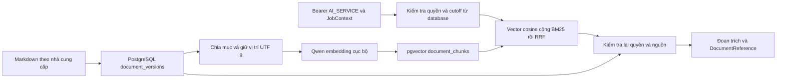

# RAG PostgreSQL: thiết kế, cấu hình và quản lý tài liệu

Hướng dẫn dùng kho Markdown chung cho ứng dụng và Langflow. Chạy các dịch vụ qua [stack SSO](../HUONG-DAN-CHAY.md); các lệnh CLI dưới đây dành cho operator.

## Kiến trúc và dữ liệu

PostgreSQL/pgvector là kho RAG dùng trong ứng dụng. Chroma chỉ phục vụ ví dụ local
trong `examples/rag`, không nằm trên đường chat SSO của stack.

### Phạm vi và kết quả

Migration 0003 giữ 27 bảng nghiệp vụ và `public.api_idempotency`, thêm hoặc tiếp
nhận ba bảng Core: `core.documents`, `core.document_versions`, `core.document_chunks`.
Các migration sau bổ sung manager, chat và Agent Hub. Dùng Alembic head của source
để kiểm schema đầy đủ.

PostgreSQL lưu Markdown canonical, phiên bản, chunk dẫn xuất và vector. Runtime PostgreSQL không gọi Chroma; demo file local + Chroma cũ vẫn có thể chạy bằng chế độ development riêng. Một hồ sơ `supplier_review` đang hoạt động cho mỗi supplier; mỗi lần sửa tạo một version. Không tạo một document mới cho từng lần nhận xét.



### Ba bảng và các quy tắc bổ sung

`documents` giữ danh tính và ACL; `document_versions.content_md` là bản gốc duy nhất.
`document_chunks.content` là bản trích dẫn xuất, phải khớp byte nguồn và có thể tái tạo.

Supplier được gắn qua `subject_type='supplier'` và `subject_id` dạng UUID string. Kho Core dùng chung không có FK riêng tới supplier. Lệnh import kiểm tra supplier, reviewer và phòng ban tồn tại; receiver xác minh scope theo dữ liệu server. Không coi JSONB metadata là FK.

Metadata của supplier review có `supplier_id`, `reviewer_user_id`, `reviewer_name_snapshot`, `report_asof`, `reviewer_attribution`. Actor import nằm ở `created_by_subject`, khác người nhận xét. Bộ fixture được ghi rõ `synthetic_assignment_from_seed`; tên do script phân công không trở thành xác nhận nhận xét thật của người dùng.

`embedding` được cố định `extensions.vector(1024)` cho model Qwen đã pin. Profile gồm revision, dimension, cosine, normalization, precision, instruction và document context. Khi đổi model/profile/cách chia đoạn phải có generation khác. Đổi số chiều cần migration riêng.

### Trích dẫn và byte UTF 8

Chunker hiện tại vẫn chia theo ký tự và heading `#`, `##`, `###`, giữ reviewer, ancestry, giới hạn 1000 ký tự và overlap 100 trong mục. Adapter chuyển vị trí ký tự thành byte bằng độ dài UTF-8 của phần đứng trước. `source_end_byte` là exclusive; không chép số vị trí ký tự vào cột byte.

Nguồn được chuẩn hóa newline LF một lần lúc import, sau khi đã xác minh checksum file local. Sau publication, không tiếp tục trim/normalize trước khi kiểm tra hash hoặc cắt trích dẫn.

Reference PostgreSQL giữ sáu field của DTO hiện tại: document_id, document_version, chunk_id, source_uri, checksum, supplier_id. `document_version` là UUID của `version_id`; `checksum` vẫn là hash nội dung riêng. URI có dạng `core-document://<document_id>/<version_id>#bytes=<start>:<end>`. Adapter không còn lấy content hash làm định danh duy nhất của version, vì cùng nội dung có thể có metadata nhận xét khác nhau.

`chunk_id` do worker tính UUIDv5 theo version, generation, byte span và chunk hash; default random ở DDL chỉ là fallback. Cùng đầu vào chạy lại cho cùng ID. Đổi generation có chunk ID mới; giữ các hàng generation cũ để resolve reference đã lưu. Resolve không cần model hiện tại nhưng vẫn phải kiểm tra ACL, trạng thái nguồn và checksum. Chưa có HTTP endpoint resolve riêng; CLI `inspect` dùng resolver này.

### Publication và thời điểm A B

Trigger chặn sửa/xóa nội dung, checksum, title snapshot, metadata và lineage sau publication. Chỉ cho phép publication sang withdrawal, với timestamp server. Phiên bản draft mới có thể sửa; sửa nhận xét đã công bố phải tạo version mới. DB kiểm tra checksum với SHA-256 của byte UTF-8 thật, không chỉ regex 64 ký tự.

Publication online gán `published_at` và `known_from` bằng thời gian server trong transaction; không backdate theo nội dung Markdown hoặc ngày mẫu. Import lịch sử có bằng chứng phải được thiết kế thành một quy trình audit khác. `report_asof` mô tả mốc dữ liệu báo cáo, không cấp quyền nhìn vào tri thức tương lai.

Ví dụ V1 khả dụng ngày 08, V2 ngày 14: A lập PR ngày 09 dùng V1; B theo dõi PO ngày 15 dùng V2. Truy hồi chọn tối đa một version mới nhất đã biết cho mỗi document tại cutoff, trước khi tính BM25/vector. Không fallback sang version cũ nếu version mới nhất ở cutoff chưa index xong; trả cảnh báo thiếu index.

Quy tắc thu hồi được chốt rõ: version đang withdrawn không được trả nội dung, kể cả replay khi nó từng được công bố. Nếu đó là version mới nhất đã biết tại cutoff thì không tự hồi sinh version cũ. Replay trước thời điểm version đó xuất hiện vẫn có thể dùng version trước còn published. ACL hiện tại và soft-delete hiện tại luôn là điều kiện bắt buộc; đây là replay có kiểm soát, không phải chức năng khôi phục quyền truy cập cũ.

HTTP lấy cutoff từ `analysis_tasks.feature_asof` và phòng ban từ PR liên kết. Không thêm `as_of` vào body v0.4.1. CLI cho phép cutoff do operator chỉ định để thử nghiệm; không gọi đó là xác thực production.

### Generation hoàn tất và retry

Không cần bảng readiness thứ tư cho giai đoạn này. Generation là SHA-256 của format version, version_id, source checksum, chunker version và embedding profile. Với mỗi version, worker tính toàn bộ chunk/vector ngoài transaction. Sau đó mở transaction ngắn, lấy advisory lock, khóa đọc nguồn, kiểm tra nguồn còn hợp lệ, thay toàn bộ hàng của generation đó, đối chiếu đủ count/ID/span/hash/content rồi commit.

MVCC làm bộ chunk xuất hiện cùng lúc. Nếu một insert lỗi, toàn bộ replacement của version đó rollback; generation hoàn chỉnh trước đó còn nguyên. Truy vấn cũng dựng bộ chunk kỳ vọng từ nguồn và chỉ dùng generation có đủ các hàng khớp, nên bộ chunk bị sửa thủ công hay thiếu không trở thành index ready.

Batch nhiều version commit từng version; nếu version sau lỗi, các version trước đã hoàn tất vẫn dùng được. Retry xác minh generation trước khi quyết định bỏ qua embedding. Không tuyên bố exactly-once; đây là xử lý idempotent theo nội dung. Các process có thể cùng tính embedding nhưng ghi được tuần tự theo version/generation.

Lệnh CLI `index` quét và đối soát các version published trong scope. Hiện chưa có daemon outbox tự chạy. Không lấy `outbox_events.published_at` làm chứng cứ đã index, không sửa trạng thái event PO/PR và không tái sử dụng `analysis_tasks` làm hàng đợi index. Nhóm có thể gọi CLI định kỳ hoặc từ worker sau bước publish; cần bổ sung scheduler nếu muốn tự động.

### Truy hồi và phân quyền

Giữ **exact cosine pgvector + BM25 Python + RRF**, reranker vẫn tắt. GIN/tsvector cấu hình simple được lưu làm khả năng tìm kiếm phụ; FTS không được quảng cáo là BM25 và chưa thay nhánh BM25 đã thử. Tài liệu pgvector hỗ trợ exact/approximate search và kết hợp full-text bằng RRF; PostgreSQL có các hàm FTS ranking riêng: [pgvector](https://github.com/pgvector/pgvector#hybrid-search), [PostgreSQL ranking](https://www.postgresql.org/docs/current/textsearch-controls.html#TEXTSEARCH-RANKING).

Chưa bật HNSW/IVFFlat ở quy mô sáu file/96 chunk. Sau này thêm ANN phải đo recall khi lọc supplier/ACL/time; không chỉ so tốc độ hoặc lấy top-k toàn kho rồi lọc quyền ở client.

HTTP dùng IdP introspection hiện có, ánh xạ issuer/subject vào user active và kiểm tra grant AI_SERVICE hợp lệ. `X-Job-Context` là UUID task được đọc từ database; chỉ AI service đã được cấp quyền mới được dùng. Task phải thuộc PR còn hợp lệ, revision phải khớp, cutoff không ở tương lai, phòng ban còn active. Receiver giới hạn hồ sơ global và đúng phòng ban của job. Sau CPU work, kiểm tra lại identity grants, job/resource lineage và nguồn trước khi trả quote.

Nhánh UserContext-only chưa triển khai; contract runtime của hai endpoint được thu hẹp về ServiceAuth + JobContext. Không nhận JSON role, department, allowlist hoặc cutoff từ client. Cơ chế này phục vụ worker theo job của v0.4.1; chưa tuyên bố triển khai đầy đủ execution manifest/context được ký và service binding của tài liệu Layer2 rộng hơn.

RLS bật và quyền PUBLIC/anon/authenticated bị thu hồi trên đúng ba bảng. Backend dùng connection có quyền đọc/ghi và thực thi policy ứng dụng. Đây không phải Supabase Auth RLS policy dành cho browser; không đưa service key/DSN ra frontend. Owner/BYPASSRLS có thể bỏ qua RLS: [PostgreSQL RLS](https://www.postgresql.org/docs/current/ddl-rowsecurity.html).

Retrieval là truy vấn đọc: Idempotency-Key được yêu cầu theo contract nhưng không cache quote lâu dài để tránh trả nội dung đã mất quyền. Index kiểm tra conflict key/payload trong bảng idempotency hiện có và vẫn xác minh source/index khi retry. HTTP index giữ synchronous 200; chưa đổi thành 202 job API.

Model cục bộ dùng chung trong app, có mutex giữ bên trong worker thread ngay cả khi HTTP task bị hủy. Không mở transaction trong lúc load model/embedding và không gọi asyncio.run trên engine app trong worker thread. Shutdown đợi model worker trước khi gỡ tài nguyên.


## Chuẩn bị và truy hồi


```powershell
uv sync --locked --extra rag --group dev
```

Kiểm tra revision và nâng schema tới head của source:

```powershell
.\.venv\Scripts\python.exe -m alembic current
.\.venv\Scripts\python.exe -m alembic upgrade head
.\.venv\Scripts\python.exe scripts/init_core_knowledge.py --check
```

Migration 0003 tiếp nhận ba bảng Core tương thích đã tạo ngoài Alembic; không DROP/TRUNCATE dữ liệu. Nếu vector đang ở schema khác extensions, cột khác thiết kế hoặc dữ liệu cũ vi phạm bất biến/checksum/thời gian thì transaction dừng, cần đối chiếu hiện trạng. Không tự chuyển extension hoặc xóa bảng để ép chạy.

Nếu nhóm chưa quản lý baseline bằng Alembic và chỉ muốn nâng ba bảng Core hiện có:

```powershell
.\.venv\Scripts\python.exe scripts/init_core_knowledge.py --apply
.\.venv\Scripts\python.exe scripts/init_core_knowledge.py --check
```

Script này chỉ chạy SQL Core và kiểm tra; không tạo 27 bảng nghiệp vụ, không stamp baseline Alembic và không sửa dữ liệu mẫu. Không stamp một database chưa được đối chiếu. Baseline 27 bảng + bảng vận hành api_idempotency của repo cần có trước khi dùng đầy đủ HTTP API.

### Import sáu Markdown và index

Supplier/reviewer UUID trong catalog phải tồn tại trong database tương ứng dữ liệu từ script trước đây. Nếu database được tạo bằng seed khác thì sửa mapping được xác minh, không bỏ qua kiểm tra binding.

```powershell
$env:OMP_NUM_THREADS = "4"
$env:HF_HUB_OFFLINE = "1"
.\.venv\Scripts\python.exe -m flowbridge.supplier_assistant.knowledge.postgres_cli import
.\.venv\Scripts\python.exe -m flowbridge.supplier_assistant.knowledge.postgres_cli index
```

Nếu máy chưa có model cache, bỏ HF_HUB_OFFLINE và chạy `index --allow-download`. Đây chỉ tải model embedding công khai đã pin; không upload Markdown. Có thể thêm `--department <uuid>` trước subcommand để import hồ sơ giới hạn phòng ban. Default import là hồ sơ global; operator quyết định scope với credential backend.

Import là nguồn dữ liệu fixture, giữ attribution giả lập. `known_from` bắt đầu ở thời điểm publication/import thực tế. Vì vậy job A/B có cutoff trước lần import đầu sẽ chưa thấy các Markdown này. Tạo job thử mới sau import; không backdate known_from để làm demo lịch sử trông đúng. Mỗi hồ sơ import trong transaction riêng và retry không sinh version thừa nếu nội dung/metadata hiện hành giống nhau.

Quét index lại sau mỗi publication/correction. Chưa có daemon tự nhận outbox. Các version cũ còn published cũng được index để replay A/B; tăng version không ghi đè version cũ.

### Thử truy hồi bằng CLI

```powershell
.\.venv\Scripts\python.exe -m flowbridge.supplier_assistant.knowledge.postgres_cli --supplier 3806e329-2ebe-5cfc-895d-1bd60894b348 search "Đơn đặt hàng DEMO-PO-00212 giao trễ như thế nào?" --top-k 3
```

CLI là operator đã có credential database, không phải chứng minh phân quyền HTTP. Replay có thể thêm `--as-of "2026-10-16T12:00:00+07:00"` trước subcommand nếu mốc đó sau publication và không ở tương lai. `references` xuất refs chuẩn bị cho HTTP index; `inspect <reference.json>` nhận một JSON DocumentReference gồm sáu field để resolve quote cũ còn được phép đọc.

### Bật HTTP

```powershell
$env:FLOWBRIDGE_RAG_DEV_ENABLED = "false"
$env:FLOWBRIDGE_RAG_POSTGRES_ENABLED = "true"
$env:FLOWBRIDGE_DOCS_ENABLED = "true"
$env:FLOWBRIDGE_DATABASE_COMMAND_TIMEOUT_SECONDS = "300"
.\.venv\Scripts\python.exe -m flowbridge.main
```

Giữ credential database/IdP trong `.env` hoặc secret manager. Cần cấu hình issuer, audience, introspection URL, client ID/secret của IdP hiện có và ánh xạ identity AI service tới user/grant AI_SERVICE active. Nếu IdP chưa nối, HTTP không bỏ qua xác thực mà trả lỗi dependency/unauthenticated; vẫn có thể thử operator CLI.

Sau khi đồng bộ main có Keycloak, registry phải nhận diện đúng client AI là service. Với tên client mặc định trong realm của repo, cấu hình trong `.env`:

```dotenv
FLOWBRIDGE_OIDC_ALLOWED_CLIENTS=["flowbridge-web-a","flowbridge-web-b","flowbridge-ai","flowbridge-po"]
FLOWBRIDGE_OIDC_SERVICE_CLIENTS=["flowbridge-ai","flowbridge-po"]
```

Nếu nhóm đổi client ID thì dùng registry tương ứng. Token gọi RAG phải thuộc client AI được đăng ký; user liên kết trong PostgreSQL phải có `account_type=service` và grant `AI_SERVICE` đang hoạt động. Registry không thay thế grant trong database. Xem [hướng dẫn SSO](SSO.md) để cấu hình issuer, audience, introspection và bootstrap identity; không cần tạo lại bảng RAG.

`POST /internal/v1/tools/retrieve-knowledge`:

```http
Authorization: Bearer <access token của AI service>
Idempotency-Key: rag-query-001
X-Job-Context: <UUID analysis_tasks thật>
Content-Type: application/json
```

```json
{"query":"Đơn đặt hàng DEMO-PO-00212 giao trễ như thế nào?","supplier_id":"3806e329-2ebe-5cfc-895d-1bd60894b348","top_k":3}
```

JobContext chỉ nhận task UUID, không nhận JSON user/role/cutoff. Receiver lấy feature_asof và phòng ban từ database, kiểm tra PR/revision/trạng thái. Không gửi X-User-Context kèm theo. `POST /internal/v1/tools/index-knowledge` dùng cùng headers, body `{"documents":[<DocumentReference chuẩn bị>]}` và trả 200 sau khi xử lý. Để index nhiều nguồn ban đầu, nên dùng CLI tránh giới hạn HTTP timeout.

### Kiểm tra

```powershell
.\.venv\Scripts\python.exe -m pytest -q
.\.venv\Scripts\python.exe -m ruff check backend scripts tests
```

Bốn test database mới chỉ chạy khi chủ động cấu hình database test có migration 0003:

```powershell
.\.venv\Scripts\python.exe -m pytest -o addopts="" -m integration tests/integration/test_knowledge_pgvector_database.py -q
```

Chúng tạo hồ sơ fixture trong outer transaction rồi rollback, dùng vector điều khiển để kiểm tra adapter; không thay benchmark Qwen. Không dùng database production làm môi trường kiểm thử thường xuyên.

Kiểm chứng SQL cục bộ tùy chọn, không phải dependency runtime backend:

```powershell
.\.venv\Scripts\python.exe scripts/export_rag_sql_fixture.py
npm install --ignore-scripts --no-save --prefix .cache/rag/pg-sql-tools @electric-sql/pglite@0.5.10 @electric-sql/pglite-pgvector@0.0.11
$env:NODE_PATH = "$PWD/.cache/rag/pg-sql-tools/node_modules"
node tests/sql/knowledge_pgvector.mjs
```

Kết quả SQL trong `.cache/rag/pgvector-sql-results.json`; không commit npm packages/cache hoặc credential. PGlite direct SQL kiểm tra migration/trigger/query, chưa thay kết quả asyncpg/Supabase E2E.

## Quản lý tài liệu trên giao diện

Trang **Tài liệu RAG** nằm trong React client hiện có (`clients/sso`), mở bằng
`http://127.0.0.1:8761/#knowledge`. Backend xác minh bearer Keycloak và grant
`ADMIN` còn hiệu lực trong DB cho mọi thao tác, kể cả đọc nội dung/trạng thái.
Không cấp quyền quản lý cho nhân viên kho, người duyệt hay AI service.

### Nguồn và pipeline

Nguồn gốc là `core.documents` và `core.document_versions.content_md` trong PostgreSQL.
Các file ở `examples/rag` là fixture có thể import, không phải một bản nội dung
thứ hai được chỉnh sửa song song. Migration 0004 nhận diện các tài liệu đã tồn tại,
gán tên `<supplier_code>.md` khi metadata đủ an toàn, nếu không dùng `<document_id>.md`.
Không đọc/ghi file tùy ý trên máy chủ. Upload chỉ truyền văn bản UTF-8.

```text
React → API admin → core.knowledge_jobs (pending, bền vững)
                  → worker dùng splitter * / ** / *** và # / ## / ### hiện có
                  → Qwen3-Embedding-0.6B hiện có, 1024 chiều, chuẩn hóa
                  → transaction: phiên bản mới + toàn bộ chunk/vector + trạng thái ready
Langflow → API retrieve-knowledge hiện có → chọn phiên bản theo cutoff của tác vụ
```

Worker dùng chung model/mutex với truy hồi. Tạo embedding trước khi mở transaction
xuất bản. Nếu lỗi, bản nguồn đã xuất bản và vector cũ vẫn hoạt động. Lease, fencing
token và heartbeat trong DB cho phép lấy lại tác vụ sau crash. Không dùng FastAPI
BackgroundTasks hoặc state trên browser làm hàng đợi. Khởi động backend với manager
được bật là đủ để xử lý tác vụ tồn đọng; không cần chạy script ingest thủ công.
Retry lỗi được yêu cầu rõ ràng; không lặp vô hạn khi model/config sai.
Vòng polling phục hồi sau lỗi kết nối/pool timeout và ghi loại lỗi an toàn vào log;
lỗi heartbeat không làm dừng worker hoặc che mất tín hiệu hủy khi tắt ứng dụng.

Sau khi API tiếp nhận, giao diện đóng form đã gửi và cho thêm tài liệu khác ngay.
Khung **Hàng đợi đồng bộ RAG** theo dõi riêng các tác vụ chờ, đang xử lý, hoàn tất
và lỗi. Worker hiện xử lý lần lượt; chỉ khóa sửa/xóa/đồng bộ tiếp trên đúng tài liệu
đang có tác vụ. Tác vụ hoàn tất không đóng hoặc ghi đè form tài liệu khác đang soạn.
Reload trang sẽ lấy lại tác vụ từ DB; lỗi đọc trạng thái tạm thời được tự thử lại,
không tự gửi lại thao tác ghi và không tự chạy lại một tác vụ đồng bộ đã thất bại.

Mỗi nhà cung cấp có một tài liệu đang dùng theo unique index Core hiện có. Khi tạo,
quản trị viên chọn nhà cung cấp, người nhận xét, mốc dữ liệu và phạm vi toàn hệ thống
hoặc phòng ban. Người thao tác thật được ghi riêng trong job và phiên bản.
Không suy ra quyền ghi từ tên người nhận xét hay từ phòng ban trên giao diện.

Nút **Tải tài liệu** xuất Markdown UTF-8 nguyên văn của phiên bản đang xem, giữ dấu
sao và xuống dòng. Mỗi lần tải đọc lại đúng phiên bản qua API ADMIN hiện có; không
xuất HTML xem trước hoặc nội dung nháp chưa lưu. Bản hiện tại giữ tên file, bản được
chọn trong lịch sử có thêm `.v<version_no>` trước `.md` để dễ phân biệt.

Sửa giữ `document_id`, tăng phiên bản. Chỉ sau khi chunk/vector được kiểm chứng trong
cùng transaction thì bản mới có `published_at/known_from` thực tế. Không backdate.
Không xóa vector của các phiên bản trước: chúng phục vụ truy vết và các tác vụ có
cutoff cũ. Truy hồi hiện hành chỉ chọn phiên bản đúng cutoff, không trộn các bản cũ.
Vì vậy **tác vụ Langflow đã tạo trước lần sửa vẫn có thể thấy bản cũ**. Muốn dùng
tài liệu mới phải dùng tác vụ có cutoff sau thời điểm xuất bản; không sửa cutoff
của tác vụ đã tồn tại để giả cập nhật lịch sử.

Lưu cùng nội dung/tiêu đề không tạo embedding hay tăng phiên bản. Nút **Đồng bộ lại**
luôn dựng lại generation hiện tại, kể cả hash không đổi. Khóa trên document,
`expected_revision`, unique active job và idempotency chống hai lần lưu ghi đè nhau.
DB source/version/generation đang đọc vẫn được kiểm lại tại lúc commit.

### Xóa

**Xóa tài liệu** có xác nhận trên UI. Chỉ ADMIN được yêu cầu. Backend kiểm lại
`risk_analysis_reports.report_data` và `analysis_supplier_candidates.evidence_refs`,
bao gồm tham chiếu document/version/chunk. Nếu đã được trích dẫn, trả 409, không xóa.
Đề xuất tham chiếu báo cáo được bảo vệ thông qua báo cáo đó. Có nút **Ngừng sử dụng**
để loại tài liệu khỏi truy hồi và giữ nguồn lịch sử cho quản trị viên xem.

Với tài liệu tải nhầm chưa được trích dẫn: trong một transaction, đánh dấu xóa,
xóa mọi chunk và phiên bản của đúng tài liệu, xóa document/tên file; scrub nội dung
nháp khỏi các job liên quan. Log job chỉ giữ ID, loại thao tác, người thao tác,
trạng thái, số đoạn, thời điểm. Tạo lại cùng tên nhận ID mới. Trigger khóa tài liệu
khi ghi bằng chứng để không cho báo cáo mới ghi tham chiếu tới nguồn vừa bị xóa.
Không tắt trigger bất biến của phiên bản. Không dùng truncate/drop hoặc tắt RLS.

Phạm vi xóa là kho Core và vector của tài liệu. Chat history của Langflow hay bản
xuất fixture do người dùng giữ là dữ liệu độc lập, không tự bị sửa/xóa theo thao tác này.

### Cài/chạy trên Windows

Từ repository root, dùng môi trường backend sẵn có. Lưu cấu hình DB/IAM trong
`.env` hoặc secret của tiến trình, không đưa lên Git. Backup DB bằng công cụ của
nhóm trước khi nâng migration. Xem SQL dự kiến trước khi chạy:

```powershell
.\.venv\Scripts\python.exe -m alembic upgrade 0003_core_knowledge:head --sql
.\.venv\Scripts\python.exe -m alembic upgrade head
```

Migration 0004 bổ sung `core.knowledge_files`, `core.knowledge_jobs` và guard tham
chiếu. Không thay nội dung/version/vector nghiệp vụ hiện có. Tự động downgrade bị
chặn để không làm mất job hoặc nguồn; muốn revert, tắt manager, chờ hết job rồi
review SQL rollback riêng. Không drop bảng Core để rollback.

```powershell
$env:FLOWBRIDGE_RAG_POSTGRES_ENABLED = 'true'
$env:FLOWBRIDGE_RAG_MANAGER_ENABLED = 'true'
# Tối đa 2 MB UTF-8/file, có thể giảm giới hạn:
$env:FLOWBRIDGE_RAG_MANAGER_MAX_BYTES = '2097152'
.\.venv\Scripts\python.exe -m flowbridge.main
```

Model cache Qwen và cấu hình IAM/DB theo phần **Chuẩn bị và truy hồi** ở trên.
Không tự tải model khi có request. Trang quản lý không cần Langflow API key hoặc
flow ingest riêng; ghi đúng kho mà endpoint RAG của Langflow đang đọc.

Frontend theo [hướng dẫn client](../clients/sso/README.md). `npm ci --ignore-scripts`,
`npm run build`, `npm run start:a` trong `clients/sso`; cấu hình public phải trỏ đúng
API và issuer đã đăng ký. Sau đăng nhập ADMIN, chọn **Tài liệu RAG**. Reload trang
rồi chọn lại tài liệu sẽ đọc trạng thái job đã lưu và tiếp tục polling.

API riêng dưới `/api/admin/knowledge`: `GET options`, `GET/POST documents`,
`GET/PUT/DELETE documents/{id}`, `GET documents/{id}/versions/{revision}`,
`POST documents/{id}/reindex`, `POST documents/{id}/withdraw`,
`GET jobs/{id}`, `POST jobs/{id}/retry`. Thao tác ghi cần `Idempotency-Key`;
sửa/xóa/reindex cần `expected_revision`. 202 là đã tiếp nhận, chưa phải đã đồng bộ.
Job ready mới là đã commit. Failed hiển thị mã lỗi an toàn và cho thử lại.

UI chỉ render Markdown bằng React text/heading/paragraph, không thực thi HTML,
ảnh, script hoặc link nhúng. Giữ nguyên các dấu sao trong văn bản nguồn.

### Kiểm tra

```powershell
.\.venv\Scripts\python.exe -m pytest tests/unit/test_knowledge_manager.py -q
# DB thật, transaction rollback, embedding kiểm soát; không chứng nhận IAM/model:
.\.venv\Scripts\python.exe -m pytest tests/integration/test_knowledge_manager_database.py -m integration -q
# UI dùng HTTP/Keycloak mock, không ghi dữ liệu Supabase:
npm --prefix clients/sso run test:ui
```

Thử với nhà cung cấp thử nghiệm chưa có tài liệu: tạo câu độc nhất `VERSION_A`,
đợi ready, tạo tác vụ mới và truy vấn; sửa thành `VERSION_B`, đợi ready và dùng tác
vụ mới để kiểm tra bản mới. Lịch sử vẫn có A. Tài liệu khác phải giữ version/chunk.
Xóa tài liệu thử, đợi ready, truy hồi phải không còn A/B từ document đó. Không dùng
test trên tài liệu đã trích dẫn hoặc thay nội dung 6 tài liệu đang dùng chỉ để QA.
