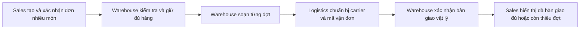
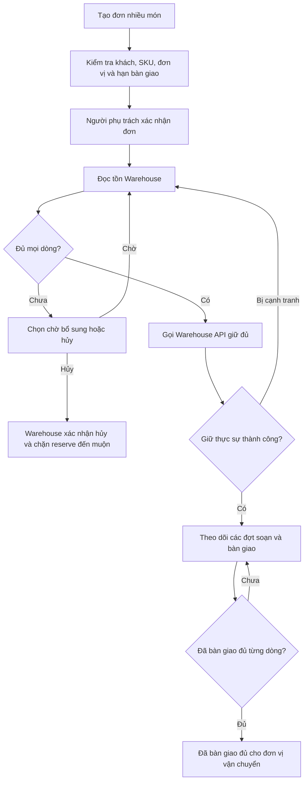
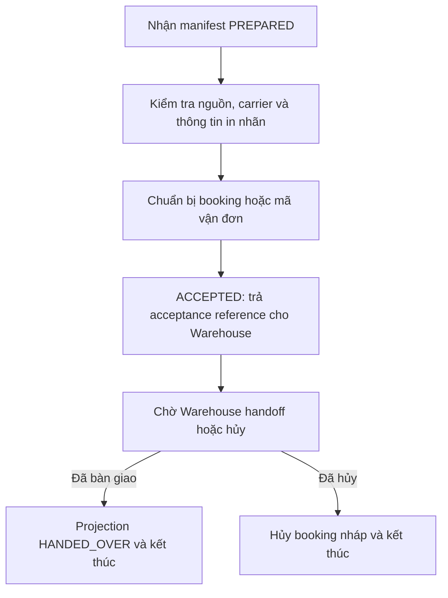

# DX-OS demo v2 — kết thúc khi bàn giao cho đơn vị vận chuyển

Thiết kế nghiệp vụ 0.2 · 22/10/2026; cập nhật bàn giao 23/10/2026. Models, migrations và seed đã có; API, worker sự kiện và workflow chưa được module này triển khai. Quy trình cập nhật theo seed hiện tại: `QUY_TRINH_BAN_GIAO.md`.

**Điểm kết thúc: Warehouse đã bàn giao đủ từng mặt hàng cho đơn vị vận chuyển.** Không theo dõi khách nhận hàng, giao lại, hoàn trả hoặc bồi thường. Bản v1 có phạm vi giao đến khách được giữ nguyên riêng. Logistics trong bản này là bộ phận nội bộ điều phối; đơn vị vận chuyển/carrier là bên ngoài đến kho nhận hàng. Master Spec không bị sửa.

## 1. Luồng chính và lợi ích liên thông



Ba giá trị cần chứng minh:

1. Sales đọc tồn mới tại Warehouse để biết có thể đáp ứng đơn hay phải chờ nhập bổ sung.
2. Logistics nhận đúng manifest của kho và thông tin in nhãn được Sales cấp phép, tránh nhập lại sai món/lượng/người nhận.
3. Chatbot biết đơn thiếu gì, đang chờ hàng, chờ soạn hay chờ carrier, đã bàn giao đợt nào; mỗi thông tin có nguồn và phạm vi quyền rõ.

Tồn đủ qua một lần đọc chưa phải giữ được hàng. Tạo vận đơn cũng chưa chứng minh hàng đã rời kho. Phải gọi đúng Business API để thực hiện và xác nhận từng bước.

Onboarding/công bố dữ liệu của nền tảng vẫn theo Master Spec: đăng ký nguồn → chọn dataset/cột → duyệt → provision/kiểm tra quyền → ACTIVE. Ba quy trình nghiệp vụ dưới đây là quy trình mẫu có thể thay cấu hình/định nghĩa theo doanh nghiệp. Ứng dụng thứ ba là Logistics theo ảnh mới, chưa tự sửa Procurement trong Master Spec.

### Phạm vi MVP

- Đơn nhiều dòng, SKU/đơn vị thống nhất; một kho được chọn cho mỗi đơn.
- Giữ đủ mọi dòng hoặc rollback toàn bộ. Chưa giao phần có sẵn khi phần còn lại chưa được cấp giữ.
- Sau khi giữ đủ có thể chia nhiều đợt chuẩn bị/bàn giao.
- Hủy toàn đơn trước lần bàn giao đầu tiên, có giải phóng hàng giữ.
- Có booking/mã vận đơn, carrier, người tiếp nhận và chứng cứ handoff.
- Carrier đến chậm, manifest sai, timeout và hủy trước bàn giao được xử lý; phát sinh trên đường vận chuyển nằm ngoài demo.
- Không có customer delivery, tối ưu tuyến, ETA/ML, trả hàng/hoàn tiền hoặc phân bổ nhiều kho.

## 2. Nguồn chuẩn của dữ liệu

| Nguồn | Dữ liệu sở hữu |
|---|---|
| Sales | Khách, đơn/dòng hàng, giá bán, snapshot người nhận/địa chỉ in nhãn, kho chọn, hạn yêu cầu bàn giao |
| Warehouse | SKU/đơn vị, giá vốn, tồn/giữ, phiếu nhập, phiếu chuẩn bị và xác nhận bàn giao vật lý |
| Logistics | Bố trí carrier, chấp nhận manifest, booking/mã vận đơn và lịch sử chuẩn bị; projection handoff đối chiếu từ Warehouse |
| Core/Keycloak/Flowable | Registry, contract/quyền, identity, process definition/version/instance/task và audit nền tảng |

Warehouse là nguồn xác nhận vật lý. Logistics không tự ghi một sự kiện handoff độc lập có thể mâu thuẫn với kho. Trong demo nhân viên Logistics nhập carrier/mã vận đơn, nhân viên Warehouse xác nhận đại diện vận chuyển đã nhận; chưa cần API hãng vận chuyển thật.

Quy ước cấu trúc:

- `org_id` lấy từ identity/binding được xác minh, là ranh giới doanh nghiệp trong mọi bảng, unique key và join.
- UUID là ID kỹ thuật, mã SO/RSV/DSP/SHP để con người đọc.
- FK nội bộ có org và parent ID. Reference sang DB khác là opaque ID được kiểm chứng qua API/event/contract, không FK vật lý xuyên DB.
- Warehouse sở hữu SKU/đơn vị; không để LLM nối sản phẩm bằng tên gần giống.
- `input_revision` là phiên bản nội dung đơn, riêng với `version` chống cập nhật đồng thời status. Giữ theo input revision đã xác nhận.
- Sales `requested_handoff_at` là hạn gửi/bàn giao cho vận chuyển, không phải hạn khách nhận. Kho chọn, dòng hàng và hạn gốc được khóa sau xác nhận.
- Quantity dùng numeric(18,3), money numeric(18,2) + currency; timestamps timestamptz lưu/trao đổi UTC.
- Actor là Keycloak subject; không lưu mật khẩu trong DB nghiệp vụ.
- Snapshot giao dịch được phép; không sao chép cả database ứng dụng sang Core.

## 3. Quy trình Sales



Trạng thái: DRAFT, SUBMITTED, CONFIRMED, WAITING_STOCK, RESERVED, FULFILLING, PARTIALLY_HANDED_OVER, COMPLETED; nhánh CANCEL_PENDING/CANCELLED và EXCEPTION.

**COMPLETED trong bản này chỉ là hoàn tất phạm vi bàn giao.** Phải hiển thị “Đã bàn giao đủ cho đơn vị vận chuyển”, không dùng “Khách đã nhận đủ”. Xác minh lượng Warehouse HANDED_OVER theo từng dòng; completed_at là mốc handoff muộn nhất để đạt đủ tất cả dòng, không phải lúc projection được cập nhật.

Đơn đang chờ hàng, chờ soạn, chờ carrier chấp nhận và chờ bàn giao phải phân biệt được bằng dữ liệu nguồn/process; không dùng chung nhãn “đang giao” khiến người dùng tưởng hàng đã trên đường.

## 4. Quy trình Warehouse

Nhập bổ sung: tạo phiếu nhập → kiểm đếm/chấp nhận theo dòng → POSTED → tăng tồn, ghi movement và outbox cùng transaction. Tồn đầu kỳ cũng cần chứng từ nguồn.

Giữ/xuất: nhận order và input revision → khóa các dòng balance → đủ mọi SKU thì tạo reservation, nếu thiếu rollback toàn bộ → nhân viên soạn một đợt → dispatch PREPARED đóng băng manifest → Logistics chấp nhận đúng carrier/manifest → kho xác nhận người vận chuyển nhận hàng → commit handoff.

Trong ví dụ, on_hand/reserved là tên rút gọn của on_hand_quantity/reserved_quantity:

```text
available = on_hand - reserved
remaining_hold_line = allocated - released - dispatched

Giữ q:      on_hand không đổi; reserved += q
Hủy giữ q:  on_hand không đổi; reserved -= q
Bàn giao q: on_hand -= q; reserved -= q
```

Điều kiện: 0 ≤ reserved ≤ on_hand; released + dispatched ≤ allocated; tổng giữ còn hiệu lực khớp reserved trên balance.

PREPARED chưa làm giảm tồn. Khi nhiều dispatch cùng chuẩn bị từ một reservation, khóa cùng đối tượng và kiểm tra tổng PREPARED + dispatched + released không vượt allocated. Handoff chuyển phần PREPARED sang dispatched, giảm balance và ghi movement đúng một lần.

`stock_movements` chỉ ghi biến động tồn vật lý on_hand. Reserved đối soát qua reservation counters và command/events; không tạo movement vật lý giả cho giữ/giải phóng.

Khi handoff, Warehouse ghi carrier snapshot, tên đại diện vận chuyển nhận hàng, thời điểm thật, actor xác nhận và proof document ref nếu có. Các thông tin phải khớp acceptance/manifest được kiểm chứng.

PostgreSQL row lock/cập nhật có điều kiện có thể bảo vệ cạnh tranh trong transaction. Không giữ transaction mở trong lúc gọi Logistics qua mạng. [PostgreSQL — Explicit Locking](https://www.postgresql.org/docs/current/explicit-locking.html).

## 5. Quy trình Logistics nội bộ: điều phối bàn giao cho carrier bên ngoài



Trạng thái: DRAFT, ACCEPTED, HANDED_OVER, CANCELLED, EXCEPTION. Tên bảng vẫn là shipments để giữ một hồ sơ có carrier/mã vận đơn/SKU, nhưng **chưa có IN_TRANSIT/DELIVERED**.

Một order có nhiều dispatch; MVP một dispatch ứng với một shipment. Mỗi shipment có nhiều dòng. planned_quantity là lượng manifest; handed_over_quantity lấy từ nguồn Warehouse, trước handoff bằng 0. planned_handoff_at là snapshot từ Sales.requested_handoff_at; handed_over_at là mốc thật từ Warehouse.

Người nhận/địa chỉ trên nhãn là thông tin cần để gửi hàng, chưa phải chứng cứ khách đã nhận. Không có delivery_attempts, delivery_attempt_lines, delivered_quantity hoặc delivered_at trong bản này.

### Phát sinh chỉ trước/tại điểm bàn giao

| Phát sinh | Xử lý |
|---|---|
| Carrier chưa tới/xe đến muộn | Dispatch PREPARED, chưa giảm tồn; Logistics điều chỉnh booking và báo chờ |
| Sai món/lượng/manifest hoặc carrier từ chối | Chưa handoff; ghi lý do, xử lý ngoại lệ/hủy kế hoạch cũ và chuẩn bị đúng |
| Timeout tạo booking | Retry cùng dispatch/manifest/key hoặc tra trạng thái, không tạo vận đơn trùng |
| Handoff đã commit nhưng mất phản hồi | Retry/reconcile outbox; không trừ tồn hoặc bàn giao lần hai |
| Sales hủy trước handoff | Warehouse hủy kế hoạch/giải phóng giữ; Logistics đóng booking và task nháp |

Hàng mất/hỏng trên đường, khách vắng mặt và hoàn trả là phần ngoài phạm vi, không thêm nhánh xử lý giao khách ẩn bên trong EXCEPTION.

## 6. Cấu trúc: 17 bảng nghiệp vụ + 9 bảng kỹ thuật

Fields, key/index/FK và notes nằm trong ba DBML đi kèm.

| DB | Bảng nghiệp vụ | Vai trò |
|---|---|---|
| Sales | customers | Khách và liên hệ riêng của Sales |
| Sales | sales_orders | Đơn, kho chọn, hạn bàn giao gốc, input revision/version, snapshot in nhãn |
| Sales | sales_order_lines | SKU/đơn vị/lượng từng dòng, tên và đơn giá bán snapshot |
| Sales | sales_order_events | Lịch sử quyết định/tiến độ có actor và source event |
| Warehouse | products | SKU/đơn vị/tên và giá vốn nhạy cảm |
| Warehouse | warehouses | Danh mục kho; một kho được chọn cho mỗi order |
| Warehouse | inventory_balances | on_hand/reserved/version theo org–kho–sản phẩm |
| Warehouse | goods_receipts | Phiếu nhập/kiểm nhận |
| Warehouse | goods_receipt_lines | Lượng thực nhận/được chấp nhận từng sản phẩm |
| Warehouse | reservations | Giữ đủ cho order/input revision, có cancellation fence |
| Warehouse | reservation_lines | requested/allocated/released/dispatched quantities, Sales line ref |
| Warehouse | dispatches | Phiếu soạn/bàn giao, manifest, carrier/acceptance và handoff evidence |
| Warehouse | dispatch_lines | Dòng giữ được sử dụng, lượng bàn giao từng món |
| Warehouse | stock_movements | Ledger tồn vật lý bất biến, chứng từ nguồn và actor |
| Logistics | shipments | Booking/mã vận đơn, carrier, manifest và projection handoff |
| Logistics | shipment_lines | Reference dòng nguồn, SKU/đơn vị, planned và handed-over quantities |
| Logistics | shipment_events | Lịch sử chuẩn bị/chấp nhận/hủy/nhận handoff |

Mỗi DB thêm command_receipts (idempotency), outbox_events (gửi sự kiện bền vững) và inbox_receipts (persist/dedup/retry sự kiện nhận). Tổng Sales **7**, Warehouse **13**, Logistics **6** = **26 bảng**. Đây không phải 26 màn hình; 9 bảng kỹ thuật lặp theo nơi sở hữu giao dịch.

### Những ràng buộc không được bỏ khi triển khai

- Unique mã theo org và dòng theo chứng từ; FK composite giữ cùng org/đúng parent.
- Reserve toàn đơn hoặc rollback; không tạo thêm reservation do status version tăng.
- Tổng các dispatch PREPARED không gán trùng phần giữ; handoff không vượt allocated.
- Chứng từ HANDED_OVER bất biến, retry không tạo movement thứ hai.
- Snapshot deadline/PII có thể null lúc draft nhưng đủ ở confirm/accept.
- Số lượng dương/không âm đúng nghĩa; giá vốn và PII không tự được chia sẻ cùng stock dataset.
- Những điều kiện SUM nhiều dòng, trạng thái và locking cần service transaction; DBML Note không tự thực thi các điều kiện đó. [PostgreSQL — Constraints](https://www.postgresql.org/docs/current/ddl-constraints.html).

## 7. Datasets liên thông và quyền

Đây là thiết kế view/data product, chưa provision Hasura. M0 vẫn phải kiểm chứng đa nguồn, relationship và role propagation theo Master Spec.

| Dataset | Nguồn → consumer | Dữ liệu công bố |
|---|---|---|
| product_catalog | Warehouse → Sales | org, product ref, SKU, tên, đơn vị; không unit_cost |
| stock_available | Warehouse → Sales | org, warehouse ref, SKU, available_quantity, updated_at |
| sales_fulfillment_lines | Sales → Warehouse | Order/line refs, SKU/đơn vị/lượng, input revision, kho chọn, requested_handoff_at |
| shipping_label_instructions | Sales → Logistics được phân công | Snapshot người nhận/địa chỉ tối thiểu, không public toàn bộ customers |
| reservation_progress | Warehouse → Sales | Order/line refs, allocated/released/dispatched/remaining quantities |
| dispatch_manifest | Warehouse → Logistics | Dispatch/line/order refs, SKU/lượng, manifest version/hash, status |
| handoff_evidence | Warehouse → Sales/Logistics đúng scope | Lượng bàn giao, carrier, handoff time/source event; proof ref có quyền riêng |
| shipment_preparation | Logistics → Sales/Warehouse | Carrier, booking/mã vận đơn, acceptance và tình trạng chuẩn bị của đúng order |

Sales không đọc giá vốn. Warehouse không cần giá bán/toàn bộ hồ sơ khách. Logistics chỉ đọc manifest và nhãn của shipment được phân công. Org/department/owner/assignment và contract ACTIVE phải được kiểm tra thật tại backend/tool/Hasura. Platform admin không tự động đọc mọi dữ liệu nghiệp vụ.

Join bằng org + ID/reference hoặc SKU đã thống nhất; stock một dòng theo org–kho–SKU, không join chỉ SKU rồi nhân đôi Sales line. Tổng hợp ở cấp dòng trước khi join nhiều đợt.

## 8. Chatbot giúp gì?

| Câu hỏi | Nguồn đọc | Kết quả đúng |
|---|---|---|
| Đơn này thiếu món gì? | Sales + Warehouse availability/own reservation | Lượng thiếu trước giữ hoặc lượng đã giữ riêng, theo từng món |
| Kho nhập thêm rồi đã đủ chưa? | Sales + stock query mới | Giá trị sau commit, không dùng số nhớ trong chat |
| Đơn kẹt ở bộ phận nào? | Sales + reservation/dispatch + Logistics preparation | Chờ hàng, soạn, carrier chấp nhận hay handoff |
| Đợt 1 bàn giao cho ai, vận đơn nào? | Warehouse handoff + Logistics booking | Carrier, mã vận đơn, món/lượng và mốc thật |
| Còn món nào chưa bàn giao? | Sales lines + tổng Warehouse handoff từng dòng | Đúng số thiếu và đơn vị, không cộng cái với ram/cuộn |
| Khách đã nhận chưa? | Ngoài phạm vi | Nói demo chỉ xác minh đến bàn giao vận chuyển, chưa theo dõi khách nhận |

Bot mặc định read-only; gợi ý/nút thao tác phải qua Business API có quyền/xác nhận, không tự SQL UPDATE tồn hoặc tự nói carrier đã nhận. JSON có thể giữ answer/datasets/tables/charts/warnings kèm evidence, queried_at theo nguồn, trace/config version. Không tạo biểu đồ khách nhận từ dữ liệu chưa thu thập.

Nguồn lỗi, thiếu quyền và không tìm thấy trong scope là các tình trạng khác nhau. Có thể báo phần đã xác minh nhưng không đoán phần chưa truy vấn được. Query nhiều DB không được mô tả như snapshot ACID chung; lúc ghi vẫn kiểm tra lại tại nguồn sở hữu.

## 9. Lệnh, sự kiện và an toàn khi retry/hủy

Lệnh: confirm Sales order; post goods receipt; reserve; prepare dispatch; accept Logistics shipment; confirm Warehouse handoff; cancel-before-first-handoff. Mỗi lệnh có key/hash/version phù hợp. Cùng key khác nội dung bị từ chối; quyền vẫn kiểm tra trên retry.

Command receipt + thay đổi nghiệp vụ + outbox commit trong một DB; gọi mạng ngoài transaction. Event tối thiểu:

```text
sales.order.confirmed / cancellation_requested
warehouse.stock.changed
warehouse.reservation.confirmed / rejected / cancelled
warehouse.dispatch.prepared / cancelled / handed_over
logistics.shipment.accepted / cancelled / exception
```

Envelope giữ org, producer, aggregate ID/version, schema version, stable event ID, correlation/order ref và occurred/recorded times. Inbox persist payload tối thiểu/private, ACK sau persistence. Outbox PUBLISHED không có nghĩa nghiệp vụ đã hoàn thành. Event duplicate được dedup, gap/out-of-order được defer hoặc đối chiếu nguồn, không bỏ delta cũ tùy ý. Worker polling có lease/retry/backoff; chưa cần Kafka.

Race phải khóa:

1. Hủy trước khi reserve tồn tại: Warehouse ghi CANCELLED tombstone theo org + order + input revision, reserve cũ đến muộn bị chặn.
2. Hủy đua handoff: khóa cùng reservation/dispatch, chỉ một nhánh thắng. Sales CANCELLED sau khi Warehouse xác nhận giải phóng; timeout không là bằng chứng thất bại.
3. Cancel đến Logistics trước prepare: giữ fence theo org + source dispatch; prepare cũ không tạo booking trở lại. Đóng task/process nếu đã tồn tại.
4. Hai dispatch chuẩn bị cùng phần giữ: cap PREPARED + dispatched + released ≤ allocated trong transaction.
5. Handoff commit nhưng phản hồi mất: retry cùng key/dispatch, không trừ tồn hoặc phát xác nhận vật lý lần hai.

Reservation expires_at mặc định null; chỉ bật TTL khi có worker/timer với cùng locking/ràng buộc. Hủy sau lần handoff đầu tiên và hoàn trả ngoài MVP.

## 10. BPMN mẫu và tính linh hoạt

| Process | User Tasks | Service/correlation |
|---|---|---|
| sales_order_fulfillment | Xác nhận đơn, chọn chờ/hủy | Read availability, reserve, chờ đủ Warehouse handoff, kết thúc scope Sales |
| warehouse_fulfillment | Soạn từng đợt, xác nhận đại diện vận chuyển nhận | Prepare manifest, acceptance Logistics, atomic handoff, đợt tiếp/hủy |
| logistics_handoff | Carrier/booking, xác nhận chuẩn bị | Nhận manifest, return acceptance, chờ Warehouse handoff/cancel rồi kết thúc |

Mermaid là giải thích, chưa phải BPMN XML thực thi. Flowable User Task/Service Task/event/gateway cần adapter/correlation và integration test. [Flowable OSS — BPMN Constructs](https://www.flowable.com/open-source/docs/bpmn/ch07b-BPMN-Constructs/).

Core binding org + app + operation tới process definition/version và approved adapters; business object nối process instance/correlation. Không nhân bản bảng task/identity/role trong ba DB. Doanh nghiệp có thể thêm bước duyệt theo giá trị đơn hoặc timer chờ carrier; API vẫn bảo vệ đủ tồn/không giữ trùng/không xuất quá lượng. Thay workflow không tự cấp quyền hoặc bỏ invariant kho.

## 11. Demo liền mạch

Phần dưới là fixture thiết kế ban đầu, giữ để tham khảo ý tưởng; tên SKU/chứng từ không phải danh sách hiện tại trên database. Dữ liệu demo hiện hành được mô tả trong [Demo Data](DEMO_DATA.md) và [quy trình nghiệp vụ](QUY_TRINH_BAN_GIAO.md).

### A. Thiếu hàng → nhập bổ sung → giữ đủ

SO-0100, khách Công ty An Phát, kho WH-HCM:

| SKU | Món | Đơn vị | Nhu cầu | on_hand | reserved đơn khác | available |
|---|---|---|---:|---:|---:|---:|
| LAP-15 | Laptop văn phòng 15,6 inch, RAM 16 GB, SSD 512 GB | cái | 10 | 8 | 3 | 5 |
| MOU-USB | Chuột USB có dây | cái | 5 | 25 | 5 | 20 |

Lượng giữ đơn khác phải có reservation nền thật. Reserve đủ SO-0100 thất bại vì thiếu 5 laptop; không giữ chuột dở dang. Kho POSTED nhập thêm 7 laptop → 15/3/**12**. Chat đọc mới thấy đủ. Reserve thành công → laptop 15/13/**2**, chuột 25/10/**15** (on_hand/reserved/available).

Bot phân biệt 10 laptop đã giữ riêng cho đơn với 2 laptop còn tự do, không kết luận đơn thiếu 8.

### B. Chia hai đợt, kết thúc tại carrier

- DSP-0100-01/SHP-0100-01: 6 laptop + 5 chuột, carrier và mã vận đơn riêng. ACCEPTED chưa giảm tồn.
- Kho xác nhận handoff đợt 1 → laptop **9/7/2**, chuột **20/5/15**. Sales hiển thị đã bàn giao 6/10 laptop + 5/5 chuột, còn 4 laptop.
- DSP-0100-02/SHP-0100-02: 4 laptop còn lại; handoff → laptop **5/3/2**.
- Sales hiển thị **Đã bàn giao đủ cho đơn vị vận chuyển**; Logistics dừng HANDED_OVER. Không có trạng thái khách nhận và không giảm kho thêm.

### C. Chờ carrier, retry và quyền

Carrier tới muộn/manifest sai → PREPARED, chưa giảm tồn. Sau khi nhận thật mới handoff. Thử mất phản hồi rồi retry để chứng minh không tạo phiếu xuất/stock effect trùng.

Sau B chỉ còn 2 laptop tự do. Hai đơn cùng giữ 2: chỉ một thắng, retry không giữ thêm. Sales hỏi unit_cost bị chặn; org khác không thấy đơn. Logistics outage phải báo chưa xác minh chuẩn bị vận chuyển, không đoán.

### D. Metric trễ chỉ là trễ bàn giao

Fixture lịch sử SO-0090, chốt ngày 22/10/2026, mốc dưới đây UTC+07:00:

| Đối tượng | Hạn bàn giao gốc | Handoff thật | Kết luận |
|---|---|---|---|
| DSP-0090-01 | 18/10/2026 17:00 | 18/10/2026 10:00 | Đúng hạn |
| DSP-0090-02 | 18/10/2026 17:00 | 19/10/2026 09:00 | Trễ 16 giờ |
| SO-0090 | 18/10/2026 17:00 | Đủ mọi dòng 19/10/2026 09:00 | Trễ 16 giờ |

Hai dispatch hoàn tất, một trễ → tỷ lệ dispatch bàn giao trễ 50%. Tập một Sales order trễ → tỷ lệ order bàn giao trễ 100%. Không gọi là tỷ lệ khách nhận trễ. Đơn/dispatch đang mở quá hạn đếm riêng; không có mẫu hoàn tất thì tỷ lệ null. Fixtures cần đủ chuỗi chứng từ/acceptance/events, không chỉ gán status.

## 12. Điều kiện kiểm tra trước khi triển khai

- Đơn nhiều dòng giữ đúng key/đơn vị sau join; thiếu một SKU rollback toàn bộ reserve.
- Hai đơn tranh tồn không oversell; nhập/retry tăng balance đúng một lần.
- PREPARED/ACCEPTED chưa giảm tồn; hai manifest không giữ trùng phần được cấp.
- Đúng carrier/manifest/acceptance mới handoff; actor và proof có nguồn; giảm tồn một lần.
- Sau đợt 1 chưa COMPLETED, đủ đợt 2 mới đã bàn giao đủ; không kết luận khách nhận.
- Cancel-before-reserve/prepare chặn lệnh đến muộn; hủy đua handoff chỉ một nhánh thắng.
- Duplicate/gap/restart không mất delta/lặp business effect; timeout được reconcile.
- Org/row/column permission đúng; Sales không đọc giá vốn; hỏi khách nhận phải nêu giới hạn.
- Metric bàn giao dùng hạn gốc, actual handoff và đúng cấp đếm; mẫu rỗng null.
- Flowable definition/version/task và recovery được kiểm thử thật khi triển khai.

Models/migrations và dữ liệu mẫu trên bốn database độc lập đã có. Các bước tiếp: kiểm chứng Hasura quyền thật → Business APIs/outbox/inbox → BPMN → chatbot có nguồn. Notes CHECK, partial unique, SUM cap và locking vẫn phải được triển khai; parser/export thành công chỉ xác nhận cấu trúc thiết kế, chưa phải hệ thống chạy được.
