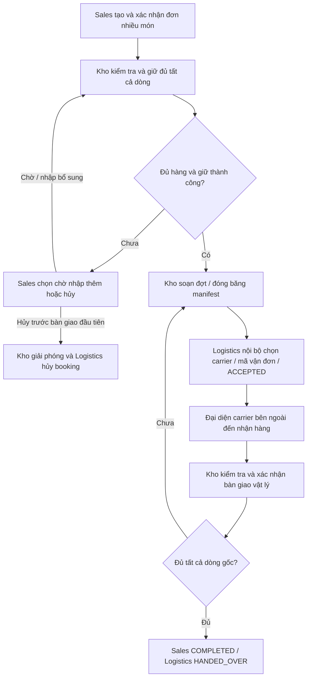

# DX-OS — Quy trình mẫu liên thông Sales, Warehouse và Logistics

**Phạm vi chốt ngày 23/10/2026: kết thúc khi Kho đã bàn giao đủ mọi dòng hàng cho đơn vị vận chuyển bên ngoài.** Logistics là bộ phận nội bộ điều phối việc gửi hàng; không phải đơn vị vận chuyển. Không có bước khách nhận, giao lại, hoàn trả hoặc khiếu nại trên đường trong bản demo này.

Tài liệu mô tả quy trình cần tích hợp. Database/migrations/seed đã có; Business API, worker sự kiện, BPMN thực thi, Hasura permissions và chatbot liên thông chưa được module database tự triển khai.

## 1. Vai trò và bốn database độc lập

| Vai trò | Trách nhiệm | Nguồn dữ liệu chuẩn |
|---|---|---|
| Nhân viên Sales | Lập, xác nhận và theo dõi đơn nhiều mặt hàng; chọn kho và hạn bàn giao | `sales_db.public` |
| Nhân viên Warehouse (Kho) | Nhập, kiểm tồn, giữ hàng, soạn hàng và xác nhận bàn giao vật lý | `warehouse_db.public` |
| Nhân viên Logistics nội bộ | Chọn đơn vị vận chuyển, chuẩn bị mã vận đơn và chấp nhận manifest | `logistics_db.public` |
| Đại diện đơn vị vận chuyển bên ngoài | Đến kho tiếp nhận hàng, cung cấp tên người nhận bàn giao | Không sở hữu một database nghiệp vụ trong demo |
| Quản trị/chủ dữ liệu | Đăng ký nguồn, duyệt phạm vi chia sẻ và cấu hình quy trình/Agent | `dxos_core_db.public` |

Ba database nghiệp vụ và Core nằm cùng PostgreSQL server nhưng độc lập. Liên thông qua API/Hasura và sự kiện theo UUID + `org_id` chung; không có FK/JOIN PostgreSQL nội bộ xuyên database. Ba quy trình dưới đây là ví dụ; doanh nghiệp có thể cấu hình quy trình khác qua Core/Flowable sau khi tích hợp.

## 2. Luồng phối hợp tổng thể



Điểm kết thúc là J: **Đã bàn giao đủ cho đơn vị vận chuyển**. Tạo vận đơn, Logistics ACCEPTED và Kho PREPARED đều chưa chứng minh hàng rời kho. Sales không được hoàn tất chỉ vì một đợt đầu đã giao.

## 3. Quy trình Sales

1. Tạo đơn nháp với khách, nhiều dòng sản phẩm, lượng/đơn vị, giá bán, kho chọn, thông tin in nhãn và hạn bàn giao.
2. Xác minh sản phẩm/đơn vị bằng catalog Warehouse được cấp quyền; xác nhận đơn và đóng băng `input_revision`, các dòng gốc và hạn bàn giao.
3. Đọc availability mới tại Kho rồi gửi lệnh giữ hàng. Kết quả đọc chỉ để tham khảo; lệnh giữ mới quyết định có cấp được hàng trong điều kiện cạnh tranh.
4. Nếu thiếu một mặt hàng, giữ toàn đơn thất bại: chờ nhập bổ sung rồi thử lại hoặc yêu cầu hủy trước lần bàn giao đầu tiên.
5. Khi đã giữ đủ, theo dõi các đợt soạn và bàn giao. Đọc lượng thực bàn giao theo từng dòng gốc; không gộp sản phẩm khác đơn vị thành một tổng lượng.
6. Khi tất cả dòng đủ, chuyển COMPLETED. `completed_at` là mốc bàn giao thật muộn nhất để làm đủ đơn, không phải lúc Sales nhận event.

Trạng thái chính: DRAFT → SUBMITTED → CONFIRMED → RESERVED → FULFILLING → PARTIALLY_HANDED_OVER → COMPLETED; có WAITING_STOCK, CANCEL_PENDING/CANCELLED và EXCEPTION.

## 4. Quy trình Warehouse

- Nhập bổ sung: kiểm nhận theo dòng → POSTED → tăng số dư, ghi movement và outbox trong một transaction. Tồn đầu kỳ cũng có chứng từ.
- Giữ hàng: khóa số dư theo thứ tự ổn định, kiểm tra đủ mọi dòng và đúng revision → giữ toàn bộ hoặc rollback toàn bộ.
- Soạn từng đợt: chọn lượng từ reservation, không vượt phần còn giữ; tạo dispatch PREPARED có manifest version/hash cố định.
- Đợi Logistics chấp nhận đúng manifest và carrier. Không trừ tồn khi mới PREPARED hoặc ACCEPTED.
- Đại diện carrier đến: đối chiếu món/lượng/manifest/carrier; Kho ghi người nhận bàn giao, thời điểm thật, actor xác nhận, event ID và proof document ref nếu có.
- Commit handoff: giảm tồn vật lý, giảm giữ, tăng bộ đếm dispatched, ghi movement/evidence/outbox và kết quả lệnh đúng một lần.

```text
available = on_hand_quantity - reserved_quantity
Giữ q:      reserved += q; on_hand không đổi.
Giải phóng: reserved -= q; on_hand không đổi.
Bàn giao q: reserved -= q; on_hand -= q.
```

Warehouse là nguồn chuẩn của bàn giao vật lý. Có thể chia nhiều dispatch sau khi toàn đơn đã được giữ đủ; MVP mỗi đơn dùng một kho và không hủy toàn đơn sau lần handoff đầu tiên.

## 5. Quy trình Logistics nội bộ

1. Nhận dispatch PREPARED từ Warehouse với manifest version/hash, dòng nguồn và `org_id` đã xác minh.
2. Đọc snapshot nhãn từ Sales theo quyền của đơn được phân công. Chọn carrier bên ngoài, chuẩn bị booking hoặc mã vận đơn.
3. Chấp nhận đúng manifest, trả `acceptance_ref`; trạng thái ACCEPTED chỉ thể hiện sẵn sàng phối hợp gửi hàng.
4. Chờ Warehouse xác nhận đại diện carrier đã nhận thật. Kiểm tra event đúng dispatch/version/hash/carrier và chống xử lý trùng.
5. Ghi projection HANDED_OVER cùng lượng/thời điểm từ Kho; kết thúc shipment. Nếu còn dispatch khác của đơn thì tiếp tục hồ sơ khác tương ứng.

MVP một dispatch tương ứng một shipment; một đơn có thể có nhiều dispatch/shipment. Logistics không tự nhập ngày bàn giao để thay bằng chứng Warehouse và không ghi stock movement. Không có trạng thái IN_TRANSIT/DELIVERED, `delivered_at` hay bằng chứng khách nhận.

## 6. Quyết định, ngoại lệ và bằng chứng

| Tình huống | Xử lý đúng | Bằng chứng / nguồn |
|---|---|---|
| Thiếu một món hoặc hai đơn tranh tồn | Không giữ dở dang; báo thiếu/chờ/thử lại | Balance và kết quả command tại Kho |
| Carrier chưa tới | Giữ PREPARED/ACCEPTED, tồn chưa giảm | Dispatch Kho + booking Logistics |
| Manifest sai, sai carrier hoặc lượng | Chưa handoff; sửa qua hủy/chuẩn bị/chấp nhận lại đúng phiên bản | Hash/version/acceptance và lý do ngoại lệ |
| Timeout booking/lệnh bàn giao | Tra cứu/retry cùng key; không tạo booking hoặc movement trùng | Command receipt, inbox/outbox, source event |
| Handoff commit nhưng mất phản hồi | Đối soát nguồn Kho và replay event | Handoff event + ledger + bằng chứng Kho |
| Hủy trước lần bàn giao đầu tiên | Kho hủy/giải phóng; Logistics đóng booking; chặn lệnh cũ đến muộn | Cancellation fence và receipt/source event |
| Một đợt đã bàn giao nhưng chưa đủ dòng | Hiển thị còn thiếu từng món, chưa COMPLETED | Tổng dispatch HANDED_OVER theo Sales line |
| Hỏi khách đã nhận chưa | Nêu phạm vi dừng tại carrier; chưa có dữ liệu khách nhận | Không suy diễn từ tracking number/status |

Lệnh nghiệp vụ, receipt và outbox commit trong cùng database sở hữu. Worker gọi mạng ngoài transaction; inbox xử lý trùng/gap/retry. Bảng kỹ thuật đã có nhưng worker/locking/state machine phải được triển khai ở service; seed không chứng minh đã chạy hệ thống sự kiện thật.

## 7. Kịch bản dữ liệu mẫu liền mạch

Ảnh chụp mẫu tại **20/10/2026 15:00, UTC+07:00**. Chi tiết nguồn trong `docs/DEMO_DATA.md`.

- SO-2026-0099 đã giữ 3 laptop Dell Latitude 3540 và 5 chuột Logitech B100, chưa xuất.
- SO-2026-0100 cần 10 laptop + 5 chuột. Tồn laptop đầu 8, đang giữ 3 nên chỉ khả dụng 5: lần xin giữ ban đầu thất bại toàn đơn. Phiếu nhập thêm 7 laptop làm đủ hàng, sau đó giữ thành công.
- DSP-2026-0100-1 bàn giao 6 laptop + 5 chuột lúc 18/10/2026 10:00; DSP-2026-0100-2 bàn giao 4 laptop lúc 19/10/2026 09:00. Đơn chỉ hoàn tất sau đợt hai.
- Hạn gốc SO-2026-0100 là 18/10/2026 17:00 → toàn đơn hoàn tất bàn giao trễ **16 giờ**. Một trong hai dispatch trễ → tỷ lệ dispatch trễ 50%; một trong một đơn hoàn tất trễ → tỷ lệ đơn trễ 100%. Phải nói rõ mẫu số/cấp đếm, không gọi là giao khách trễ.
- SO-2026-0101 cần 4 laptop nhưng chỉ còn 2 khả dụng nên chờ hàng. SO-2026-0102 có 12 ram giấy đã PREPARED/ACCEPTED nhưng chưa bàn giao: tồn giấy không giảm. SO-2026-0103 đã hủy trước cấp hàng.

| Sản phẩm | Tổng nhập | Đã bàn giao | Tồn vật lý | Đang giữ | Khả dụng |
|---|---:|---:|---:|---:|---:|
| Dell Latitude 3540 — cái | 15 | 10 | 5 | 3 | 2 |
| Logitech B100 USB — cái | 25 | 5 | 20 | 5 | 15 |
| Double A A4 80 gsm — ram | 50 | 0 | 50 | 12 | 38 |

Đơn hủy loại khỏi mẫu số thực hiện; đơn đang mở quá hạn đếm riêng. Tỷ lệ của tập rỗng trả null. Không cộng cái/ram hoặc đếm lặp dòng khi join nhiều đợt.

## 8. Lợi ích liên thông, chatbot và phạm vi triển khai

| Câu hỏi/demo | Nguồn cần kết hợp | Giá trị thể hiện |
|---|---|---|
| Vì sao đơn 0100 từng thiếu nhưng giờ hoàn tất? | Sales + phiếu nhập, reservation và dispatch Kho | Giải thích chuỗi nguyên nhân có chứng từ |
| Đơn còn món nào chưa bàn giao? | Sales lines + tổng lượng handoff Kho theo dòng | Không kết luận từ một status tổng |
| Đã tạo vận đơn sao tồn giấy chưa giảm? | Logistics ACCEPTED + dispatch Kho PREPARED | Phân biệt kế hoạch và sự kiện vật lý |
| Tồn laptop 5 sao chỉ bán thêm được 2? | Balance + reservation của các đơn | Không bán nhầm phần đã giữ |
| Đợt này giao cho ai, vận đơn nào? | Handoff Kho + booking Logistics | Đúng carrier, người tiếp nhận, lượng và thời điểm |

Sales được đọc catalog/tồn khả dụng nhưng không mặc định đọc giá vốn. Logistics chỉ nhận manifest và PII tối thiểu để in nhãn của đơn được phân công. Chatbot mặc định chỉ đọc theo contract/grant ACTIVE, cung cấp source refs và thời điểm truy vấn; không tự SQL UPDATE tồn và không đoán dữ liệu nguồn lỗi/thiếu quyền.

Core P0 hiện lưu principals/phòng ban, registry, products/contracts, access requests/grants, jobs/audit và command receipts. Agent/Workflow metadata P1/P2 còn là kế hoạch, không nằm trong 12 bảng hiện hành. Core không lưu bản sao hàng nghiệp vụ và không thay database của Flowable/Keycloak. Phần runtime N nguồn và triển khai quyền/Agent thực tế còn cần tích hợp.

Bộ hiện tại có Models, **7 Alembic revision files** và 38 bảng hiện hành. Nghiệp vụ giữ 114 dòng demo; Core sau reset để trống, seed Core tùy chọn gồm 9 dòng draft registry. Dựng đích mới bằng migrations; kiểm tra bằng `status`, `check`, `verify`. Các bước nghiệp vụ và chatbot trên đây là kế hoạch tích hợp, không phải bằng chứng đã có API/BPMN/Hasura chạy hoàn chỉnh.
