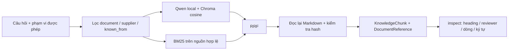

# Báo cáo triển khai RAG local cho FlowBridge

**Nhánh:** `minnhungdev_features`

**Phạm vi:** 6 hồ sơ nhà cung cấp, ingestion Markdown, hybrid retrieval, kiểm tra nguồn, CLI local và endpoint HTTP development cập nhật ngày 16/10/2026.

**Thời điểm thực hiện:** 15/10/2026.

## 1. Kết quả và phạm vi

Đã triển khai package `backend/src/flowbridge/supplier_assistant/knowledge/`, sao chép sáu file `DEMO-S01.md` đến `DEMO-S06.md` vào `examples/rag/supplier_reviews/` và tạo catalog liên kết với supplier/reviewer. Mỗi nhà cung cấp là một file Markdown; không gộp hồ sơ nhiều nhà cung cấp vào một tài liệu.

Đầu ra `search` và HTTP retrieval tương thích `RetrievalResponse` của contract v0.4.1 trong repo. Có lệnh `inspect` để kiểm tra nguồn và người nhận xét. Đã thêm endpoint retrieval development bật riêng, giữ hành vi Core sample khi flag tắt. Không tạo bảng/migration, không kết nối hoặc sửa Supabase, chưa tích hợp caller/ACL thật hoặc TabICLv2/Langflow. Bản triển khai được bàn giao trên nhánh `minnhungdev_features`. Các mục 2–9 ghi lại thiết kế và các lần kiểm tra trước; cập nhật HTTP mới nhất ở mục 10.

## 2. Quan hệ với paper và code tham khảo

Đã dùng paper `ISDS_Paper_ID_3871.pdf` và code nội bộ `ctu-context-search-api` để đối chiếu kiến trúc: Markdown phân cấp, dense retrieval kết hợp BM25, hợp nhất bằng RRF với k=60 và khả năng rerank phía sau. Không chép kho code/paper nội bộ vào repo, không gửi tài liệu đó lên dịch vụ bên ngoài; các module mới được viết theo cấu trúc và license của FlowBridge.

| Thành phần | Cách triển khai trong FlowBridge |
|---|---|
| Phân cấp Markdown | Nhận `#`, `##`, `###`, giữ toàn bộ chuỗi tiêu đề cha trong metadata; bỏ qua dấu `#` nằm trong fenced code block. |
| Chia đoạn | Tối đa 1.000 ký tự, chồng lấn tối đa 100 ký tự trong cùng section; ưu tiên ranh giới dòng. Không nối nội dung hai hồ sơ. |
| Embedding | Qwen3-Embedding-0.6B, 1.024 chiều, chuẩn hóa vector, cosine; instruction dành cho query; thêm supplier/heading/reviewer vào ngữ cảnh embedding của đoạn. |
| Dense | Chroma persistent local, truyền vector tường minh, đặt cosine tường minh. Chroma không tự tải model và không lưu bản canonical của Markdown. |
| Sparse | `rank-bm25`, token Unicode giữ dấu tiếng Việt và mã có gạch nối. Không xóa các từ phủ định như “chưa”, “không”. |
| Hợp nhất | Tối đa 40 ứng viên mỗi kênh, RRF k=60, pool tối đa 20, trả top-k từ 1 đến 20. |
| Rerank | Chuẩn bị interface, mặc định tắt; nếu adapter trả chỉ số lặp/thiếu/sai kiểu hoặc lỗi, giữ thứ tự RRF và thêm cảnh báo. |
| Agent/trả lời | Chưa triển khai sinh câu trả lời bằng LLM; CLI trả đoạn trích để tầng agent tích hợp sau. |

Đây là triển khai vận dụng kiến trúc tham khảo, không phải tái lập toàn bộ thí nghiệm hay kết quả chất lượng của paper. Chưa dùng MCIP/multimedia hoặc listwise LLM reranker. Bộ tách token hiện tại đơn giản hơn tokenizer chuyên biệt tiếng Việt, cần đo trước khi chọn thêm dependency.

Các điểm được gia cố so với cách làm trong code tham khảo: giữ metadata tiêu đề, ID chunk ổn định thay vì phụ thuộc thời điểm chạy, không append BM25 trùng, chuyển thế hệ chỉ mục thay vì để đoạn cũ lẫn đoạn mới, lọc nguồn trước cả hai kênh, kiểm tra checksum khi trả trích dẫn và không biến lỗi model/vector store thành kết quả rỗng thành công.

## 3. RAG trỏ về đâu?

Mỗi chunk trỏ tới **một đoạn trong một phiên bản tài liệu của một nhà cung cấp**. `DocumentReference` có đúng sáu trường trong contract: `document_id`, `document_version`, `chunk_id`, `source_uri`, `checksum`, `supplier_id`. URI `local-document://...#chars=a:b` là URI logic để tra cứu bằng catalog, không phải URL public và không tự fetch đường dẫn do người hỏi cung cấp.

`document_version` chứa SHA-256 toàn file; `checksum` cũng là hash toàn file theo byte gốc. Snapshot giữ thêm hash đoạn, vị trí `[start_char, end_char)`, số dòng, heading path và reviewer. Khi resolve, code đọc lại nguồn hiện có và kiểm tra đoạn trích khớp hash. Vị trí ký tự là Unicode code point theo Python, không phải byte UTF-8 hay UTF-16 offset của trình duyệt.

`chunk_id` là UUIDv5 từ dataset, document ID, version, phiên bản chunker, vị trí và hash đoạn; không chứa timestamp lần index. Hai tài liệu giống nội dung vẫn có ID riêng. Thay nội dung làm đổi version nên mọi chunk của tài liệu đó có ID mới, kể cả đoạn chữ không đổi; đây là lựa chọn để trích dẫn gắn chặt với đúng bản tài liệu.

Reviewer lấy từ catalog nguồn, được giữ nguyên ở metadata; RAG không suy đoán tên người viết. Bộ mẫu dùng người dùng kho có sẵn do script phân công cho báo cáo xuất ra, không khẳng định đây là các nhận xét đã được người đó thực sự tạo trong DB. Department của reviewer không được tự suy ra thành quyền truy cập tài liệu.

## 4. Dữ liệu và thời điểm dự đoán A/B

Các file được sao chép nguyên nội dung và hash từ bộ xuất `supplier_reviews_from_script_20261015`, dựa trên seed 20261015 và mốc nghiệp vụ 15/10/2026 18:00 UTC+07. `source_provenance.json` và `seed_validation.json` lưu căn cứ tái tạo. Bộ nguồn có 6 supplier, 1.000 PR, 998 PO; 948 PO hoàn tất gồm 492 trễ và 456 đúng hạn; 50 PO còn mở. Không biến PO mở thành nhãn “đúng hạn”.

Markdown chỉ nêu điều được dữ liệu hỗ trợ: tiếp nhận hàng, xác nhận PO và cập nhật ngày hứa giao. Không tự thêm tỷ lệ lỗi sản phẩm, biên bản khiếu nại hay kết quả khắc phục vốn không có trong seed.

`report_asof` là mốc tổng hợp nghiệp vụ; `known_from` là thời điểm tài liệu có sẵn. Catalog mẫu dùng thời điểm export được manifest ghi nhận: **2026-10-15T16:09:51.385505Z**. Vì vậy các file tổng kết này không hợp lệ làm ngữ cảnh cho dự đoán PR/PO diễn ra trước mốc đó. `--as-of` loại tài liệu có `known_from` sau thời điểm dự đoán. Khi tích hợp thật, backend phải truyền A/B tương ứng từ nghiệp vụ; dùng timestamp xuất bản/ingest có bằng chứng, không suy ra từ ngày sự kiện được nhắc trong văn bản.

Chỉ mục hiện chỉ tra cứu **phiên bản đang hoạt động**. Chưa lưu kho version lịch sử để tái dựng đầy đủ kiến thức tại mọi A/B trong quá khứ; cần versioned document store và ACL tại thời điểm truy vấn trước khi tuyên bố hỗ trợ backtest lịch sử.

## 5. Chỉ mục và phạm vi truy cập

Mỗi lần build tạo fingerprint từ catalog, nội dung, chunker/tokenizer và cấu hình embedding; vector được ghi vào collection riêng của thế hệ đó. Chỉ sau khi đủ ID và kiểm tra lại nguồn, code mới đổi `active.json` bằng thao tác replace. Chạy lại cùng dữ liệu không tính embedding lại. Có khóa single-writer; thư mục `.cache/` và model cache không được đưa vào Git.

Nguồn gỡ hoặc thay binding/hash bị loại khi truy vấn ngay cả trước lần index tiếp theo. Chỉ mục cũ còn tại máy để truy vết, không tham gia truy vấn hiện tại. Chưa có tác vụ thu gom thế hệ cũ hay đồng bộ nhiều worker.

`RetrievalScope` yêu cầu allowlist document ID. Bộ lọc allowlist/supplier/thời gian được áp dụng trước truy vấn dense và trước tạo corpus BM25; kết quả còn được đối chiếu lại với tập hợp được phép. Tuy nhiên CLI chỉ là người vận hành tin cậy trên máy: **chưa có xác thực JWT, tenant isolation, truy vấn ACL của Core hoặc endpoint public**. Không đưa `local_operator_scope` vào web handler để thay kiểm tra quyền thật.

## 6. Phiên bản và cách tái chạy

Thêm nhóm dependency tùy chọn `rag` và cập nhật `uv.lock`: `chromadb==1.5.9`, `sentence-transformers==6.1.0`, `rank-bm25==0.2.2`. Đối chiếu lockfile với HEAD cho thấy không đổi phiên bản package đã có; thêm 92 package mới vào graph đa nền tảng. Qwen pin revision `97b0c614be4d77ee51c0cef4e5f07c00f9eb65b3`; profile bao gồm kích thước, cosine, chuẩn hóa, CPU FP32, giới hạn 2.048 token và phiên bản ngữ cảnh/instruction. Query khác profile bị từ chối và yêu cầu index lại. Cấu hình BF16 mặc định chạy chậm trên CPU máy thử, nên lượt đó đã được dừng và bản cuối nạp FP32 tường minh; không lấy thời gian của lượt bị dừng làm kết quả benchmark.

Hướng dẫn từng lệnh: [examples/rag/README.md](../examples/rag/README.md). Dùng `uv sync --locked --extra rag --group dev`, sau đó `python -m flowbridge.supplier_assistant.knowledge index --allow-download`, `search` và `inspect` trong môi trường uv. Lần đầu cần tải model công khai; các lần sau dùng cache local. Không có lời gọi LLM cloud; Chroma tắt anonymized telemetry trong client.

Nguồn công khai đối chiếu dependency/cấu hình: [Qwen model card](https://huggingface.co/Qwen/Qwen3-Embedding-0.6B), [Chroma collection configuration](https://docs.trychroma.com/docs/collections/configure), [Chroma metadata filtering](https://docs.trychroma.com/docs/querying-collections/metadata-filtering), [Sentence Transformers](https://pypi.org/project/sentence-transformers/), [rank-bm25](https://pypi.org/project/rank-bm25/).

## 7. Kết quả kiểm thử

Kết quả tổng hợp được cập nhật sau lần chạy cuối; bằng chứng máy có thể xem trong `examples/rag/smoke_results.json`. Unit test dùng fake embedder và test persistence Chroma dùng vector nhỏ cố định; các test đó kiểm tra logic, không đo độ chính xác mô hình.

| Kiểm tra | Kết quả |
|---|---|
| Ruff trên toàn bộ `backend/src` và `tests` | Qua. |
| Unit + integration RAG | 52 passed: 22 kiểm thử CLI/index/Chroma và 30 kiểm thử HTTP. Không cần tải model cho bộ test tự động này. |
| Toàn bộ suite repo | 144 passed, 1 failed: lỗi checksum contract có sẵn bên dưới. |
| `uv lock --check` | Qua; lockfile đồng bộ manifest. |
| `uv build --no-sources` | Build được wheel và sdist; xác nhận wheel có 12 module RAG, sdist có đủ 6 Markdown và báo cáo. |

Test `tests/sample/test_contract_coverage.py::test_contract_snapshot_matches_provenance_checksum` mong SHA-256 `3cd8cd7e97f5e018aeadaca55952c07d9d1d93d2e40797cb2641298ee0d376f2`, trong khi `backend/src/flowbridge/contracts/opencore-api.yaml` thực tế có hash `14d911a3a0b4967b5e507a8cff77b5128275d3bebd8b95525361449067a4c4ec`. Đã so với blob **HEAD trước thay đổi RAG**: hash blob cũng là `14d911...`, bytes trùng file hiện tại và không có CRLF. Vì vậy đây là sai lệch baseline/provenance có sẵn, không phải thay đổi contract hay lỗi xuống dòng do RAG. Giữ nguyên contract/test, cần nhóm kiểm tra lại bản gốc trước khi sửa checksum kỳ vọng; không đổi assertion chỉ để test xanh.

### Chạy Qwen thật trên bộ sáu hồ sơ

Bằng chứng: [smoke_results.json](../examples/rag/smoke_results.json), [cli_smoke_results.json](../examples/rag/cli_smoke_results.json).

- Máy chạy: Windows 11, Python 3.12.14, Intel Core i5-12450H, CPU FP32 với `OMP_NUM_THREADS=4`; không dùng GPU hoặc Ollama.
- Index tạo **96 chunk cho 6 tài liệu**, mất **142,128 giây**, tính từ build đến kích hoạt và không tính thời gian tải model công khai. File trọng số model khoảng 1,19 GB; đây không phải số đo toàn bộ dung lượng cache hoặc RAM đỉnh.
- Index lại cùng dữ liệu mất **0,074 giây**, giữ nguyên version `f3d7a18e4afdd78c2c3018abb8b5438e6eeac43b00bbc1ee8eb777b8a0e017ea` và vẫn 96 vector; không tính embedding lại.
- Sáu câu hỏi về mã PO cụ thể, mỗi câu giới hạn đúng nhà cung cấp, đều đưa mục chứa PO đó lên hạng 1. Hai câu hỏi về thiếu dữ liệu tỷ lệ lỗi và thiếu kết quả xử lý khiếu nại cũng đưa mục giới hạn dữ liệu tương ứng lên hạng 1.
- Cả **8/8 câu hỏi** khớp mục dự kiến ở hạng 1; response đều qua JSON Schema, đúng supplier, đúng reviewer và resolve được đoạn nguyên văn. Đây là kiểm tra nhanh có mục tiêu trên dữ liệu mẫu, **không phải kết luận accuracy/recall tổng quát**. Chưa có bộ nhãn độc lập hoặc so sánh ablation các kênh.
- Thời gian 8 truy vấn trong cùng tiến trình sau khi model đã nạp: **0,73–0,84 giây/câu**, bao gồm kiểm tra nguồn và trả DTO. Lượt kiểm tra riêng từ lúc nạp model đến có một vector query mất **14,76 giây**. CLI mới khởi chạy phải nạp lại model; không lấy thời gian warm query để cam kết latency cho từng lần gọi CLI hay VPS.
- Truy vấn tại mốc 15/10/2026 18:00 UTC+07 trước khi tài liệu được export trả rỗng; allowlist rỗng cũng trả rỗng. Những trường hợp này khác lỗi model/vector store, vốn trả lỗi rõ ràng.
- Đã chạy riêng các lệnh CLI `index`, `search`, `inspect`: exit code 0, index/search đúng DTO; inspect của kết quả đầu trỏ đúng PO `DEMO-PO-00212` và reviewer `demo-warehouse-0`. Lượt CLI search mới khởi động đo được **12,042 giây**, gồm nạp model.

Bộ hồ sơ và câu hỏi nhỏ chỉ xác nhận đường đi dữ liệu và một số trường hợp truy hồi có chủ đích. Tìm kiếm dense vẫn có thể trả đoạn gần nhất cho câu hỏi không liên quan; chưa có ngưỡng từ chối dựa trên bộ validation. Khi xây tầng trả lời cần kiểm tra căn cứ và thể hiện thiếu dữ liệu, không tự diễn giải điểm RRF thành độ tin cậy.

## 8. Những việc còn lại trước khi nối hệ thống thật

1. Adapter document store PostgreSQL/Core: đọc đúng nội dung, version, checksum và thời điểm công bố; thay local IDs/URI bằng reference của nguồn thật. Không thêm lại bảng `supplier_document` làm nguồn canonical thứ hai.
2. Adapter IAM/ACL: backend lấy quyền từ danh tính đã xác thực, truyền allowlist đáng tin cậy; kiểm tra quyền lại lúc mở trích dẫn. Không nhận trực tiếp allowlist tự khai từ client.
3. Nối endpoint contract và Langflow; đoạn nguồn là dữ liệu không đáng tin cậy, không được biến câu lệnh trong tài liệu thành chỉ dẫn thực thi cho agent.
4. Tạo bộ câu hỏi có nhãn relevance, phủ ít nhất giao hàng/chất lượng/phản hồi/PO cụ thể/thiếu dữ liệu/nhầm supplier. Đo Recall@k, MRR/nDCG, nguồn đúng, latency và RAM; so sánh dense/BM25/hybrid trước khi cân nhắc reranker.
5. Thử tài liệu dài, bảng dài và heading cấp sâu nếu kho thật có; parser hiện chủ đích hỗ trợ ba cấp heading như bộ mẫu, không phải parser Markdown đầy đủ. Đo chunk size/tokenization tiếng Việt bằng bộ câu hỏi thật.
6. Version lịch sử, thu gom index cũ và triển khai worker nếu cần cập nhật đồng thời. Chưa có mã production cho các phần này.

Không dùng `relevance_score` làm xác suất câu trả lời đúng hoặc xác suất giao trễ. RAG cung cấp bằng chứng văn bản; dự đoán TabICLv2 và truy vấn số liệu nghiệp vụ vẫn là các công cụ riêng.

## 9. Đối chiếu main và khả năng tích hợp — 16/10/2026

### Trạng thái Git

Đã chạy `git fetch origin main` và `git merge --ff-only origin/main` trên nhánh `minnhungdev_features`. Kết quả: **Already up to date**. HEAD và origin/main cùng commit `a94ad4744f18c3a249780d4c52cfe4eba40727bc` (merge PR #2: FlowBridge API backend). Không có commit mới trên main để đưa vào; toàn bộ thay đổi RAG local được giữ nguyên. Không tạo commit hoặc push trong bước kiểm tra này.

### Kết quả kiểm tra tích hợp

Đã tạo FastAPI app với cấu hình test/sample và gọi HTTP trong tiến trình bằng TestClient; không mở server, không gọi Supabase/PostgreSQL hoặc dịch vụ ngoài. Bằng chứng máy nằm tại `.cache/rag/main-integration-check.json`.

| Điểm nối | Quan sát thực tế | Kết luận |
|---|---|---|
| `GET /_ops/live` | HTTP 200. | Khung FastAPI hoạt động. |
| `GET /api/v1/core/identity/me` | HTTP 200, principal `USER-SAMPLE`, role `sample_user`. | Là danh tính fixture; chưa thể suy ra quyền đọc hồ sơ thật. |
| `GET /api/v1/core/files` và download file mẫu | HTTP 200; download trả `sample.txt`, nội dung fixture tổng hợp. | Có giao diện Files để làm adapter sau, chưa đọc được sáu hồ sơ Markdown hoặc kho PostgreSQL thật. |
| `POST /internal/v1/tools/retrieve-knowledge` | HTTP 404. Request tra cứu và response thật từ CLI đều qua JSON Schema `RetrievalRequest`/`RetrievalResponse` hiện tại. | Có thể tái sử dụng service và DTO để xây router HTTP; chưa có route được mount. |
| `POST /internal/v1/tools/index-knowledge` | HTTP 404. | Mới có contract. Cần handler xử lý danh sách source references, không gắn thẳng lệnh CLI index toàn catalog vào request. |
| Langflow/worker | Chưa có mã tích hợp Langflow trong source hiện tại. | Cần nối caller vào AI Tools sau khi route HTTP có thể gọi được. |

Các điểm nguồn đã đối chiếu: `main.py:105` khởi tạo các SampleAdapter và mount Core routers khi sample mode bật; `files/service.py:36` upload chỉ dựng response `FILE-UPLOADED`, không lưu bytes; `files/adapter.py:29` download lấy bytes fixture. Hai đường dẫn RAG và yêu cầu caller nằm trong `contracts/ai-tools-api.yaml`; package knowledge chưa có router HTTP.

### Phần nối được tiếp theo

1. **HTTP retrieval trên môi trường development:** thêm router gọi `Retriever.search`; DTO hiện đã khớp contract. Quản lý embedder và Chroma theo vòng đời app để tái sử dụng model giữa các request, xử lý công việc CPU ngoài event loop và giới hạn concurrency. Giữ nguyên các API sample hiện tại; phân biệt rõ truy xuất RAG thật trên dữ liệu fixture với các response API mẫu.
2. **Caller, quyền và thời điểm:** contract yêu cầu `ServiceAuth` kèm `UserContext` hoặc `JobContext`, role AI_SERVICE và `Idempotency-Key`. Cần tầng receiver xác minh ngữ cảnh, ánh xạ quyền server sang `RetrievalScope.allowed_document_ids` và xác định mốc A/B từ nghiệp vụ. Không lấy `local_operator_scope` hoặc allowlist tự khai từ client làm quyền truy cập HTTP. `RetrievalRequest` hiện không có trường as_of, nên bước nối phải lấy mốc thời gian đáng tin cậy từ context/job hoặc đề xuất thay đổi contract có chủ đích.
3. **Nguồn và index:** triển khai adapter document store PostgreSQL/Core có nội dung/version/checksum, binding supplier/reviewer và thời điểm công bố. File DTO Core hiện có `id`, `sha256`, `created_at`, `scan_status`, `metadata`; chưa có ngữ nghĩa version/caller ACL/known_from của kho Markdown thật. Cần map và kiểm chứng các thông tin đó, thay UUID/URI fixture bằng reference của kho nguồn. Chỉ sau bước này mới nối endpoint index xử lý đúng từng reference trong request, quyền index và idempotency theo contract. Không thêm lại bảng supplier_document.
4. **Langflow:** sau HTTP retrieval, cấu hình tool gọi endpoint và chuyển `chunks[].reference` vào câu trả lời/căn cứ proposal. Truy vấn dữ liệu có cấu trúc và dự đoán TabICLv2 vẫn là hai công cụ riêng.

Kết luận của lần kiểm tra: **nối được về interface/service của RAG và FastAPI; hiện chưa có đường tích hợp dữ liệu/phân quyền thật để chỉ bật là dùng production**. Lần này cập nhật Git và báo cáo kiểm tra, chưa thêm endpoint HTTP hoặc sửa nghiệp vụ ứng dụng.

## 10. Endpoint retrieval development đã triển khai — 16/10/2026

### Thay đổi

Đã thêm **POST /internal/v1/tools/retrieve-knowledge** trong `knowledge/router.py`, gọi service RAG thật qua `knowledge/development.py`. Bật bằng `FLOWBRIDGE_RAG_DEV_ENABLED=true`, mặc định tắt. `Settings` từ chối production, host ngoài loopback và DSN không trống cho chế độ này. Request từ peer ngoài loopback bị từ chối, không dựa vào X-Forwarded-For do caller gửi.

HTTP nhận `query`, tùy chọn `supplier_id`, `top_k` từ 1 đến 20, kèm header `Idempotency-Key` bắt buộc dài 1–128 ký tự. Supplier có thể bỏ qua khi không lọc; explicit null bị từ chối theo schema UUID của contract. Body không nhận đường dẫn file, role, owner, allowlist hoặc as_of. Kết quả là `RetrievalResponse` hiện có; thêm notice development vào warnings và header `X-FlowBridge-RAG-Mode`. Không gọi LLM sinh câu trả lời.

Một `Retriever` và embedder được giữ theo lifespan app; model nạp lười ở lần query đầu và được dùng lại. Toàn bộ tìm kiếm chạy trong worker thread, khóa nằm trong worker đến khi xử lý xong, tránh nạp model song song và tránh chặn event loop. Request chồng lên nhận 429/Retry-After: 1. Shutdown chờ worker xong rồi bỏ tham chiếu retriever/model. Model không được tự tải và index không được tự xây bởi HTTP.

Scope của chế độ development là catalog fixture do người vận hành cấu hình ở server, không phải quyền người dùng production. OpenAPI khai báo security rỗng cho pilot và giữ yêu cầu ServiceAuth + UserContext/JobContext của contract như metadata production để tích hợp sau. Chưa triển khai JWT/role/ACL thật hoặc replay idempotency bền vững. Không mount endpoint index-knowledge.

Sau khi gộp với main đã bỏ API sample, RAG development chạy riêng khi database không được cấu hình. Swagger lấy route RAG trực tiếp từ FastAPI; không còn nhánh ghép Core sample. Khi tắt RAG và cấu hình database, 46 API app/AI cùng OpenAPI có xác thực được giữ nguyên. Backend thông thường không nạp Torch/Chroma hoặc model.

### Kiểm chứng

Các kết quả dưới đây ghi nhận bản trước khi gộp main, khi Core sample còn tồn tại; kết quả kiểm tra bản gộp được ghi trong docs/CHECKPOINT.md.

- **30 test HTTP mới qua**, kiểm tra flag tắt, cấu hình bị cấm, scope server, UUID/null và trường thừa, Idempotency-Key, JSON lỗi, peer từ xa, supplier không tồn tại, lỗi 503/500 có che chi tiết, correlation ID, model/retriever tái sử dụng, cleanup, 429 và event loop còn phục vụ liveness.
- Toàn bộ repo: **144 passed, 1 failed**. Failure duy nhất vẫn là checksum contract baseline được mô tả ở mục 7; không sửa contract/assertion ngoài phạm vi.
- Ruff trên toàn backend/tests và uv lock --check: qua. Không thêm dependency cho HTTP; dùng FastAPI/Starlette đã có.
- Đã chạy server Uvicorn localhost tạm, dùng HTTP thật và Qwen/Chroma thật trên sáu Markdown. Swagger, Core Files sample và route RAG cùng hoạt động. Hai request trả 200, đúng DTO, đúng supplier và đúng PO trễ 26 ngày. Request thiếu Idempotency-Key trả 422. Server QA đã dừng sau kiểm tra.
- Request đầu đo được **27,377 giây**, gồm nạp model; request thứ hai cùng tiến trình **0,661 giây**. Đây là số đo thử trên máy local, không phải cam kết latency môi trường khác.
- Bằng chứng chia sẻ trong repo: `examples/rag/http_smoke_results.json`. Response đầy đủ và log server thử nằm ở `.cache/rag/`, được Git ignore.

### Cách dùng và giới hạn còn lại

Xem [hướng dẫn API/Postman/PowerShell](../examples/rag/README.md#7-api-http-development--gọi-từ-postman-hoặc-powershell). Khởi chạy từ root repo với flag RAG và docs bật, DSN trống; mặc định model/index lấy từ cache đã chuẩn bị bằng CLI. Để trống cả FLOWBRIDGE_DATABASE_URL và FLOWBRIDGE_DATABASE_PASSWORD; không còn cờ Core sample. Các path fixture/cache có setting riêng trong .env.example.

Phần còn lại trước tích hợp thật: adapter kho Markdown PostgreSQL, danh tính/caller/ACL và mốc A/B đáng tin cậy, endpoint index theo source references và idempotency bền vững, sau đó cấu hình tool Langflow. Code hiện tại là endpoint development có kết quả RAG thật trên dữ liệu fixture; không phải backend phân quyền production hoàn chỉnh. Phiên bản endpoint development được bàn giao trên nhánh `minnhungdev_features`.
