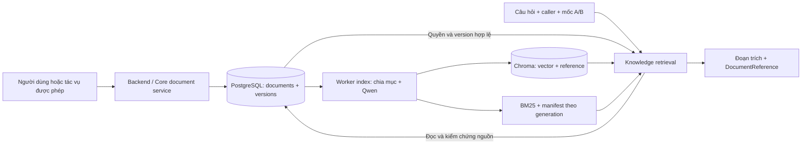

> Lưu trữ đề xuất cũ. Thiết kế hiện hành đã chuyển sang [PostgreSQL và pgvector](rag-postgres-pgvector-design.md) với ba bảng Core; không dùng phần Chroma dưới đây cho triển khai mới.

# Thiết kế nối RAG với PostgreSQL và Chroma — FlowBridge

Ngày thiết kế: 16/10/2026. Đây là **đề xuất triển khai tiếp theo**, chưa phải migration đã chạy hoặc tính năng PostgreSQL đã có trong backend.

## 1. Kết quả đối chiếu script thực tế

Đã đọc tĩnh `script.py` bằng AST, không chạy installer hoặc kết nối database. Bản đối chiếu có SHA-256 `8f006286a0c6bcfa73044352b8a2197d62d3382cc737a0bc8ef248fff23a8577`, trùng script đã dùng xuất sáu Markdown.

- `TABLES` có **27 bảng nghiệp vụ**.
- Không có bảng document/file/knowledge/chunk hoặc cột Markdown trong schema này.
- Header `SCHEMA_SQL` ghi rõ không tạo kho Markdown mới.
- `risk_analysis_reports.report_data` và `analysis_supplier_candidates.evidence_refs` chỉ lưu tham chiếu tới kho Markdown được giả định tồn tại bên ngoài.
- `outbox_events`, `users`, `roles`, `user_roles`, `departments`, `analysis_tasks.feature_asof` đã có và có thể tái sử dụng đúng trách nhiệm.
- Repo hiện chưa có SQLAlchemy models/Alembic migrations cho kho tài liệu thật. RAG đang đọc file local; endpoint HTTP vừa triển khai là chế độ development với DSN trống.

Kết luận: **script tạo database nghiệp vụ, không tạo nguồn Markdown cho RAG**. PostgreSQL có thể lưu Markdown trong cột TEXT, nhưng cần thiết kế bảng hoặc tích hợp một document store thực tế. Chưa có bằng chứng về một kho ngoài script đã được cài trên server; thiết kế dưới đây lấy script này làm nền như yêu cầu.

## 2. Quyết định kiến trúc

Giữ nguyên 27 bảng nghiệp vụ. Đề xuất bổ sung một kho tài liệu dùng chung của Core gồm **hai bảng `core.documents` và `core.document_versions`**, trong cùng PostgreSQL. Nếu áp dụng thì có 27 bảng nghiệp vụ + 2 bảng Core mới; không sửa ngầm baseline `script.py`.

Đây là kho canonical duy nhất cho nội dung Markdown và lịch sử phiên bản. Không thêm lại `supplier_document`, không đồng thời lưu một bản canonical trong bảng nghiệp vụ khác. Kho này dùng được cho nhiều loại tài liệu; `supplier_review` là một loại, liên kết với supplier qua subject/binding do ứng dụng kiểm chứng. Không chỉ đổi tên một bảng supplier-specific rồi giữ hai bản nội dung.

Chroma giữ vector và khóa trỏ về phiên bản nguồn. Manifest/BM25 là dữ liệu dẫn xuất có thể xây lại. Không cần Redis, Kafka hoặc một server PostgreSQL thứ hai cho giai đoạn đầu.

## 3. Hai bảng nguồn được đề xuất

Tên/cột là thiết kế mới, chưa tồn tại trong script. `core` là schema PostgreSQL của dịch vụ tài liệu; 27 bảng ứng dụng vẫn ở `public`.

### 3.1. `core.documents` — danh tính và phạm vi tài liệu

| Thuộc tính | Mục đích |
|---|---|
| `document_id UUID PK` | ID ổn định của tài liệu qua nhiều phiên bản. |
| `document_kind TEXT` | Ví dụ `supplier_review`; hỗ trợ loại tài liệu khác của Core. |
| `subject_type TEXT`, `subject_id TEXT` | Đối tượng được đánh giá. Với bộ này là `supplier` và supplier_id của bảng `public.suppliers`. Binding phải được backend kiểm tra. |
| `title TEXT` | Tiêu đề để liệt kê hồ sơ; tiêu đề dùng khi trích dẫn được chụp ở version. |
| `scope_type TEXT` | `global` hoặc `department`; quyền hiển thị được cấu hình tường minh. |
| `department_id UUID NULL` | Chỉ có khi scope là department; không tự lấy phòng ban reviewer làm ACL. |
| `owner_subject TEXT` | Định danh chủ sở hữu từ Identity; không lấy owner client tự khai. |
| `created_at TIMESTAMPTZ`, `deleted_at TIMESTAMPTZ NULL` | Thời điểm tạo và gỡ hồ sơ. |

Ràng buộc: một logical document `supplier_review` đang hoạt động cho mỗi supplier; unique `(document_kind, subject_type, subject_id)` chỉ áp dụng khi `deleted_at IS NULL AND document_kind = 'supplier_review'`. Các loại tài liệu khác không bị giới hạn một tài liệu cho mỗi subject. Scope global không có department; scope department phải có department.

Core không hardcode FK tới bảng supplier của một ứng dụng. Adapter Supplier Assistant kiểm tra subject_id thực sự tồn tại, supplier thuộc phạm vi được phép, reviewer ánh xạ đúng `users`. Nếu đội chọn gộp Core với riêng ứng dụng thay vì giữ tính tổng quát, cần quyết định ràng buộc FK riêng trong migration; không mô tả JSON metadata như thể có FK database tự bảo vệ.

### 3.2. `core.document_versions` — nội dung và metadata tại từng phiên bản

| Thuộc tính | Mục đích |
|---|---|
| `version_id UUID PK` | Khóa phiên bản nguồn; không tái sử dụng. |
| `document_id UUID FK` | Trỏ tới tài liệu logic. |
| `version_no INTEGER` | Tăng dần trong từng document; unique `(document_id, version_no)`. |
| `title_snapshot TEXT` | Tiêu đề đúng thời điểm xuất bản. |
| `content_md TEXT` | Nội dung Markdown canonical. |
| `checksum_sha256 CHAR(64)` | SHA-256 của UTF-8 canonical, đối chiếu khi trích nguồn. |
| `status TEXT` | `draft`, `published`, `withdrawn`. |
| `metadata JSONB` | Metadata theo loại tài liệu, được service kiểm tra. |
| `created_by_subject TEXT`, `created_at TIMESTAMPTZ` | Actor tạo/import version và thời điểm hệ thống ghi nhận. |
| `published_at TIMESTAMPTZ NULL`, `known_from TIMESTAMPTZ NULL` | Thời điểm xuất bản và thời điểm tri thức thực sự được ghi nhận là có sẵn. Draft không được retrieval sử dụng. |

Với `supplier_review`, metadata cần tối thiểu `supplier_id`, `reviewer_user_id`, `reviewer_name_snapshot`, `report_asof`, `reviewer_attribution`. Supplier phải khớp subject của document; reviewer phải hợp lệ trong `users`. Người import, service sinh báo cáo và người nhận xét là các vai trò khác nhau, không gán lẫn cho nhau.

Sáu hồ sơ mẫu có reviewer **được script phân công**. Giữ attribution này khi import; không biến thành chứng nhận người đó đã viết hoặc duyệt nhận xét thật.

Sau khi published, nội dung, checksum và metadata mô tả nhận xét của version là bất biến qua source API. Sửa lỗi tạo version mới; việc thu hồi được ghi nhận, không ghi đè nội dung cũ. Migration/DB role phải bảo vệ quy tắc này, không chỉ dựa vào một CHECK về giá trị status.

Quy ước UTF-8 và xuống dòng được xác định lúc ghi nguồn. Không tự đổi CRLF/LF khi resolve vì sẽ làm sai checksum/offset. Bản import phải đọc lại từ PostgreSQL để kiểm chứng hash.

## 4. Chroma và BM25 lưu gì?

Một point là một chunk của **một phiên bản** tài liệu, không phải cả một nhà cung cấp. Sáu file hiện tại tạo 96 chunk; số này sẽ thay đổi khi nội dung/version thay đổi.

Metadata point tối thiểu: `document_id`, `document_version`, `version_key`, `supplier_id`, `source_checksum`, `index_generation`, `embedding_profile`. `version_key` phân biệt các bản của cùng tài liệu. Heading ancestry, reviewer snapshot, source span và hash đoạn nằm trong manifest dẫn xuất gắn generation. BM25 lưu token dẫn xuất cùng generation, không phải một database nguồn mới.

Public `DocumentReference` vẫn giữ sáu trường: document_id, document_version, chunk_id, source_uri, checksum, supplier_id. URI phải do document service tạo và resolve, không fetch URL tùy ý từ người hỏi. Source document/version ID dùng ID thật do kho cấp; ID fixture không được tự nhận là Core ID thật.

Giữ Qwen revision/profile và cosine hiện tại. Thay model, kích thước vector, instruction hoặc cách chunk phải tạo generation phù hợp; không trộn embedding khác profile vào một chỉ mục đang query.

Chroma hỗ trợ lọc metadata bằng `where`/`$in`; backend sẽ truyền tập version được phép trước dense search. Đây là công cụ lọc, quyền đọc vẫn do source/backend quyết định. [Tài liệu Chroma](https://docs.trychroma.com/docs/querying-collections/metadata-filtering).

## 5. Luồng ghi và lập chỉ mục

1. Backend xác thực actor, kiểm role/grant đang hoạt động và binding supplier/reviewer. Client không tự chọn owner/ACL qua metadata.
2. Trong **một transaction PostgreSQL**, ghi document/version published và một outbox event, ví dụ `knowledge.document_published`. `aggregate_id` là document_id; payload chứa version_id và checksum. Draft không được lên index.
3. Giai đoạn đầu dùng một worker, có thể chạy cùng backend và dùng chung model/mutex để tránh nạp hai bản Qwen vào RAM. Chỉ xử lý event type của knowledge; không lấy nhầm các event PO/proposal/email.
4. Worker đọc phiên bản bất biến, chia `#`/`##`/`###`, embedding và xây Chroma + BM25 + manifest của generation mới. Không giữ transaction SQL mở suốt quá trình embedding.
5. Kiểm đủ point và kiểm nguồn lại, sau đó chuyển active generation. Cách generation hiện tại có thể tái sử dụng; với bộ nhỏ, build toàn corpus trước, chưa cần incremental index phức tạp.
6. Ghi nhận hoàn thành đúng các event/version đã được xử lý. Crash trước bước xác nhận khiến event được thử lại; stable IDs và generation fingerprint làm lần thử lại không nhân đôi point.

`outbox_events` hiện chỉ có pending/published/failed, chưa có lease hoặc trạng thái consumer index. V1 chủ đích một worker và cơ chế at-least-once; không tuyên bố claim nhiều worker an toàn chỉ nhờ bảng này. Nếu outbox đã được publisher khác gửi vào message bus, cần consumer checkpoint/index job riêng; `published_at` của broker không đồng nghĩa Chroma đã index xong. Không dùng `analysis_tasks` làm index queue vì CHECK hiện chỉ cho ba loại tác vụ phân tích PR/PO.

Khi sửa/gỡ/thu hồi quyền, receiver kiểm nguồn thật nên phải chặn phiên bản không còn hợp lệ ngay cả khi index chưa cập nhật. Có thể tạm thiếu kết quả cho tài liệu vừa thay mới; không âm thầm trình bày version cũ như bản hiện hành. Worker thất bại giữ generation trước, báo rõ trạng thái chưa cập nhật và có thể retry.

Việc sửa nhiều file/văn bản cùng lúc có thể gom thành một lần index. Chưa cần thêm một tầng broker cho bộ dữ liệu nhỏ. Transaction đảm bảo nội dung nguồn và sự kiện được ghi cùng nhau; Chroma là cập nhật bất đồng bộ, không nằm trong transaction PostgreSQL. [PostgreSQL transactions](https://www.postgresql.org/docs/current/tutorial-transactions.html).

## 6. Luồng truy vấn và phân quyền

1. Receiver lấy ServiceAuth và UserContext/JobContext được xác minh. Tra `users`, `roles`, `user_roles`, trạng thái và scope hiện hành; không dùng service token để tự cấp toàn bộ tài liệu cho người hỏi.
2. Với mốc T, PostgreSQL chọn version published được biết tại T cho từng document, cùng quyền hiện tại và bộ lọc supplier. Chỉ version keys được phép mới vào cả dense và BM25.
3. Qwen embedding query → Chroma và BM25 → RRF. Reranker tiếp tục tắt trong giai đoạn đầu.
4. Đọc lại nội dung đúng version và kiểm quyền/trạng thái trước khi trả; đối chiếu checksum toàn nguồn, span và hash đoạn.
5. Trả `RetrievalResponse`. Khi lưu báo cáo phân tích, đưa DocumentReference vào `risk_analysis_reports.report_data.document_refs` hoặc `analysis_supplier_candidates.evidence_refs` đã có. Không nhân bản cả nội dung nguồn vào các bảng đó.

Nội dung Markdown được xem là dữ liệu nguồn, không phải chỉ dẫn thực thi cho agent. Khi nối LLM, phải giữ ranh giới này và giữ citation của các kết luận.

RLS là một lớp bảo vệ database, không thay receiver policy. Role có đặc quyền hoặc table owner có thể bỏ qua RLS; cần chọn DB role và kiểm soát truy cập phù hợp. [PostgreSQL row security](https://www.postgresql.org/docs/current/ddl-rowsecurity.html).

### Ranh giới async/CPU khi nối code

Engine/session hiện tại là SQLAlchemy async. Không gọi engine này bằng `asyncio.run` từ thread tìm kiếm. V1 nhỏ có thể đọc một authorized snapshot gồm metadata/nội dung của các version được phép bằng async session, đưa snapshot bất biến vào worker RAG dùng chung embedder/vector store, rồi recheck quyền/source trong async receiver trước khi trả. Tách phần SQL khỏi CPU worker; khi corpus lớn hơn có thể chuyển sang rank refs rồi batch resolve.

Không bỏ guard DSN trống của `rag_dev_enabled` để giả thành production. Giữ chế độ fixture hiện có; thêm receiver/source mode PostgreSQL được cấu hình và kiểm chứng riêng sau khi adapter quyền/dữ liệu hoạt động.

## 7. Thời điểm A/B và lịch sử

T lấy từ `analysis_tasks.feature_asof`/ngữ cảnh nghiệp vụ đã xác minh, không lấy tùy ý từ body hiện tại. `report_asof` mô tả báo cáo tổng hợp đến khi nào; `known_from` mới là mốc tài liệu được biết. Không lùi known_from về ngày PO hay ngày in trên báo cáo. Giữ timestamp có timezone.

Ví dụ: version 1 có sẵn 08:00, version 2 có sẵn 14:00. Dự đoán A lúc 09:00 chọn version 1; B lúc 15:00 chọn version 2. Nếu A lúc 07:00 thì không có tài liệu đó. Người truy vấn vẫn cần quyền đọc hiện tại; chọn thời gian cũ không khôi phục quyền đã bị thu hồi.

Muốn hỗ trợ A/B lịch sử đầy đủ phải index/giữ các published versions và lọc **version_key**. Code hiện tại chỉ có một version active cho mỗi document: catalog key và `_eligible` đang theo document_id, CLI inspect theo active generation. Chỉ thêm cột version_no trong PostgreSQL chưa đủ. Cần sửa model snapshot, manifest/BM25, Chroma filter và resolve để không chọn nhầm phiên bản. API `RetrievalRequest` hiện không có as_of; caller/job context cần mang T theo contract được thống nhất.

Khi giữ nhiều version, `indexed_documents` tính số logical document khác nhau; tổng số version là thống kê nội bộ của manifest, không tự thêm trường response ngoài contract. `indexed_chunks` tính số chunk thực tế trong generation.

Khi import sáu MD hiện có, lấy metadata và hash từ manifest đã xuất. Có thể giữ mốc known_from cũ khi có bằng chứng phiên bản đã có sẵn; nếu chỉ có dữ liệu được nhập mới, dùng mốc ghi nhận thực tế. Không coi các sự kiện lịch sử được nhắc trong văn bản là bằng chứng tài liệu đã tồn tại từ ngày đó.

## 8. Các file/module cần thay đổi ở bước triển khai

| Khu vực | Việc cần làm |
|---|---|
| Core document models/migration | Tạo hai bảng nguồn riêng, không viết lại installer 27 bảng. |
| Document repository/service | SQL async, publication/version immutability, binding, ACL và transactional outbox. |
| `knowledge/sources.py` | Tách interface đọc source và giữ LocalSources; bổ sung snapshot/adapter PostgreSQL. |
| `knowledge/models.py` | Source locator không phụ thuộc path local; nhận diện từng version và ID thật của kho. |
| `knowledge/indexing.py` | Dùng source snapshot từ PostgreSQL, version keys và published history khi hỗ trợ A/B. |
| `knowledge/vector_store.py` | Lưu/lọc version_key, không chỉ document_id. |
| `knowledge/retrieval.py` | Quyền + phiên bản trước cả hai kênh, resolve đúng version, source recheck. |
| Receiver HTTP mới | Tái sử dụng DTO nhưng xác minh caller/context; lifecycle model giữ lại. |
| Index worker | Tái sử dụng outbox có chọn event type, một worker V1, retry an toàn. |

`POST index-knowledge` hiện có contract trả 200/KnowledgeIndexResult nhưng chưa có handler. Nếu đổi sang 202/job_id để index bất đồng bộ thì phải sửa contract công khai có chủ đích; không tự đổi response. Có thể dùng CLI/worker cho bước nhập và index đầu tiên, giữ retrieval API gọn.

## 9. Thứ tự làm tối thiểu

1. Chốt hai bảng Core và policy nguồn, tạo migration riêng.
2. Import sáu MD từ bộ đã có; đối chiếu supplier/reviewer với seed và đọc ngược PostgreSQL để so checksum.
3. Viết PostgreSQL source adapter/authorized snapshot; chạy index và truy vấn parity với kết quả local.
4. Nối receiver xác thực/phân quyền và context thời điểm; giữ đường development để kiểm thử độc lập.
5. Sau khi đọc đúng nguồn/version, thêm worker outbox; chạy thử update, gỡ tài liệu, revoke quyền và crash/retry.
6. Nối tool Langflow, lưu citations vào hai vị trí evidence/report đã có.

Chưa thực thi SQL, chưa sửa script.py, chưa tạo bảng hoặc import dữ liệu lên Supabase/VPS trong lần thiết kế này. Không tự commit/push bản thiết kế mới.
