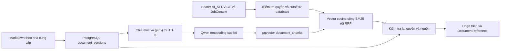

# Thiết kế RAG PostgreSQL và pgvector đã hiệu chỉnh

Ngày 16/10/2026. Thay thế đề xuất dùng Chroma cho phần tích hợp database. Hai file Word do nhóm cung cấp được giữ nguyên; bản hiệu chỉnh và code trong lần bàn giao này dùng các quy tắc dưới đây. Không xác nhận trạng thái Supabase chỉ từ nội dung báo cáo cũ.

## Phạm vi và kết quả

Giữ nguyên 27 bảng nghiệp vụ baseline và bảng vận hành `public.api_idempotency` đã được repo thêm ở migration 0002. Thêm hoặc tiếp nhận **đúng ba bảng Core với 37 cột** như hai file Word: `core.documents` 10, `core.document_versions` 13, `core.document_chunks` 14. Vì repo đã có bảng idempotency nên khi áp dụng đủ migration, các bảng do FlowBridge quản lý là **27 + 1 + 3 = 31**, chưa tính `alembic_version` hay bảng hệ thống Supabase. Không thêm `supplier_document`.

PostgreSQL lưu Markdown canonical, phiên bản, chunk dẫn xuất và vector. Runtime PostgreSQL không gọi Chroma; demo file local + Chroma cũ vẫn có thể chạy bằng chế độ development riêng. Một hồ sơ `supplier_review` đang hoạt động cho mỗi supplier; mỗi lần sửa tạo một version. Không tạo một document mới cho từng lần nhận xét.

## Ba bảng và các quy tắc bổ sung

Danh sách 37 cột được giữ theo hai file Word. `documents` là danh tính và ACL; `document_versions.content_md` là bản gốc duy nhất. `document_chunks.content` là bản trích dẫn xuất, phải khớp byte nguồn, có thể tái tạo. Không xem chunk là tài liệu gốc thứ hai.

Supplier được gắn qua `subject_type='supplier'` và `subject_id` dạng UUID string. Kho Core dùng chung không có FK riêng tới supplier. Lệnh import kiểm tra supplier, reviewer và phòng ban tồn tại; receiver xác minh scope theo dữ liệu server. Không coi JSONB metadata là FK.

Metadata của supplier review có `supplier_id`, `reviewer_user_id`, `reviewer_name_snapshot`, `report_asof`, `reviewer_attribution`. Actor import nằm ở `created_by_subject`, khác người nhận xét. Bộ fixture được ghi rõ `synthetic_assignment_from_seed`; tên do script phân công không trở thành xác nhận nhận xét thật của người dùng.

`embedding` được cố định `extensions.vector(1024)` cho model Qwen đã pin. Profile gồm revision, dimension, cosine, normalization, precision, instruction và document context. Khi đổi model/profile/cách chia đoạn phải có generation khác. Đổi số chiều cần migration riêng.

## Trích dẫn và byte UTF 8

Chunker hiện tại vẫn chia theo ký tự và heading `#`, `##`, `###`, giữ reviewer, ancestry, giới hạn 1000 ký tự và overlap 100 trong mục. Adapter chuyển vị trí ký tự thành byte bằng độ dài UTF-8 của phần đứng trước. `source_end_byte` là exclusive; không chép số vị trí ký tự vào cột byte.

Nguồn được chuẩn hóa newline LF một lần lúc import, sau khi đã xác minh checksum file local. Sau publication, không tiếp tục trim/normalize trước khi kiểm tra hash hoặc cắt trích dẫn.

Reference PostgreSQL giữ sáu field của DTO hiện tại: document_id, document_version, chunk_id, source_uri, checksum, supplier_id. `document_version` là UUID của `version_id`; `checksum` vẫn là hash nội dung riêng. URI có dạng `core-document://<document_id>/<version_id>#bytes=<start>:<end>`. Adapter không còn lấy content hash làm định danh duy nhất của version, vì cùng nội dung có thể có metadata nhận xét khác nhau.

`chunk_id` do worker tính UUIDv5 theo version, generation, byte span và chunk hash; default random ở DDL chỉ là fallback. Cùng đầu vào chạy lại cho cùng ID. Đổi generation có chunk ID mới; giữ các hàng generation cũ để resolve reference đã lưu. Resolve không cần model hiện tại nhưng vẫn phải kiểm tra ACL, trạng thái nguồn và checksum. Chưa có HTTP endpoint resolve riêng; CLI `inspect` dùng resolver này.

## Publication và thời điểm A B

Trigger chặn sửa/xóa nội dung, checksum, title snapshot, metadata và lineage sau publication. Chỉ cho phép publication sang withdrawal, với timestamp server. Phiên bản draft mới có thể sửa; sửa nhận xét đã công bố phải tạo version mới. DB kiểm tra checksum với SHA-256 của byte UTF-8 thật, không chỉ regex 64 ký tự.

Publication online gán `published_at` và `known_from` bằng thời gian server trong transaction; không backdate theo nội dung Markdown hoặc ngày mẫu. Import lịch sử có bằng chứng phải được thiết kế thành một quy trình audit khác. `report_asof` mô tả mốc dữ liệu báo cáo, không cấp quyền nhìn vào tri thức tương lai.

Ví dụ V1 khả dụng ngày 08, V2 ngày 14: A lập PR ngày 09 dùng V1; B theo dõi PO ngày 15 dùng V2. Truy hồi chọn tối đa một version mới nhất đã biết cho mỗi document tại cutoff, trước khi tính BM25/vector. Không fallback sang version cũ nếu version mới nhất ở cutoff chưa index xong; trả cảnh báo thiếu index.

Quy tắc thu hồi được chốt rõ: version đang withdrawn không được trả nội dung, kể cả replay khi nó từng được công bố. Nếu đó là version mới nhất đã biết tại cutoff thì không tự hồi sinh version cũ. Replay trước thời điểm version đó xuất hiện vẫn có thể dùng version trước còn published. ACL hiện tại và soft-delete hiện tại luôn là điều kiện bắt buộc; đây là replay có kiểm soát, không phải chức năng khôi phục quyền truy cập cũ.

HTTP lấy cutoff từ `analysis_tasks.feature_asof` và phòng ban từ PR liên kết. Không thêm `as_of` vào body v0.4.1. CLI cho phép cutoff do operator chỉ định để thử nghiệm; không gọi đó là xác thực production.

## Generation hoàn tất và retry

Không cần bảng readiness thứ tư cho giai đoạn này. Generation là SHA-256 của format version, version_id, source checksum, chunker version và embedding profile. Với mỗi version, worker tính toàn bộ chunk/vector ngoài transaction. Sau đó mở transaction ngắn, lấy advisory lock, khóa đọc nguồn, kiểm tra nguồn còn hợp lệ, thay toàn bộ hàng của generation đó, đối chiếu đủ count/ID/span/hash/content rồi commit.

MVCC làm bộ chunk xuất hiện cùng lúc. Nếu một insert lỗi, toàn bộ replacement của version đó rollback; generation hoàn chỉnh trước đó còn nguyên. Truy vấn cũng dựng bộ chunk kỳ vọng từ nguồn và chỉ dùng generation có đủ các hàng khớp, nên bộ chunk bị sửa thủ công hay thiếu không trở thành index ready.

Batch nhiều version commit từng version; nếu version sau lỗi, các version trước đã hoàn tất vẫn dùng được. Retry xác minh generation trước khi quyết định bỏ qua embedding. Không tuyên bố exactly-once; đây là xử lý idempotent theo nội dung. Các process có thể cùng tính embedding nhưng ghi được tuần tự theo version/generation.

Lệnh CLI `index` quét và đối soát các version published trong scope. Hiện chưa có daemon outbox tự chạy. Không lấy `outbox_events.published_at` làm chứng cứ đã index, không sửa trạng thái event PO/PR và không tái sử dụng `analysis_tasks` làm hàng đợi index. Nhóm có thể gọi CLI định kỳ hoặc từ worker sau bước publish; cần bổ sung scheduler nếu muốn tự động.

## Truy hồi và phân quyền

Giữ **exact cosine pgvector + BM25 Python + RRF**, reranker vẫn tắt. GIN/tsvector cấu hình simple được lưu làm khả năng tìm kiếm phụ; FTS không được quảng cáo là BM25 và chưa thay nhánh BM25 đã thử. Tài liệu pgvector hỗ trợ exact/approximate search và kết hợp full-text bằng RRF; PostgreSQL có các hàm FTS ranking riêng: [pgvector](https://github.com/pgvector/pgvector#hybrid-search), [PostgreSQL ranking](https://www.postgresql.org/docs/current/textsearch-controls.html#TEXTSEARCH-RANKING).

Chưa bật HNSW/IVFFlat ở quy mô sáu file/96 chunk. Sau này thêm ANN phải đo recall khi lọc supplier/ACL/time; không chỉ so tốc độ hoặc lấy top-k toàn kho rồi lọc quyền ở client.

HTTP dùng IdP introspection hiện có, ánh xạ issuer/subject vào user active và kiểm tra grant AI_SERVICE hợp lệ. `X-Job-Context` là UUID task được đọc từ database; chỉ AI service đã được cấp quyền mới được dùng. Task phải thuộc PR còn hợp lệ, revision phải khớp, cutoff không ở tương lai, phòng ban còn active. Receiver giới hạn hồ sơ global và đúng phòng ban của job. Sau CPU work, kiểm tra lại identity grants, job/resource lineage và nguồn trước khi trả quote.

Nhánh UserContext-only chưa triển khai; contract runtime của hai endpoint được thu hẹp về ServiceAuth + JobContext. Không nhận JSON role, department, allowlist hoặc cutoff từ client. Cơ chế này phục vụ worker theo job của v0.4.1; chưa tuyên bố triển khai đầy đủ execution manifest/context được ký và service binding của tài liệu Layer2 rộng hơn.

RLS bật và quyền PUBLIC/anon/authenticated bị thu hồi trên đúng ba bảng. Backend dùng connection có quyền đọc/ghi và thực thi policy ứng dụng. Đây không phải Supabase Auth RLS policy dành cho browser; không đưa service key/DSN ra frontend. Owner/BYPASSRLS có thể bỏ qua RLS: [PostgreSQL RLS](https://www.postgresql.org/docs/current/ddl-rowsecurity.html).

Retrieval là truy vấn đọc: Idempotency-Key được yêu cầu theo contract nhưng không cache quote lâu dài để tránh trả nội dung đã mất quyền. Index kiểm tra conflict key/payload trong bảng idempotency hiện có và vẫn xác minh source/index khi retry. HTTP index giữ synchronous 200; chưa đổi thành 202 job API.

Model cục bộ dùng chung trong app, có mutex giữ bên trong worker thread ngay cả khi HTTP task bị hủy. Không mở transaction trong lúc load model/embedding và không gọi asyncio.run trên engine app trong worker thread. Shutdown đợi model worker trước khi gỡ tài nguyên.

## Kiểm thử

Các bước chạy unit test, integration test asyncpg/pgvector có rollback và kiểm tra SQL bằng PGlite nằm trong [hướng dẫn setup](rag-postgres-setup.md). Kết quả chạy thử được lưu local trong `.cache/rag/`, không đưa vào Git.
