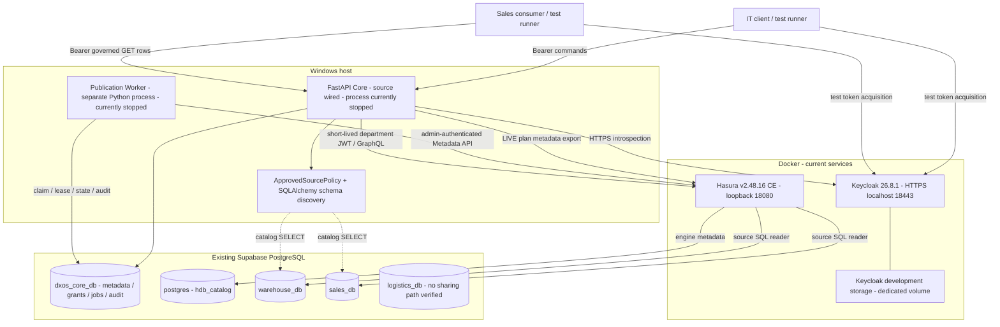
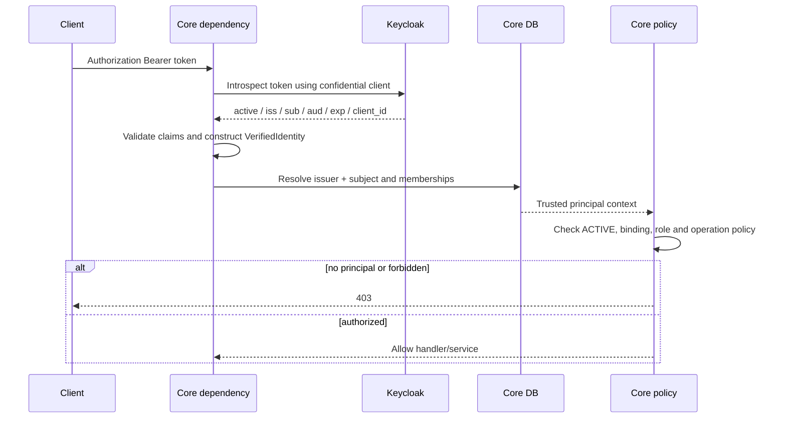
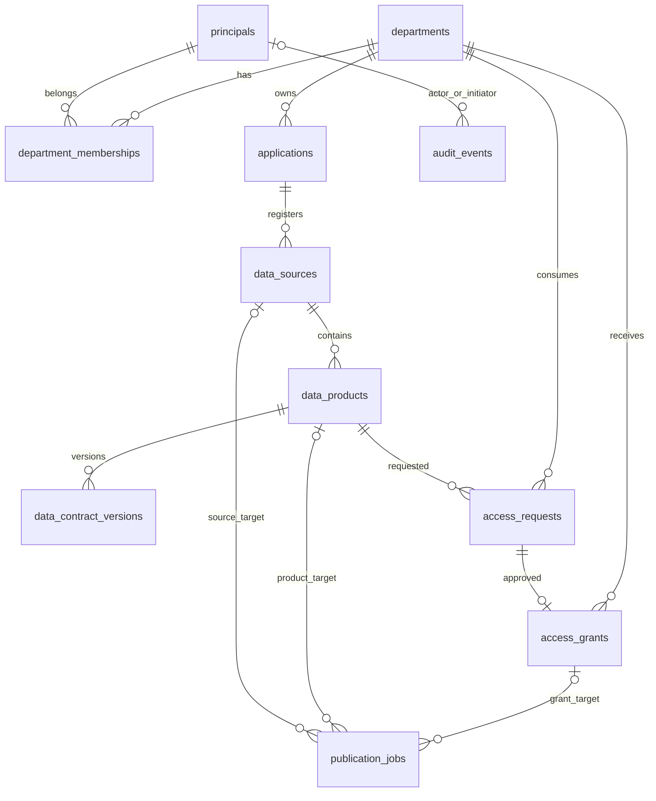

# FlowBridge — Current Codebase & Architecture Audit (As-Is)

> **Historical snapshot dated 23/10/2026.** It intentionally describes the runtime observed at that time and is not the `v0.1.0-beta.1` deployment guide. See [current Architecture](../ARCHITECTURE.md) and [Deployment](../DEPLOYMENT.md).

**Ngày audit:** 23/10/2026, Asia/Saigon. Runtime snapshot lúc khoảng 20:33; đối chiếu storage trong cùng phiên audit.  
**Source snapshot:** Git HEAD `6140445`; working tree sạch trước khi tạo báo cáo.  
**Phương pháp:** đọc source, composition roots, contracts, models/migrations, assertions, ledger/logs cục bộ; quan sát Docker/process/listening ports; GET discovery/health/version; truy vấn Supabase bằng transaction `READ ONLY`.  
**Giới hạn thao tác:** không chạy tests, login/lấy token, migrations, E2E, bootstrap, cleanup hoặc command ghi; không sửa source/config/database/container. File báo cáo này là thay đổi duy nhất của audit.

## 1. Executive Summary

FlowBridge hiện có một **vertical slice Data Sharing P0**: FastAPI Core xác thực Bearer token qua Keycloak, resolve principal/quyền từ Core DB, tiếp nhận đăng ký khai báo, khám phá schema PostgreSQL, lưu metadata, phát publication jobs và cho đọc dữ liệu qua Hasura theo grant. Dữ liệu nghiệp vụ không được sao chép vào Core hay vào database consumer. Đây không phải một hệ thống mà mọi API trong contracts đã được triển khai. Router hiện có **25 HTTP operations**, trong khi root Core specification khai báo **62 operations**. [Nguồn: `backend/app/main.py:37`, `backend/app/core/runtime.py:48`, `backend/app/core/router.py:27`, `contracts/core-api.openapi.yaml:15`.]

Topology đã quan sát: **Keycloak và Hasura đang chạy bằng Docker**; **Core API/Worker không chạy** tại thời điểm audit. Có năm PostgreSQL database vật lý đang được sử dụng/đối chiếu: `postgres`, `dxos_core_db`, `warehouse_db`, `sales_db`, `logistics_db`. Hasura metadata ở `postgres.hdb_catalog`; không có PostgreSQL container trong Compose hiện hành. [Quan sát O1–O2 ở chương 18; `infra/docker-compose.yml:1`.]

Bằng chứng lượt `9860b946629e` còn trên máy: ledger E01–E09, 12 native runtime logs, lịch sử jobs/audit trong Core và trạng thái sau cleanup. Báo cáo cũ ghi **4 tests passed**, thực chất gồm **2 integration test functions + 2 E2E test functions**, không phải bốn luồng browser SSO độc lập. Audit không chạy lại: **LAST REPORTED PASS — NOT RERUN**. Kết quả offline **738 passed, 54 deselected** cũng giữ nhãn này; không coi pytest cache là chứng thư kết quả. [Nguồn: `tests/e2e/test_existing_supabase.py:91`, `docs/DOCKER.md:96`, O3.]

Các giới hạn quan trọng: Portal còn gọi API khác runtime Core; nhiều management endpoints mới tồn tại trong contracts; reader P0 chỉ department-level SELECT/column scope/ALL rows; NUMERIC, relationships và VIEW thiếu uniqueness evidence không được publication path P0 chấp nhận; credentials Core hiện có quyền DB rộng, hai SQL reader test có SELECT toàn bảng. Phát hiện chi tiết, không kèm thiết kế thay thế, ở chương 17.

## 2. Tổng quan hệ thống hiện tại

### 2.1. Các boundary thực tế

- **Platform identity/HTTP:** xác minh token và chuẩn hóa request/error. Không đọc Core/domain DB để tự quyết định quyền nghiệp vụ.
- **Core application layer:** đăng ký metadata, kiểm principal/membership/grant, lifecycle và revision; không thực hiện CRUD nghiệp vụ của Sales/Kho/Logistics.
- **Core persistence:** lưu metadata quản trị, desired/applied state, jobs, receipts và audit trong `dxos_core_db`.
- **Hasura:** adapter thực thi data access: kết nối PostgreSQL nguồn, track object, áp SELECT permissions và chạy GraphQL.
- **Database nghiệp vụ:** nơi sở hữu bảng/dòng thực; có models/migrations riêng. Source hiện có chưa gồm HTTP business services hoạt động.

Nguồn: `backend/app/platform/identity/authentication.py:42`, `backend/app/core/governance/service.py:135`, `backend/app/core/db/postgres.py:71`, `backend/app/core/hasura_provisioner/services.py:54`, `services/warehouse-api/app/db/models.py:307`.

### 2.2. Control Plane và Data Plane

| Plane | Đường thực thi | Trách nhiệm |
|---|---|---|
| Control Plane | IT → Core → Core DB → Worker → Hasura Metadata API | Cấu hình, publication, apply/revoke permissions, readback và audit |
| Data Plane | Consumer → Core policy → internal JWT → Hasura GraphQL → source DB | Đọc projection được cấp; validate response theo pinned contract |
| Schema inspection | Core → SQLAlchemy Inspector → source DB catalogs | Đọc cấu trúc vật lý trong object scope đã được operator cấu hình |

Core cần tồn tại vì Hasura không tự quản lý mô hình principal/department/access-request/desired revision của FlowBridge. Hasura cần tồn tại trong path hiện hành vì `HasuraDataReader` không trực tiếp SELECT các hàng nghiệp vụ. Source DB cần riêng vì đó là nơi giữ dữ liệu và constraints vật lý; Core chỉ tham chiếu `schema_name/object_name`. [Nguồn: `backend/app/core/governance/service.py:516`, `backend/app/core/data_products/reading.py:76`, `backend/app/core/data_sources/discovery.py:94`.]

## 3. Kiến trúc thực tế (As-Is Architecture)



Đường Data Sharing Warehouse → Core/Hasura → Sales caller có historical E2E evidence. Sales DB được đăng ký để kiểm source/publication/failure; không phải nơi nhận bản sao Warehouse. Logistics có database/models/migration và được kiểm baseline trong harness, không có evidence luồng đọc qua Hasura. Diagram mô tả các component có source/cấu hình; không ngụ ý API/Worker đang chạy. [Nguồn: `backend/app/core/runtime.py:48`, `tests/e2e/test_existing_supabase.py:188`, `tests/e2e/test_existing_supabase.py:456`, O1–O3.]

## 4. Repository & Module Inventory

### 4.1. Module và đường gọi

| Module | Trách nhiệm | Entry point | Service/Adapter | Runtime | Evidence |
|---|---|---|---|---|---|
| `backend/app/main.py` | FastAPI DI/factory, middleware, router | `create_app` | `CoreDependencies`, `DataSharingService`, `RuntimeOnboarding` | Được native factory gọi | `backend/app/main.py:27` |
| `core/runtime.py` | Ghép production adapters, API lifespan, worker loop | `create_app`; `python -m app.core.runtime worker` | PostgreSQL, HTTPX, OIDC, discovery, Hasura | Windows Python | `backend/app/core/runtime.py:48` |
| `core/router.py` | HTTP boundary/DTO/dependencies | `/api/v1/core` | `Actor`, `Key`, command dispatcher | 25 operations wired | `backend/app/core/router.py:27` |
| `core/applications` | Manifest, compiler, canonical onboarding, CLI | `RuntimeOnboarding` ở HTTP | `prepare`, `import_drafts`, `compile_manifest` | HTTP wired; CLI là đường riêng | `backend/app/core/applications/runtime.py:99` |
| `core/data_sources` | Approved source scope, schema discovery | `SourceDiscoveryService.snapshot` | `PostgresSchemaDiscovery` | Core API/Worker dùng | `backend/app/core/data_sources/service.py:27` |
| `core/data_products` | DTO, physical contract, GraphQL reader/JWT | Publication/read path | `require_physical_contract`, `HasuraDataReader` | Reader bật có điều kiện | `backend/app/core/data_products/validation.py:73` |
| `core/governance` | Principal policy và Data Sharing lifecycle | `DataSharingService` | `CommandExecutor`, CoreStore ports | HTTP/Worker dùng | `backend/app/core/governance/service.py:135` |
| `core/db` | Durable unit-of-work, row mapping, CAS, audit, receipts | `PostgresCoreStore` | SQLAlchemy async/asyncpg | `dxos_core_db` | `backend/app/core/db/postgres.py:71` |
| `core/hasura_provisioner` | Metadata client, registration/publication/permission, worker | `PublicationWorker.run_once` | `HasuraMetadataClient`, worker repository adapters | Process riêng | `backend/app/core/hasura_provisioner/worker.py:39` |
| `platform/identity` | Bearer introspection; Directory adapter | `authenticated_identity` | `verify_access_token`, `KeycloakDirectory` | Verifier wired; Directory không wired vào Core factory | `backend/app/platform/identity/authentication.py:29`; `backend/app/platform/identity/directory.py:26` |
| `platform/http` | Correlation, private JSON, sanitized errors; utilities | Middleware/handlers | Request policy/error envelope | Chỉ các middleware factory đăng ký là active | `backend/app/main.py:81` |
| `contracts` | OpenAPI/JSON schemas, examples/fixtures | Files specification | Runtime DTO chỉ thực hiện một subset | Không phải HTTP server | `contracts/core-api.openapi.yaml:1` |
| `infra` | Hai engine Docker, realm template, metadata baseline | `infra/docker-compose.yml` | Runtime config render từ local environment | Keycloak/Hasura running | `infra/docker-compose.yml:1` |
| `scripts` | Bootstrap local config, DB administration, E2E/process/cleanup | Python modules, PowerShell runner | Không tự được gọi khi Core startup | Explicit operator/test tools | `scripts/test_e2e.ps1:1`; `scripts/database/cli.py:1` |
| `services/*-api/app/db` | Models và constraints ba domain | Declarative models/migrations | Không tìm thấy router/service HTTP nghiệp vụ | Storage có thật; service process chưa có | `services/sales-api/app/db/models.py:307` |
| `portal` | React UI, session/PKCE, theme, API client, preview/fixtures | `portal/src/main.tsx`, `portal/server.mjs` | Keycloak JS, legacy API facade | Không tham gia Core E2E; không thấy listener trong snapshot | `portal/src/app/session.tsx:80`; `portal/src/lib/api.ts:100` |

Các package chỉ có scaffold không được tính là implementation hoặc runtime. Không import source từ `_archive` để suy ra chức năng active. Các phần ngoài vertical slice không được phân tích thành subsystem trong báo cáo này.

### 4.2. CODE / WIRED / TESTED / REAL E2E / RUNTIME NOW

`H` = có historical evidence được đối chiếu, **không rerun**; `U` = chưa có bằng chứng phù hợp. TESTED dưới đây nghĩa là có assertions trong source, không phải kết quả vừa chạy.

| Thành phần | CODE | WIRED | TESTED | REAL E2E | RUNTIME NOW | Giới hạn |
|---|---|---|---|---|---|---|
| Core API + PostgreSQL store | Có | Có | Unit + persistence + real harness | H | Không | Không phải toàn bộ contracts |
| OIDC introspection + Core principal | Có | Có | Unit + real integration | H | Core off; IdP on | Không chứng minh browser/multi-app SSO |
| Manifest/compiler/discovery/import | Có | Có | Unit + persistence + real harness | H cho table fixture | API off | Import chỉ DRAFT |
| Publication/permission worker | Có | Có | Policy + persistence + real harness | H | Không | Engine apply là bất đồng bộ |
| Governed reader/internal JWT | Có | Có điều kiện | Unit + real harness | H | Không; generated flag false | P0 scalar/SELECT profile |
| Keycloak Directory adapter | Có | Không trong Core factory | Unit/HTTP mock | U | Không thấy caller active | Không tự provision principal |
| Portal login/refresh/logout | Có | Nội bộ Portal | Frontend tests có source | U với Core hiện hành | Không quan sát running | API paths/config khác Core |
| Ba domain models/migrations | Có | DB CLI/tests | Domain/database tests | Không có business HTTP E2E | DB online | Tables không chứng minh business handlers |

### 4.3. FastAPI và error boundary

Native `dependencies()` tạo store/discovery/HTTP client/settings và metadata client; `app.main.create_app()` nhận `CoreDependencies`, tạo hai application services trên `app.state`, include một router. Startup không migrate, không seed, không tự tạo principal và không có memory fallback khi không bật testing. Lifespan đóng HTTP client/engine. [Nguồn: `backend/app/core/runtime.py:48`, `backend/app/main.py:37`.]

Router → `authenticated_identity` → Core policy → application service → `CommandExecutor`/CoreStore → adapters. Các DTO tách khỏi tables/ORM. `PrivateJsonMiddleware` giới hạn body 1 MiB, phát hiện duplicate JSON keys và non-finite constants, yêu cầu JSON với POST/PATCH/PUT và đặt `Cache-Control: no-store`. Correlation middleware gắn request ID. [Nguồn: `backend/app/platform/http/request_policy.py:20`, `backend/app/platform/http/correlation.py:35`.]

Error envelope gồm `code`, `message`, `request_id`, `retryable`, `details`; DTO errors thường 422, JSON middleware có nhánh 400; auth 401/403, state/revision/idempotency conflict 409, upstream 503/504. Không trả nguyên exception/upstream response chứa credentials. Có error enum không đồng nghĩa có middleware thực thi năng lực tương ứng, ví dụ rate limiting. [Nguồn: `backend/app/platform/http/errors.py:44`, `backend/app/main.py:61`.]

### 4.4. HTTP operations thực sự wired

Tất cả path sau có prefix `/api/v1/core`; management commands yêu cầu IT/admin và `Idempotency-Key`, trừ validate/plan chỉ đọc không dùng command receipt. HTTP 202 là receipt chờ job, không phải provisioning đã thành công.

| Method + path | Thành công | Handler line | Hành vi |
|---|---|---|---|
| GET `/me` | 200 | `router.py:52` | Trusted identity + principal/memberships |
| POST `/application-onboarding/validate` | 200 | `router.py:70` | Shape/canonical annotations |
| POST `/application-onboarding/plans` | 200 | `router.py:75` | STATIC/LIVE plan |
| POST `/application-onboarding/imports` | 201 | `router.py:82` | Atomic draft import |
| POST `/applications` | 201 | `router.py:110` | Application DRAFT |
| PATCH `/applications/{application_id}` | 200 | `router.py:115` | Revision-checked configuration/status |
| POST `/data-sources` | 201 | `router.py:124` | Approved source configuration |
| GET `/data-sources/{data_source_id}` | 200 | `router.py:129` | Redacted source metadata |
| POST `/data-sources/{data_source_id}/connect` | 202 | `router.py:136` | CONNECT_SOURCE job |
| GET `/data-sources/{data_source_id}/schema` | 200 | `router.py:158` | Bounded catalog discovery |
| POST `/data-products` | 201 | `router.py:176` | Product DRAFT |
| GET `/data-products/{data_product_id}` | 200 | `router.py:181` | Product metadata/visibility policy |
| POST `/data-products/{data_product_id}/contracts` | 201 | `router.py:188` | Contract version DRAFT |
| GET `/data-contracts/{contract_version_id}` | 200 | `router.py:197` | Contract metadata/visibility policy |
| PATCH `/data-contracts/{contract_version_id}` | 200 | `router.py:202` | Edit DRAFT contract |
| POST `/data-contracts/{contract_version_id}/publish` | 200 | `router.py:211` | Validate và PUBLISHED |
| POST `/data-products/{data_product_id}/publish` | 202 | `router.py:222` | PUBLISH_PRODUCT job |
| POST `/data-products/{data_product_id}/disable` | 202 | `router.py:233` | Disable ngay + reconcile permissions |
| POST `/access-requests` | 201 | `router.py:242` | IT tạo request cho department |
| GET `/access-requests/{access_request_id}` | 200 | `router.py:247` | Admin đọc request |
| POST `/access-requests/{access_request_id}/approve` | 202 | `router.py:256` | Request/grant/job trong một transaction |
| GET `/access-grants/{access_grant_id}` | 200 | `router.py:265` | Admin hoặc membership hợp lệ của grant |
| POST `/access-grants/{access_grant_id}/revoke` | 202 | `router.py:270` | REVOKING + REVOKE_GRANT job |
| GET `/publication-jobs/{job_id}` | 200 | `router.py:277` | Admin đọc job status |
| GET `/data-products/{data_product_id}/rows` | 200 | `router.py:282` | Governed read; không admin bypass |

`router.py` trong bảng là `backend/app/core/router.py`. Không có GET application-by-ID, list applications, principal/department/membership management hoặc audit listing handler trong router này, dù một số đã nằm trong contracts. Không đếm Swagger/OpenAPI do FastAPI sinh tự động vào 25 business operations. [Đối chiếu AST router với `contracts/core-api.openapi.yaml:15` và các path refs.]

## 5. Runtime / Docker / Supabase Topology

### 5.1. Trạng thái quan sát

| Component | Cấu hình | Quan sát hiện tại | Mức xác minh |
|---|---|---|---|
| Docker | Engine 29.2.0, Compose 5.0.2 | Hoạt động | Lệnh chỉ đọc O1 |
| Keycloak | Official image 26.8.1, pin digest; `start-dev --import-realm` | Running, discovery HTTPS 200 | VERIFIED NOW cho service/discovery |
| Hasura | Official image v2.48.16 pin digest | Healthy; `/healthz` 200, `/v1/version` trả CE/v2.48.16 | VERIFIED NOW cho health/version |
| Core API | Native factory, test port 18000 | Không thấy process/listener; port 8000 cũng không listen | Không đang phục vụ API |
| Worker | Native `app.core.runtime worker` | Không thấy process | Không có process xử lý jobs hiện tại |
| Portal | Vite/Node source | Không thấy listener 5174; không kết luận về mọi port tùy chỉnh | U cho running instance |
| PostgreSQL | Supabase session pooler 5432 | Năm DB kết nối READ ONLY được, client TLS on | VERIFIED NOW cho các audit connections |

Chỉ hai port Compose publish lên `127.0.0.1`: 18443→8443 và 18080→8080. Keycloak có volume `keycloak_data`, mounts realm/TLS read-only; không có service PostgreSQL, Core hay Worker trong Compose. Cấu hình development Keycloak không chỉ định database bên ngoài; storage development H2/dev-file được giữ trong volume, không nằm trong Supabase. Audit không mở file H2 hoặc xác thực nội dung live users bằng Admin API. [Nguồn: `infra/docker-compose.yml:3`, O1.]

### 5.2. Configuration và process boundaries

| Nhóm cấu hình | Biến chính — chỉ tên |
|---|---|
| Core store/scope | `FLOWBRIDGE_CORE_DATABASE_URL`, fallback `DXOS_CORE_URL`; `FLOWBRIDGE_CORE_SOURCE_SCOPES` |
| Identity | `FLOWBRIDGE_OIDC_ISSUER`, `FLOWBRIDGE_OIDC_AUDIENCE`, `FLOWBRIDGE_OIDC_INTROSPECTION_URL`, `FLOWBRIDGE_OIDC_CLIENT_ID`, `FLOWBRIDGE_OIDC_CLIENT_SECRET`, `FLOWBRIDGE_OIDC_ALLOWED_CLIENTS`, `FLOWBRIDGE_OIDC_SERVICE_CLIENTS`, `FLOWBRIDGE_OIDC_CA_BUNDLE` |
| Hasura control plane | `FLOWBRIDGE_HASURA_ENDPOINT`, `FLOWBRIDGE_HASURA_ADMIN_SECRET`, `FLOWBRIDGE_HASURA_ALLOWED_SOURCES`, `FLOWBRIDGE_HASURA_ALLOWED_DATABASE_HOSTS`, `FLOWBRIDGE_HASURA_SECRET_BINDINGS` |
| Data reader | `FLOWBRIDGE_CORE_VERIFIED_HASURA_AUTH_PROFILE`, `FLOWBRIDGE_CORE_HASURA_JWT_SIGNING_KEY`, `FLOWBRIDGE_CORE_HASURA_JWT_ISSUER`, `FLOWBRIDGE_CORE_HASURA_JWT_AUDIENCE`, `FLOWBRIDGE_HASURA_SELECT_LIMIT` |
| Worker | `FLOWBRIDGE_CORE_WORKER_POLL_SECONDS` |
| Docker/local files | `FLOWBRIDGE_DOCKER_RUNTIME_DIR`, `FLOWBRIDGE_KEYCLOAK_ADMIN_PASSWORD`, `FLOWBRIDGE_HASURA_JWT_CONFIG` |
| Hasura process | `HASURA_GRAPHQL_METADATA_DATABASE_URL`, `FB_E2E_WAREHOUSE_URL`, `FB_E2E_SALES_URL` |
| DB administration/test setup | `DXOS_ADMIN_URL`, `DXOS_CORE_URL`, `DXOS_WAREHOUSE_URL`, `DXOS_SALES_URL`, `DXOS_LOGISTICS_URL` |

Giá trị secrets/DSNs không nằm trong báo cáo. `.env.docker` và `.tmp/docker-integration` là local ignored state, không phải source phát hành. Source bindings là operator-managed environment references, không cho manifest tự cấp credentials. `core_engine()` dùng asyncpg, NullPool, disable prepared-statement cache, reject Supabase transaction-pooler 6543 cho session-lock topology. [Nguồn: `backend/app/core/runtime.py:33`, `backend/app/core/db/engine.py:10`, `scripts/docker_env.py:20`.]

Base `core.env` đang có reader flag false và không có source allowlist; run-specific `core.env` có hai allowed source names nhưng flag vẫn false trên file. Trong test, flag được bật trong process environment sau integration checks, không ghi ngược file. Vì vậy một generated env file không tự chứng minh reader đã bật hoặc API đang chạy. [Nguồn: `backend/app/core/runtime.py:70`, `tests/e2e/test_existing_supabase.py:182`, O2–O3.]

### 5.3. Scripts hiện có — không thực thi trong audit

`scripts/docker_env.py` render secrets/TLS/realm/base env; `scripts/e2e_environment.py` làm metadata/bootstrap/fixture preparation với explicit write flags; `scripts/e2e_runtime.py` quản lý các native processes mình tạo; `scripts/test_e2e.ps1` dựng profile, chạy assertions và finally cleanup; `scripts/e2e_cleanup.py` chỉ dọn tài nguyên có ledger. `scripts/check_docker.py` có lấy/introspect token nên audit không gọi script này. `scripts/test_postgres.ps1` và database CLI có khả năng tạo/migrate database; không được gọi để kiểm topology. [Nguồn: các entry points ở chương 18.]

## 6. Keycloak Identity & Authentication

### 6.1. Realm và clients

Template source là realm `flowbridge`; generator integration render realm riêng `flowbridge-it`. Runtime discovery đã xác minh issuer `https://localhost:18443/realms/flowbridge-it`. Rendered config tại máy có sáu users, gồm user template và năm identities test; không công bố credential/user subject. File import là bằng chứng cấu hình, không thay cho Admin API readback của mọi client trong live H2 volume. [Nguồn: `infra/keycloak/realm.template.json:1`, `scripts/docker_env.py:20`, O1.]

| Client | Cấu hình source/import | Vai trò trong code |
|---|---|---|
| `flowbridge-web-a` | Public, standard flow, PKCE S256; direct grant off | Browser Portal |
| `flowbridge-api` | Confidential, standard/direct grants off | Core xác thực với introspection endpoint |
| `flowbridge-directory` | Confidential, service accounts on | Directory adapter dùng client_credentials; không được Core factory gọi |
| `flowbridge-e2e` | Public, direct password grant on trong realm test | Runner lấy real tokens; không phải bằng chứng browser login |

Discovery công bố các endpoints cùng issuer: `/protocol/openid-connect/auth`, `/token`, `/token/introspect`, `/logout`. Core yêu cầu HTTPS và dùng CA bundle khi cấu hình; không dùng `verify=false` cho Keycloak. [Nguồn: `backend/app/platform/identity/settings.py:68`, `backend/app/core/runtime.py:53`, O1.]

### 6.2. Xác minh Bearer token

`HTTPBearer(auto_error=False)` chỉ lấy credential. Backend yêu cầu đúng một Authorization header và scheme Bearer, rồi POST token tới introspection bằng confidential client authentication. Core **không tự xác minh JWT bằng local JWKS** trong implementation này; việc xác minh token được ủy quyền cho authorization server qua HTTPS. [Nguồn: `backend/app/platform/identity/authentication.py:29`, `backend/app/platform/identity/authentication.py:42`.]

Sau introspection, code kiểm `active is True`, issuer chính xác, subject không rỗng, audience chứa audience Core, expiry hữu hạn/chưa hết hạn, nbf hợp lệ, token type Bearer, client_id hợp lệ, azp nếu có phải khớp và allowed-client registry nếu không rỗng. Scope chỉ được chuẩn hóa thành tập strings; không biến scope/realm roles thành `PLATFORM_ADMIN`. Account type human/service được phân loại từ configured service-client registry. [Nguồn: `backend/app/platform/identity/authentication.py:79`.]

| Tình huống | Hành vi code |
|---|---|
| Thiếu/sai/duplicate Authorization, token inactive/hết hạn/sai issuer/audience/client | 401 UNAUTHENTICATED |
| Timeout introspection | 504 |
| Dependency chưa cấu hình hoặc HTTP/JSON upstream lỗi | 503 |
| Token đúng nhưng chưa có trusted Core principal | 403 |
| Principal DISABLED, kind/client/app binding không khớp | 403 |

Nguồn: `backend/app/platform/identity/authentication.py:29`, `backend/app/core/governance/policy.py:65`, `backend/app/core/db/postgres.py:284`, `tests/e2e/test_existing_supabase.py:92`.

### 6.3. Frontend SSO, refresh và logout

Portal có implementation `keycloak-js`: `check-sso`, PKCE S256, login redirect, `updateToken(30)`, `kc.logout`, clear UI session và development-only preview. Backend Core không có login/refresh/logout HTTP endpoint riêng; browser adapter giao tiếp Keycloak. Tuy nhiên Portal API facade hiện gọi `/api/v1/me` và các API legacy, không phải `/api/v1/core/me`; public-config defaults cũng khác origin/realm của Docker integration. Do đó **có source browser SSO không đồng nghĩa đã có Portal ↔ Core hoặc multi-application SSO E2E**. [Nguồn: `portal/src/app/session.tsx:80`, `portal/src/app/session.tsx:152`, `portal/src/app/session.tsx:211`, `portal/src/lib/api.ts:153`, `portal/server/public-config.mjs:18`.]

## 7. Core Authorization & Role Model

### 7.1. Các khái niệm không được đánh đồng

| Khái niệm | Ý nghĩa trong implementation |
|---|---|
| Principal | Trusted binding `(issuer, subject)` trong Core; không phải DB login hoặc tên phần mềm |
| Department | Đơn vị/nhóm sở hữu metadata và nhóm consumer |
| Department membership | Binding principal–department, STAFF/OWNER, status và expires_at |
| `platform_role` | Chỉ `NONE` hoặc `PLATFORM_ADMIN`; nguồn quyền quản trị thực tế |
| STAFF/OWNER | Membership metadata; hai giá trị không cấp quyền quản trị Core |
| Consumer | Cách gọi actor đọc dữ liệu bằng membership + grant; không có enum platform role tên CONSUMER |
| Service principal | Kind service, service_client_id khớp verified client; application binding được kiểm nếu có |
| Owner department | Liên kết application/source/product; không phải một cửa duyệt bắt buộc |

`resolve_principal()` đọc binding Core mỗi request/command, so khớp issuer/subject/kind; principal phải ACTIVE. Human không được có service_client_id/application binding. Service phải có client_id đúng; nếu principal có application_id thì application và department liên quan phải ACTIVE. Membership hiệu lực khi membership ACTIVE, department ACTIVE và chưa expires. Không tự đồng bộ quyền từ Keycloak group name. [Nguồn: `backend/app/core/governance/policy.py:13`, `backend/app/core/governance/policy.py:31`, `backend/app/core/governance/policy.py:65`.]

### 7.2. Authorization Matrix

Các cột STAFF/OWNER giả định principal có `platform_role=NONE`. Nếu cùng người cũng là PLATFORM_ADMIN thì quyền quản trị đến từ platform role, không từ membership.

| Operation đã có | PLATFORM_ADMIN | STAFF | OWNER | Consumer |
|---|---|---|---|---|
| `/me` | Có nếu principal ACTIVE | Có nếu ACTIVE | Như STAFF | Có nếu ACTIVE |
| Validate/plan/import; tạo/sửa application, đăng ký/connect/discover source | Có, vẫn kiểm state/revision/allowlist | Không | Không | Không |
| Tạo/sửa/publish contract; tạo/publish/disable product | Có, vẫn kiểm schema/metadata | Không | Không | Không |
| Tạo access-request cho department | Có | Không | Không | Không tự request qua implementation hiện tại |
| Approve/revoke grant | Có | Không | Không | Không |
| GET source/request/job metadata | Có | Không | Không | Không |
| GET product/contract metadata | Có | Có nếu product đang visible/active | Như STAFF | Có với principal hợp lệ và visible product; không bắt buộc data grant |
| GET grant | Có | Chỉ department membership hiện hành của grant | Như STAFF | Theo cùng điều kiện |
| GET business rows | Chỉ khi chính actor có membership + grant hợp lệ | Theo grant | Theo grant, không ưu tiên OWNER | Theo grant |

Nguồn: `backend/app/core/db/commands.py:90`, `backend/app/core/governance/service.py:474`, `backend/app/core/governance/service.py:516`. IT không đọc tất cả rows mặc định; sample E2E kiểm IT-without-grant trả 403.

### 7.3. Ba loại role và sequence authentication

**Keycloak role** không được dùng trực tiếp để nâng quyền Core. **Core platform role** quyết định quản trị. **Hasura role** được server sinh dạng `dxos_department_<department UUID hex>` để enforce SELECT permissions; consumer không được chọn role này từ header/body. PostgreSQL login role là loại thứ tư, dùng kết nối SQL nguồn, không đại diện từng người Sales. [Nguồn: `backend/app/core/governance/policy.py:38`, `backend/app/core/hasura_provisioner/schemas.py:269`, `backend/app/core/data_products/credentials.py:24`.]



## 8. PostgreSQL Databases & Persistence

### 8.1. Topology xác minh thay vì suy từ tên config

Audit kết nối lần lượt từng configured DB và đọc `current_database()`, revision, public table names; truy vấn `pg_database` trên existing host trả năm tên với OID khác nhau: `postgres=5`, `sales_db=22907`, `warehouse_db=22908`, `logistics_db=22909`, `dxos_core_db=22910`. Vì vậy đây là **database vật lý khác nhau trong cùng PostgreSQL deployment được cấu hình**, không phải năm schema mang nhãn database. Các DSN sử dụng cùng Supabase pooler endpoint/session port 5432; audit không dùng Supabase Management API để xác nhận cloud project identity độc lập. [Quan sát O2.]

- **Supabase Project:** cloud resource/configuration boundary; không đồng nhất với database hoặc schema.
- **Database:** container catalog/tables riêng, xác minh qua current_database/OID.
- **Schema:** namespace trong một database, ví dụ public hoặc hdb_catalog.
- **PostgreSQL role:** SQL login/privileges, ví dụ reader/metadata account.
- **Application principal:** metadata actor trong Core, map từ trusted IdP identity; không phải PostgreSQL role.

### 8.2. Storage ownership và access

| Storage | Dữ liệu lưu | Thành phần truy cập | Quyền/quan sát |
|---|---|---|---|
| `dxos_core_db.public` | Registry, contracts, memberships, requests/grants, jobs, receipts, audit | Core API/Worker; explicit DB tools | Core runtime credential hiện có CREATEDB/CREATEROLE/BYPASSRLS; không phải least-privilege Core-only login |
| `warehouse_db.public` | 13 application tables: products/warehouses/inventory, receipts/reservations/dispatch/movements và command/outbox/inbox | Domain DB tools; Core schema discovery; Hasura reader | Reader test có SELECT toàn products, không INSERT/UPDATE/DELETE/TRUNCATE |
| `sales_db.public` | 7 application tables: customers, orders/lines/events và command/outbox/inbox | Domain DB tools; source/discovery/publication test | Reader test có SELECT toàn customers, không có các quyền ghi trên |
| `logistics_db.public` | 6 application tables: shipments/lines/events và command/outbox/inbox | Domain DB tools; baseline verification | Không có Data Sharing E2E qua nguồn này |
| `postgres.hdb_catalog` | 8 engine metadata/internal tables; runtime metadata chứa source definitions | Hasura, dedicated metadata login; administration quan sát read-only | Tách khỏi Core schema; source references dùng from_env |
| Keycloak volume | Development identity/session/configuration storage | Keycloak | Không chứa rows nghiệp vụ hay Core grants |

Không tính `alembic_version` vào **38 application tables**: Core 12 + Warehouse 13 + Sales 7 + Logistics 6. Mỗi DB ứng dụng có một alembic_version riêng. Các bảng hệ thống Supabase/engine không được cộng vào con số này. [Nguồn: `backend/app/core/db/models.py:36`, domain models, O2.]

### 8.3. Core tables và relationships

Mọi bảng có schema public. Các cột metadata created/updated/revision xuất hiện theo từng model; grant dùng desired/applied revision thay vì cùng shape revision của registry.

| Bảng | Fields/relationships chính | Vai trò |
|---|---|---|
| `principals` | issuer, subject UNIQUE; kind; service_client_id; optional application_id; platform_role; status | Trusted identity binding; không lưu password/token |
| `departments` | code UNIQUE, name, status, optional keycloak_group_ref | Department registry; group ref không tự cấp quyền |
| `department_memberships` | principal_id, department_id; UNIQUE pair; STAFF/OWNER, status, expires_at | Membership eligibility |
| `applications` | department_id FK, app_key UNIQUE, name, business_api_base_url, status | Đăng ký phần mềm; base URL là metadata, không tự thành integration caller |
| `data_sources` | application_id FK, source_key, host/port/database_name/db_user, secret_ref, ssl_mode, hasura_source_name, status | Connection metadata; không lưu password SQL nguồn |
| `data_products` | data_source_id FK; product_key; schema/object/type; classification; active_contract_id | Danh mục object được công bố; owner department được projection qua source/application |
| `data_contract_versions` | data_product_id FK, version, contract_json, status, published_at/by | Pinned canonical contract; UNIQUE product/version |
| `access_requests` | product/contract FKs, requester, consumer_department_id, consumer_principal_id, requested_scope_json, status/decision | Yêu cầu và quyết định quản trị |
| `access_grants` | request/product/contract/department FKs, scope_json, enforcement_role, desired/applied_revision, status, expires/revoke fields | Quyền đọc và trạng thái thực thi |
| `publication_jobs` | job_type, một target FK, target_revision, attempts, due/lease/owner, status/error, initiator/correlation | Durable work queue |
| `audit_events` | actor/initiator FKs, action, resource_ref/type, outcome, time, request_id, hashes | Command/job/bootstrap audit |
| `core_command_receipts` | namespace PK, fingerprint, HTTP status/body/location, created/expires_at | Durable idempotency replay |

Composite FK giữ active contract thuộc đúng product; request/grant contract cũng được gắn product tương ứng. Constraints/status enums/unique indexes nằm trong models và migration; không chỉ là DTO validation. Chưa có mô hình organization/org_id trong Core P0 hiện hành; các domain models vẫn có org_id. Không suy domain org_id thành Core multi-organization authorization. [Nguồn: `backend/app/core/db/models.py:303`, `backend/app/core/db/models.py:436`, `backend/app/core/db/models.py:530`; `services/warehouse-api/app/db/models.py:107`.]



ER diagram là bản rút gọn, không liệt kê mọi composite FK, self-reference actor hoặc optional application binding. Bảng receipts độc lập với FK graph nhưng được ghi trong cùng command transaction.

### 8.4. Transactions, CAS, idempotency và audit

- `transaction()` mặc định SERIALIZABLE, statement timeout 20s, lock timeout 10s; `get/find` dùng FOR UPDATE. GET resource/status của DataSharingService dùng `read_only=True`: REPEATABLE READ, SQL READ ONLY, không FOR UPDATE. `/me`, discovery và governed read không tự chuyển sang chế độ này. [Nguồn: `backend/app/core/db/postgres.py:80`, `backend/app/core/governance/service.py:474`.]
- `replace()` yêu cầu resource đã loaded và UPDATE có conditions trên revision/desired revision/attempt/status/owner/lease tương ứng; rowcount khác 1 là conflict. Nội dung/version/product của published/retired contract không được đổi. [Nguồn: `backend/app/core/db/postgres.py:225`.]
- Namespace idempotency hash từ issuer, subject, method, canonical path và key; payload fingerprint khác cùng key trả 409. Receipt được lock bằng advisory transaction lock và FOR UPDATE. Principal/admin được kiểm trước khi replay; resource, job, audit và receipt commit hoặc rollback cùng nhau. Serialization/deadlock có bounded retry. [Nguồn: `backend/app/core/db/commands.py:78`, `backend/app/core/db/postgres.py:254`.]
- Per-product/department permission reconciliation có PostgreSQL session advisory lock. NullPool không thay thế advisory lock; session-pooler topology cần giữ session semantics. [Nguồn: `backend/app/core/db/postgres.py:98`.]
- Audit hiện ghi command success, enqueue, worker success/retry/failure và test bootstrap/cleanup. Không tìm thấy ghi audit Core cho mỗi successful governed read hoặc mỗi HTTP denial. HTTP access logs không tương đương principal/resource audit events. [Nguồn: `backend/app/core/governance/service.py:135`, `backend/app/core/governance/service.py:516`, `backend/app/core/hasura_provisioner/worker.py:210`, O2.]

Core migration history là core_0001→0002→0003→0004; live head core_0004. Mỗi domain có chain riêng hiện head `<domain>_0001`, tổng bảy revision files. Migration core_0004 có logic realignment; không gọi migration/realign/seed trong audit. [Nguồn: `backend/app/core/db/migrations/versions/core_0004.py:39`, O2.]

## 9. Automated Application Onboarding

### 9.1. Input hiện hành và ví dụ trong repository

HTTP nhận **OnboardingSubmission**, không phải chỉ bare Manifest. Nó có `manifest` và `product_contracts[]`; mỗi proposal có product_key, semver và canonical contract_json. Source schema nằm ở `backend/app/core/applications/runtime.py:25`; specification ở `contracts/application-onboarding.yaml:147`.

Ví dụ Warehouse hiện có là `contracts/onboarding/examples/warehouse.json:1`: application `warehouse`, source `warehouse-pg`, hai VIEW products `product_catalog` và `available_inventory`, declared fields và một relationship thủ công. Host `.invalid` là placeholder, không phải Supabase endpoint. Dưới đây trích nguyên object manifest của Product Catalog, **không phải toàn bộ submission**:

```json
{
  "key": "product_catalog",
  "source_key": "warehouse-pg",
  "name": "Product Catalog",
  "object": {"schema": "public", "name": "product_catalog", "kind": "view"},
  "fields": [
    {"column": "sku", "expected_type": "text", "description": "Stable product identifier"},
    {"column": "name", "description": "Product name"}
  ],
  "contract_version": "1.0.0",
  "requested_state": "PUBLISH_REQUESTED"
}
```

Proposal tương ứng lấy từ fixture `onboard-warehouse` trong `contracts/fixtures/review-cases.json`:

```json
{
  "product_key": "product_catalog",
  "version": "1.0.0",
  "contract_json": {
    "document_version": "1.0",
    "grain": "One row per SKU",
    "business_key": ["sku"],
    "classification": "INTERNAL",
    "description": "Synthetic catalog",
    "fields": [
      {"column": "sku", "name": "sku", "physical_type": "TEXT", "wire_type": "string", "nullable": false, "description": "Stable product identifier"},
      {"column": "name", "name": "name", "physical_type": "TEXT", "wire_type": "string", "nullable": false, "description": "Product name"}
    ],
    "relationships": []
  }
}
```

Full fixture còn có product/proposal Available Inventory; không bỏ chúng khi đối chiếu full submission. JSON Schema-valid không có nghĩa hai VIEW/relationship của example đã được P0 live publication chứng minh. Real Supabase E2E dùng TABLE `public.products` có PK id, không dùng example VIEW như một fixture đã thành công.

### 9.2. Execution flow của ba endpoints

| Bước | Input/handler | Kiểm tra và I/O | Output/state/error |
|---|---|---|---|
| Validate | POST validate; OnboardingSubmission; `RuntimeOnboarding.validate` | Bearer + active Core admin; DTO/unique refs và canonical annotations/relationship preservation | 200 `{valid, manifest_hash, issues}`; DTO lỗi 422; không chứng minh source/permission; không ghi draft |
| STATIC plan | POST plans; `{submission, discovery_mode:"STATIC"}` | Vẫn đọc Core/principal/department/state; không đọc schema nguồn hoặc Hasura như LIVE | `STATIC_UNKNOWN`, issues/steps; không provisioning; không phải HTTP path hoàn toàn offline |
| LIVE plan | POST plans; `{submission, discovery_mode:"LIVE"}` | ApprovedSourcePolicy, catalog snapshot, physical annotation/type/nullability, compiler, existing Core state; export metadata nếu adapter có | `LIVE_VERIFIED` với hashes, expiry, steps/issues; technical validity không cấp quyền đọc |
| Import | POST imports; `{submission, plan_hash, expected_application_revision}` + idempotency key | Replay check; chạy LIVE prepare lại; kiểm hash/expiry/current state/department/revision; transaction upsert draft-only | 201 DRAFTS_SAVED và IDs/revision; 409 nếu stale/drift; không auto connect/publish/grant |

Nguồn: `backend/app/core/applications/runtime.py:103`, `backend/app/core/applications/runtime.py:192`, `backend/app/core/applications/runtime.py:369`.

`plan_hash` gắn submission hash, discovery hash, Core state hash, Hasura resource version và time window 300 giây. expires_at là cuối window, không luôn là “300 giây kể từ request”. Import kiểm lại LIVE evidence; hash/revision/state đổi có thể buộc trả conflict thay vì ghi config cũ. Response hiện cố định `ready_for_dispatch=false`: plans không tự dispatch engine work. `evidence=LIVE_VERIFIED` phụ thuộc discovery_mode, độc lập với `valid`: phải đọc issues/valid, không lấy riêng nhãn evidence làm kết luận plan hợp lệ. [Nguồn: `backend/app/core/applications/runtime.py:325`.]

### 9.3. Atomicity và retry

Import lưu application/source/product/contract trong cùng command transaction và ghi audit/receipt. DRAFT đã có có thể update; config không đổi trả cùng IDs; config active/immutable drift không bị ghi đè. Product không được rebind sang source khác bằng import. Cùng idempotency key/payload replay receipt trước khi làm discovery lại; key cũ với payload khác trả 409. Request mới với key mới vẫn phải lấy plan/revision hợp lệ; không đồng nghĩa có quyền overwrite active state. [Nguồn: `backend/app/core/applications/runtime.py:247`, `backend/app/core/applications/runtime.py:369`, `tests/core/runtime/test_onboarding.py:103`.]

## 10. Schema Discovery & Manifest Compiler

ApprovedSourcePolicy resolve secret_ref từ operator bindings, kiểm host whitelist và source connection khớp ENV; object scope cấu hình theo secret_ref phải tồn tại, không trùng và tối đa 1.000 objects. Filter schema/object_names chỉ thu hẹp scope, không mở rộng tùy ý. [Nguồn: `backend/app/core/data_sources/service.py:27`, `backend/app/core/data_sources/service.py:66`.]

`PostgresSchemaDiscovery` mở async engine/NullPool, chuyển sang READ ONLY, statement timeout 5s; SourceDiscoveryService có outer timeout 20s và kiểm schema snapshot shape/size. Inspector đọc schemas, table/view names, columns/type/nullability, PK, UNIQUE và FK metadata. **Không SELECT các hàng products/inventory để “khám phá dữ liệu”**; lấy sample/fingerprint trong test bootstrap là đường test khác. [Nguồn: `backend/app/core/data_sources/discovery.py:94`, `backend/app/core/data_sources/discovery.py:148`, `backend/app/core/data_sources/service.py:66`.]

Compiler thuần `compile_manifest()` chuẩn hóa qualified keys, fields/aliases, IR, dependencies, Core plan steps và Hasura plan steps; source_name tạo tên engine ổn định; không tự persist hoặc gọi engine. Context có snapshots, existing state, metadata, environment refs, external products, uniqueness approvals và engine profile. Các khả năng relationship planning có source/tests nhưng không đồng nghĩa runtime P0 đã có provider/evidence/dispatch đầy đủ. [Nguồn: `backend/app/core/applications/planning.py:77`, `backend/app/core/applications/planning.py:186`, `backend/app/core/applications/manifest.py:178`.]

Đường CLI `flowbridge onboard` có validate/discover/plan/schema; **apply/status đang chủ động raise MissingIntegration**. Runtime HTTP dùng `RuntimeOnboarding`, không dùng `ApplicationOnboardingService.apply` hoặc CLI như persistence adapter của nó. Do đó CLI thông báo “adapters missing” không mô tả chính xác khả năng HTTP runtime đang có. [Nguồn: `backend/app/core/applications/cli.py:56`, `backend/app/core/applications/onboarding.py:76`, `backend/app/main.py:57`.]

## 11. Data Products & Data Contracts

### 11.1. Ý nghĩa fields và version

| Khái niệm | Cơ chế hiện có |
|---|---|
| Data Source | PostgreSQL connection metadata + secret_ref + operator scope; không phải copied dataset |
| Data Product | Một object table/view thuộc source; product_key, object type/name, classification, active contract pointer |
| Contract version | Semver `major.minor.patch` riêng cho mỗi product; document_version của payload hiện là `1.0` |
| Physical column/type | Cột và PG type thật; phải khớp discovery, không tự cast để làm vừa contract |
| Published name/wire type | Alias JSON/GraphQL và dạng wire; không đồng nhất với PG type |
| Business key | Published field names không nullable; phải nằm trong projection; dùng order/pagination và uniqueness proof |
| Grain | Mô tả một hàng có ý nghĩa gì; không tự chạy aggregate/transform |
| Constraints | Bounds/length/pattern; response validator kiểm subset được hỗ trợ |
| Classification | Metadata phải khớp product; PUBLIC không tự cấp grant, CONFIDENTIAL không tự sinh policy khác |

Nguồn: `backend/app/core/data_products/schemas.py:56`, `backend/app/core/data_products/schemas.py:118`, `backend/app/core/data_products/validation.py:28`.

### 11.2. State transitions được code thực hiện

| Entity | Transition normal path | Error/giới hạn |
|---|---|---|
| Application | DRAFT → ACTIVE; PATCH có DISABLED | Kiểm expected_revision và department; không có public GET/list handler |
| Source | DRAFT/FAILED/CONNECTED → VALIDATING → CONNECTED | Final connect failure có thể FAILED; status DISABLED có trong schema không đồng nghĩa có PATCH source endpoint |
| Contract | DRAFT → PUBLISHED | Chỉ DRAFT được PATCH; PUBLISHED/RETIRED content bất biến; RETIRED có enum nhưng không có retire command |
| Product | DRAFT → PROVISIONING → ACTIVE; ERROR có thể republish; → DISABLED | Publish từ DRAFT/READY/ERROR/ACTIVE; READY có enum nhưng không phải mọi trạng thái đều có explicit HTTP transition |
| Grant/job | Chương 12–13 | Không suy enum thành scheduled process |

Publish contract thực hiện discovery/physical validation đồng bộ. Publish product đòi app/department/source hợp lệ, contract PUBLISHED thuộc product; contract switch bị chặn khi còn grant nonterminal liên quan. Product chỉ ACTIVE sau Worker track/mapping/consistency/readback và guarded DB update. [Nguồn: `backend/app/core/governance/service.py:294`, `backend/app/core/governance/service.py:322`, `backend/app/core/hasura_provisioner/worker.py:461`.]

### 11.3. Supported profile và fail-closed behavior

Physical validator chấp nhận nhóm text/character/uuid→string, integer/smallint→integer, boolean, real/double precision→number, date và timestamptz với wire types tương ứng. **NUMERIC/DECIMAL, BIGINT, JSON/object/array và arbitrary wire_schema không được publication path này bảo đảm**. Reader còn chặn số non-finite/unsafe integer, chuẩn hóa datetime UTC và không chấp nhận precision datetime vượt profile. Không được suy khả năng từ mọi giá trị Literal mà DTO cho khai báo. [Nguồn: `backend/app/core/data_products/validation.py:39`, `backend/app/core/data_products/reading.py:165`, `tests/core/runtime/test_scalar_profile.py:59`.]

Uniqueness dựa vào PK/UNIQUE columns từ discovery; nếu không chứng minh được, phải có PublicationEvidence provider. Native composition không truyền provider này. VIEW không tự chứng minh uniqueness bằng việc có tên business_key trong manifest. Contract có relationships bị `require_physical_contract()` từ chối với upstream-unavailable; compiler có relationship IR không thay đổi giới hạn đó. Warehouse sample VIEW/relationship và inventory NUMERIC vì vậy không được coi là luồng đã nghiệm thu. [Nguồn: `backend/app/core/data_products/validation.py:73`, `backend/app/core/runtime.py:77`.]

## 12. Publication Worker & Hasura Integration

### 12.1. Durable queue và ownership

Commands ghi `publication_jobs` trong Core transaction, target là source/product/grant với target_revision. Các kinds có dispatcher thực: CONNECT_SOURCE, PUBLISH_PRODUCT, APPLY_GRANT, REVOKE_GRANT, DISABLE_PRODUCT. Enqueue deduplicate theo kind/target/revision và lưu initiator/correlation. HTTP trả job_id/status_url; không đồng nhất HTTP accepted với job SUCCEEDED. [Nguồn: `backend/app/core/governance/service.py:67`, `backend/app/core/hasura_provisioner/worker.py:322`.]

Claim query lấy QUEUED/RETRY đến hạn hoặc RUNNING hết lease, bounded ORDER BY/limit với **FOR UPDATE SKIP LOCKED**. Claim tăng attempt_count, đặt owner/lease và RUNNING. Default lease 30 giây, heartbeat mỗi lease/3. Guard kiểm owner, attempt, lease, target revision và quyền admin hiện hành của người yêu cầu. Final state update dùng CAS. [Nguồn: `backend/app/core/db/postgres.py:185`, `backend/app/core/hasura_provisioner/worker.py:40`, `backend/app/core/hasura_provisioner/worker.py:150`.]

Heartbeat/execution cùng Worker instance có asyncio guard lock trước khi mở DB transaction; đây là tránh self-conflict, **không thay database locks giữa process**. Nhiều Worker dùng cùng queue; Worker chết không ACK thì lease có thể được reclaim. Stale owner/attempt không được renew/finish bằng lease cũ. [Nguồn: `backend/app/core/hasura_provisioner/worker.py:144`, `tests/core/runtime/test_worker_policy.py:15`, `tests/core/runtime/test_data_sharing.py:323`.]

Transient Hasura/timeouts và transaction conflicts được retry hữu hạn; backoff exponential + deterministic jitter, cap 300s, max_attempts do enqueue đặt 5. Nonretryable error/stale revision đi FAILED; target đang VALIDATING/PROVISIONING/PENDING_APPLY có nhánh chuyển FAILED/ERROR tương ứng. Audit ghi retry/failure/success, không ghi exception/DSN thô. [Nguồn: `backend/app/core/hasura_provisioner/worker.py:210`, `backend/app/core/hasura_provisioner/worker.py:264`.]

### 12.2. Services và Metadata API

| Service/adapter | Thao tác thực |
|---|---|
| SourceRegistrationService | Recheck admin/source/allowlist/connection; pg_add_source; consistency; mark CONNECTED |
| DataProductPublisher + PublicationMetadata | Validate pinned contract, track object, configure column aliases, consistency; mark ACTIVE |
| HasuraPermissionService | Lock đúng product/department, chọn effective grants, tạo/gỡ SELECT permission, consistency rồi mark applied/revoked |
| WorkerSources/Products/Contracts/Grants | Adapter repository qua CoreStore và lease guard; không là repository database nghiệp vụ |
| HasuraMetadataClient | Auth admin secret, resource_version CAS, inspect existing state, write và readback; conflict không tự takeover cấu hình khác |

Nguồn: `backend/app/core/hasura_provisioner/services.py:54`, `backend/app/core/hasura_provisioner/services.py:90`, `backend/app/core/hasura_provisioner/services.py:127`, `backend/app/core/hasura_provisioner/client.py:162`, `backend/app/core/hasura_provisioner/worker.py:421`.

Source metadata dùng `{database_url:{from_env:...}}`, prepared statements false, max_connections 5, read-committed; source namespace/type prefix tránh collision. Hasura source credentials phải được inject cả vào engine lẫn Core resolver. Không lưu password trong source definition response/manifest. [Nguồn: `backend/app/core/hasura_provisioner/planning.py:6`, `backend/app/core/hasura_provisioner/adapters.py:10`.]

SELECT permission dùng physical columns, filter `{}`, row limit, aggregation false, query root select, subscriptions rỗng. Đây không phải quyền INSERT/UPDATE/DELETE hoặc row-filter theo người dùng. Hasura roles sinh theo department, không theo Keycloak group. [Nguồn: `backend/app/core/hasura_provisioner/schemas.py:252`.]

Readback quan trọng vì SQL/Core desired state và Hasura metadata không cùng một database transaction. Engine có thể đã nhận write trước timeout hoặc metadata không giống desired mapping; worker phải inspect/verify trước ACTIVE. Vì vậy retries có tính reconcile/idempotent, không giả định một POST thành công là đủ. [Nguồn: `backend/app/core/hasura_provisioner/client.py:189`, `backend/app/core/hasura_provisioner/client.py:286`, `tests/core/runtime/test_worker_policy.py:86`.]

## 13. Access Request / Grant / Revoke

### 13.1. Request khác Grant

Access Request giữ scope được đề nghị, người tạo/reason và quyết định. Grant là quyền có scope, consumer department, expiry và enforcement revisions riêng. Hiện request được IT tạo thay department và IT approve; không có mandatory OWNER approval. Consumer STAFF không tự tạo/approve qua endpoints hiện có. [Nguồn: `backend/app/core/governance/service.py:347`, `backend/app/core/db/commands.py:90`.]

Input shape theo DTO hiện hành, minh họa bằng UUID giả định, không phải IDs/credentials của runtime:

```json
{
  "data_product_id": "00000000-0000-4000-8000-000000000001",
  "contract_version_id": "00000000-0000-4000-8000-000000000002",
  "consumer_department_id": "00000000-0000-4000-8000-000000000003",
  "consumer_principal_id": null,
  "requested_scope_json": {
    "action": "SELECT",
    "columns": ["sku", "name"],
    "row_scope": {"kind": "ALL"}
  },
  "reason": "Read catalog data"
}
```

Ví dụ scope dùng field names vật lý của catalog example ở chương 9. UUID chỉ biểu diễn field types; muốn command thành công cần resources/grant prerequisites thực. Source: `backend/app/core/governance/schemas.py:58`. Approve nhận expected_revision, scope_json, expires_at (UTC Z hoặc null), optional decision_note; revoke nhận expected_desired_revision và reason.

### 13.2. Lifecycle và revision

| Bước | Endpoint/action | Core state | Engine/evidence |
|---|---|---|---|
| Create request | POST access-requests | PENDING | Chưa có permission |
| Approve | POST request/approve | Request APPROVED; grant PENDING_APPLY, desired=1/applied=0; job QUEUED | Chưa được đọc |
| Apply | Worker APPLY_GRANT | ACTIVE, applied=desired sau verify | SELECT permission đọc lại đúng |
| Governed read | GET product/rows | Recheck principal/membership/grant/expiry/version | Dùng internal JWT, không admin secret |
| Revoke accepted | POST grant/revoke | REVOKING, desired tăng | Core không chọn grant này nữa |
| Revoke applied | Worker REVOKE_GRANT | REVOKED; applied bắt kịp desired | Permission gỡ/reconcile và readback |

Nguồn: `backend/app/core/governance/service.py:369`, `backend/app/core/governance/service.py:429`, `backend/app/core/hasura_provisioner/services.py:201`, `backend/app/core/hasura_provisioner/worker.py:550`.

Approve kiểm scope không vượt requested columns, expiry hợp lệ, current product/contract và không có grant nonterminal khác cùng product/department. **Approve chưa cho đọc** vì reader bắt buộc ACTIVE và applied_revision==desired_revision. Consumer_principal_id chỉ null trong DTO P0: không có per-principal grant path. [Nguồn: `backend/app/core/governance/schemas.py:58`, `backend/app/core/governance/service.py:369`.]

Membership bị revoke/expired hoặc department disabled khiến Core từ chối request đọc mới mà không phải đợi Hasura. Không có membership-management endpoint/sync từ Keycloak group trong runtime này. Grant expires được Core kiểm mỗi lượt; permission service cũng xét khi reconcile, nhưng worker loop chỉ lấy jobs, không có periodic expiry sweep được wiring. Vì vậy không đồng nhất expiry/membership change với việc metadata permission đã tự được gỡ ngay. [Nguồn: `backend/app/core/governance/policy.py:42`, `backend/app/core/governance/service.py:516`, `backend/app/core/runtime.py:99`.]

Core immediate deny nói về **lượt đọc mới đi qua Core sau trạng thái thay đổi**. Query đã được authorized/in-flight không được code này hủy hồi tố; internal JWT tối đa 10s cũng không phải cơ chế single-use token. Không công bố “mọi query trực tiếp Hasura tức thì bị hủy”. [Nguồn: `backend/app/core/data_products/credentials.py:24`, `backend/app/core/governance/service.py:589`.]

## 14. Governed Data Reading

Endpoint: `GET /api/v1/core/data-products/{id}/rows?contract_version_id=...&columns=sku,name&limit=20&offset=0`. Columns là published names; contract version phải pinned active version. Limit 1–100, offset 0–10000; duplicate query parameters quan trọng bị từ chối. Có thể order theo business key, không nhận tùy ý raw SQL/GraphQL hoặc custom predicate. [Nguồn: `backend/app/core/router.py:282`.]

### 14.1. Preconditions và query compilation

1. Keycloak token hợp lệ và Core principal ACTIVE/binding đúng.
2. Product ACTIVE, source CONNECTED, application/owner department ACTIVE; contract PUBLISHED, thuộc product và đúng active_contract_id.
3. Projection hợp lệ, không trùng, chứa business key, chỉ public names trong contract.
4. Actor có department membership hiệu lực; một grant ACTIVE đúng department/product/contract, consumer_principal_id null, chưa hết hạn, applied==desired, physical columns bao phủ projection.
5. Reader đã được cấu hình/bật; không có fallback sang admin query hoặc direct SQL rows.

Reader không ghép scope từ các grant không liên quan. IT cũng đi qua các điều kiện này. Contract/public name được map về physical column rồi map alias GraphQL; source namespace/table root lấy từ registered metadata, không lấy tên tự do từ caller. [Nguồn: `backend/app/core/governance/service.py:516`, `tests/core/runtime/test_data_sharing.py:193`.]

### 14.2. Internal credentials và response

`HasuraJwtCredentials` issue HS256 với iss/aud/sub/iat/exp và Hasura claims: default-role, allowed-roles đúng một department role, user-id và department-id. Context phải vừa được Core validate không quá 10 giây, applied==desired và grant chưa hết hạn. JWT expiry tối đa 10 giây, bị cắt ngắn bởi grant expiry; token không trả cho consumer. Đây là JWT riêng, không phải Keycloak access token. [Nguồn: `backend/app/core/data_products/credentials.py:18`.]

HasuraDataReader tự compile bounded GraphQL với variables limit/offset, order business key và physical/published aliases. Nó loại Authorization/Cookie/x-hasura-* kế thừa trước khi đặt internal Bearer, gọi GraphQL không admin secret; không follow redirect; timeout theo settings, response stream tối đa 8 MiB. HTTP 200 kèm GraphQL errors vẫn là lỗi, không phải một successful read. [Nguồn: `backend/app/core/data_products/reading.py:76`.]

Query lấy limit+1 để xác định has_more. `validate_rows()` kiểm exact row shape, wire type, nullability, constraints và safe scalar profile; lỗi một row không trả partial successful data. Output có product/contract IDs, columns, rows, limit/offset, has_more. Không INSERT rows sang Core/Sales; kết quả từ Warehouse được trả trực tiếp sau validation. [Nguồn: `backend/app/core/data_products/reading.py:165`, `backend/app/core/governance/service.py:597`.]

### 14.3. Direct SQL khác governed access

Database nguồn nhìn thấy PostgreSQL reader login; business application user permissions không tự đi theo connection. Hasura nhìn thấy department role từ internal JWT; Core nhìn thấy principal, memberships, state và grant. SQL reader test hiện đọc toàn hai bảng được cấp, trong khi consumer chỉ được cột do contract/grant cho phép. Ai có SQL credential hoặc admin secret không bị giới hạn giống consumer endpoint; các loại credential này không được coi là user token. [Nguồn: `scripts/e2e_environment.py:516`, `backend/app/core/hasura_provisioner/client.py:105`, O2.]

## 15. End-to-End Execution Sequences

### 15.1. Onboarding đến publication

```mermaid
sequenceDiagram
    participant IT as IT client
    participant API as Core API
    participant DB as Core DB
    participant PG as Source PostgreSQL
    participant W as Worker
    participant H as Hasura
    IT->>API: Validate / LIVE plan (Bearer)
    API->>DB: Resolve admin / department / existing state
    API->>PG: Read scoped schema catalogs
    API->>H: Export metadata for LIVE context
    API-->>IT: plan_hash / expiry / steps
    IT->>API: Import + expected revision + idempotency key
    API->>PG: Recheck LIVE snapshot
    API->>DB: Atomic DRAFT registry + contracts + audit + receipt
    API-->>IT: 201 DRAFTS_SAVED
    IT->>API: Activate application; connect source
    API->>DB: VALIDATING + CONNECT_SOURCE
    W->>DB: Claim / lease
    W->>H: Register source / readback
    W->>DB: CONNECTED / SUCCEEDED
    IT->>API: Publish contract then product
    API->>PG: Validate physical contract
    API->>DB: PUBLISHED; PROVISIONING + PUBLISH_PRODUCT
    W->>H: Track / mapping / consistency / readback
    W->>DB: ACTIVE / SUCCEEDED
```

Source: `RuntimeOnboarding.import_drafts`, `DataSharingService._publish_contract/_publish_product`, `PublicationWorker.execute`; historical assertions `test_03_onboarding_to_revoke`.

### 15.2. Grant, fresh read và revoke

```mermaid
sequenceDiagram
    participant IT as IT
    participant C as Sales caller
    participant API as Core
    participant DB as Core DB
    participant W as Worker
    participant H as Hasura
    participant PG as Warehouse DB
    IT->>API: Create request / approve
    API->>DB: APPROVED + PENDING_APPLY + APPLY_GRANT
    C->>API: Read before apply
    API-->>C: 403
    W->>H: Apply SELECT + readback
    W->>DB: Grant ACTIVE; applied = desired
    C->>API: Bearer GET governed rows
    API->>DB: Current principal / membership / grant / contract checks
    API->>H: Pinned GraphQL + department JWT
    H->>PG: SELECT via source reader
    PG-->>H: Current source rows
    H-->>API: JSON rows
    API-->>C: Contract-validated projection
    IT->>API: Revoke grant
    API->>DB: REVOKING / desired increment / job
    C->>API: New read
    API-->>C: 403 before engine apply
    W->>H: Remove/reconcile permission + readback
    W->>DB: REVOKED / applied revision / job success
```

Đổi riêng name của fixture Warehouse rồi đọc lại là đường SELECT mới, không replication sang Sales. Expiry/revocation xử lý như chương 13, không thêm một process ngoài worker loop đã có. [Nguồn: `tests/e2e/test_existing_supabase.py:351`, `tests/e2e/test_existing_supabase.py:403`.]

## 16. Test Evidence & Verification

### 16.1. Phân loại và provenance

Audit **không chạy lại tests hoặc Ruff**. Default pytest marker expression loại integration/e2e; “offline PASS” không gồm engine enforcement thật. Các persistence/migration tests có setup riêng không được gọi trên Supabase hiện có chỉ để audit. [Nguồn: `pyproject.toml` phần `[tool.pytest.ini_options]`, `scripts/test_postgres.ps1:1`.]

| Evidence | Nội dung đối chiếu | Kết luận cho audit |
|---|---|---|
| Unit/contract test source | Assertions identity, policy, scalar, onboarding, replay, stale lease, metadata client, Docker config | Có tests; không suy mọi assertion vừa PASS |
| Historical offline result | docs ghi 738 passed, 54 deselected, 36.69s | **LAST REPORTED PASS — NOT RERUN**; không tìm được JUnit/transcript đầy đủ để độc lập chứng nhận con số |
| Real integration/E2E result | docs ghi 4 passed, 386.50s; source có đúng 4 functions | **LAST REPORTED PASS — NOT RERUN**, có ledger/log/job evidence bổ trợ |
| `9860b946629e` ledger | E01–E09 PASS flags, retry code, failure code, cleaned true, created_fixture false | Evidence local còn tồn tại; không phải test rerun |
| Native API logs của run | 12 process log files; API status counts quan sát: 200=165, 403=11, 401=3, 422=2, 201=5, 202=9; governed rows có 3×200, 8×403, 1×422 | Execution traces tương ứng assertions; không thay toàn bộ pytest verdict |
| Live Core job history của run | 9 jobs: 8 SUCCEEDED, 1 FAILED metadata_conflict chủ đích; Sales CONNECT_SOURCE attempt_count=2 | VERIFIED NOW cho persisted history; không coi FAILED chủ đích là toàn lượt thất bại |
| Current services/topology | Docker, discovery/version/health, readonly PG queries | VERIFIED NOW tại snapshot; không chứng minh API/Worker đang active |
| Pytest cache | 1.487 cumulative nodeids; 1 stale lastfailed key tới file tests/sample đã không tồn tại | Không dùng làm pass count hay current failure verdict |

Không có Git SHA attestation trong ledger nên không khẳng định byte-for-byte source hiện tại đúng snapshot đã tạo lịch sử test. Snapshot audit là HEAD `6140445`; correspondence xác minh qua đường code/assertions/log/job, không phải signed build provenance.

### 16.2. Bốn test functions và E01–E09

| Function | Marker | Dịch vụ/đường thực được assertions dùng |
|---|---|---|
| `test_01_keycloak_native_core` | integration | Keycloak password-grant tokens, introspection, native HTTP, Supabase principal/role; invalid/expired/unregistered/DISABLED/forged header |
| `test_02_hasura_real_jwt_and_source_reader` | integration | Hasura health/metadata, valid/wrong internal JWT, Keycloak token rejected trực tiếp, SQL reader/TLS/privilege checks |
| `test_03_onboarding_to_revoke` | e2e | E01–E08: actual HTTP/discovery/Core store/worker/Hasura/Warehouse; fresh read/no copy/revoke/restart replay |
| `test_04_real_fault_retry_and_publication_failure` | e2e | E09: pause owned Hasura, two native workers, RETRY/recovery, metadata conflict causes ERROR/not ACTIVE, correction + republish, selected secret/log checks |

Nguồn: `tests/e2e/test_existing_supabase.py:92`, `tests/e2e/test_existing_supabase.py:121`, `tests/e2e/test_existing_supabase.py:188`, `tests/e2e/test_existing_supabase.py:456`.

| Group | Historical evidence được đối chiếu | Trạng thái audit |
|---|---|---|
| E01 | LIVE_VERIFIED; DRAFT-only; import replay không trùng | LAST REPORTED PASS — NOT RERUN |
| E02 | Source CONNECTED, from_env readback, PK schema discovery | LAST REPORTED PASS — NOT RERUN |
| E03 | Contract publication và tracked product ACTIVE sau worker | LAST REPORTED PASS — NOT RERUN |
| E04 | PENDING_APPLY denied; ACTIVE applied==desired; permission columns đúng | LAST REPORTED PASS — NOT RERUN |
| E05 | Governed rows được cấp; cột ngoài grant/contract bị từ chối | LAST REPORTED PASS — NOT RERUN |
| E06 | Outsider, invalid membership, IT-no-grant và forged role bị chặn | LAST REPORTED PASS — NOT RERUN |
| E07 | Catalog fixture name “20”→“35”; Sales fingerprint không đổi | LAST REPORTED PASS — NOT RERUN; không phải inventory quantity |
| E08 | Core deny trước worker; permission readback đã gỡ; tiếp tục 403 | LAST REPORTED PASS — NOT RERUN |
| E09 | Retry actual outage, 2 workers, failure not ACTIVE, restarts/idempotency, selected secret scan | LAST REPORTED PASS — NOT RERUN |

### 16.3. Cleanup và trạng thái sau test

Cleanup qua API/Worker revoke/disable tài nguyên đã publish; xóa đúng products fixture bằng id+org_id+sku; so sánh fingerprints public business tables; disable owned principals/departments và revoke memberships, giữ audit. Đây là hành vi của lần test trước, **audit không chạy cleanup**. [Nguồn: `scripts/e2e_cleanup.py:17`, O3.]

Live snapshot: applications 8 DISABLED; products 6 DISABLED/2 DRAFT; principals 4 DISABLED; grants 4 REVOKED; sources 6 CONNECTED/2 DRAFT. Tổng jobs 24 SUCCEEDED/4 FAILED gồm lịch sử các lượt và fault tests, không phải current queue backlog. Hasura metadata còn 6 sources, đều from_env, **0 SELECT permissions**. Registry/metadata còn lại có chủ đích; cleanup không đồng nghĩa xóa hết mọi record Core. Không có API/Worker process đang chạy và generated reader flag false. [Quan sát O1–O3.]

### 16.4. Những điều chưa được evidence trên chứng minh

Không có bằng chứng tương đương cho browser Portal–Core/multi-application SSO, business HTTP commands, Logistics Data Sharing, inventory NUMERIC, VIEW uniqueness provider, relationship publication trong P0 hoặc production network isolation. Assertions unit/mock không được nâng thành real enforcement evidence. Legacy isolated E2E body cũng có router mismatch ở chương 17; nó không phải test function đã chạy trong bộ bốn functions trên.

## 17. Current Limitations & Technical Findings

Severity là ảnh hưởng của implementation/config đã thấy, không phải khẳng định có khai thác đang xảy ra. “Source-verified” nghĩa suy ra trực tiếp từ control flow/constraints, không có reproduction ghi dữ liệu trong audit. Bảng không chứa roadmap hoặc cách triển khai sửa đổi.

| ID / Finding | Severity | Evidence | Impact hiện tại |
|---|---|---|---|
| F01. Core credential có quyền quản trị DB rộng | High — credential boundary | O2: role của Core DSN có CREATEDB=true, CREATEROLE=true, BYPASSRLS=true; native env trỏ dxos_core_db | Blast radius của credential vượt CRUD metadata Core; auth policy trong API không làm SQL login này thành least-privilege role |
| F02. SQL readers được cấp SELECT toàn bảng | Medium — test profile | O2 privilege checks; `scripts/e2e_environment.py:516` | Có credential SQL thì đọc được cả cột không công bố; restriction cột hiện ở Core/Hasura, không ở SQL account. Không có DML privilege trên hai bảng được kiểm |
| F03. TLS require không xác minh certificate/hostname | Medium — configuration | Metadata/source DSNs require; `backend/app/core/db/engine.py:21`; `backend/app/core/data_sources/discovery.py:164` | Client TLS encryption đã quan sát không đồng nghĩa peer identity đã được xác minh; require đặt CERT_NONE trong native code |
| F04. Browser client chưa tương thích Core runtime | Medium — integration | `portal/src/lib/api.ts:153`; `portal/server/public-config.mjs:18`; `backend/app/core/router.py:51` | Profile path/origin/realm mặc định khác; có PKCE/refresh/logout source không chứng minh Portal hoạt động với Core P0 |
| F05. CORS settings có validation nhưng không wired middleware | Medium — browser boundary | `backend/app/platform/identity/settings.py:84`; factory chỉ add hai middleware ở `backend/app/main.py:81` | Cấu hình cors_origins không tự tạo CORS headers/preflight support trên Core factory này |
| F06. API specification rộng hơn implementation | Medium — contract/runtime gap | 62 declared operations vs 25 router operations; `contracts/core-api.openapi.yaml:15`; `backend/app/core/router.py:27` | Không thể coi các CRUD/list principal/department/membership, GET application hoặc audit listing là API đang có; test bootstrap dùng trusted SQL vì không có management handlers |
| F07. Grant có thể ACTIVE nhưng không đủ business-key columns để đọc | Medium — source-verified functional gap | Request/approve chỉ kiểm subset ở `backend/app/core/governance/service.py:347` và `:369`; reader bắt key ở `:529` | Ví dụ grant chỉ name trong contract có business_key=id: columns=name trả 422; thêm id lại không đủ grant và trả 403. Approve hiện không bắt buộc key columns; E2E đã cấp key nên không bao phủ trường hợp này |
| F08. Audit không bao phủ mỗi read/denied request | Medium — observability | `backend/app/core/governance/service.py:516` không ghi audit; command success audit ở `:141`; O2 distinct audit actions không có read | Có event history cho control-plane/jobs không có nghĩa có principal/resource audit đầy đủ của Data Plane hoặc rejected requests |
| F09. P0 publication fail closed với NUMERIC/relationships/VIEW thiếu proof | Medium — functionality boundary | `backend/app/core/data_products/validation.py:28`, `:73`; native composition không truyền evidence provider | Example relationships/VIEW và business NUMERIC columns không được nghiệm thu bởi catalog E2E; một số nhánh trả 503 thay vì mang nghĩa “chức năng đã hỗ trợ” |
| F10. Expiry/membership không tự trigger engine cleanup | Medium — state/enforcement boundary | Core policy checks mỗi request; worker chỉ claim queue `backend/app/core/runtime.py:99`; permission cleanup chỉ khi reconcile | Core từ chối lượt mới nhưng không chứng minh permission metadata tự biến mất ngay; token đã issue/in-flight có giới hạn thời gian riêng |
| F11. Local/private auth profile không phải full network separation | Medium — deployment boundary | `infra/docker-compose.yml:31`; `backend/app/core/runtime.py:70`; internal token claims ở `credentials.py:24` | Metadata và GraphQL cùng Hasura loopback port; localhost còn truy cập được bởi local processes. Reader “verified” là operator flag, không tự kiểm toàn bộ ingress khi startup |
| F12. Legacy isolated E2E body gọi endpoint không tồn tại | Medium — source-verified test mismatch | `tests/e2e/test_automated_onboarding.py:220` gọi GET application; router chỉ POST/PATCH application | Body test cũ sẽ gặp 405 tại bước đó với runtime hiện hành; kết quả bộ existing-Supabase mới không chứng nhận test cũ này |
| F13. CLI apply/status vẫn disabled | Low — entry-point mismatch | `backend/app/core/applications/cli.py:56` | Có runtime persistence HTTP không đồng nghĩa CLI đã ghép persistence; message adapters missing có thể gây hiểu nhầm |
| F14. Receipt expiry là field lưu, không phải TTL lookup enforcement | Low — retention semantics | `backend/app/core/db/postgres.py:254`, `:270` | save_receipt ghi expires_at = now + 7 ngày nhưng lookup không kiểm field này; không tìm thấy expiry/purge process trong worker loop được wired |
| F15. Test provenance có giới hạn | Low — verification quality | O3 ledger không Git SHA/JUnit; `.pytest_cache` có orphan lastfailed path; docs result ở `docs/DOCKER.md:96` | Không dùng cache hoặc docs đơn lẻ để chứng nhận mọi test PASS cho HEAD hiện tại; audit đã gắn NOT RERUN |

Các guards SERIALIZABLE/CAS, heartbeat serialization và GET read-only **đã có source/tests**, không bị xem là thiếu chỉ vì đã có lịch sử retries. Bộ E2E gần nhất chứng minh một workload/fault pattern cụ thể, không phải stress/soak proof cho mọi concurrency schedule. [Nguồn: `tests/core/db/test_read_transactions.py:28`, `tests/core/runtime/test_worker_policy.py:15`, `tests/e2e/test_existing_supabase.py:456`.]

## 18. Appendix — Source References

### 18.1. Observation records của phiên audit

**O1 — Runtime read-only, khoảng 20:33 ngày 23/10/2026 (UTC+07):**

- `docker version`, `docker compose version`, `docker ps -a` lọc project flowbridge-integration: hai services running, Hasura healthy; ports loopback đúng Compose.
- Process/listener inspection: không thấy native Core/Worker, không listener 18000/8000; có listeners 18080/18443. Không start/stop/recreate/pause container.
- GET public discovery của realm flowbridge-it qua CA bundle: 200; GET Hasura health/version: 200, CE v2.48.16. Không POST token/introspection/metadata trong audit.

**O2 — Supabase read-only trong cùng phiên:**

- SQLAlchemy psycopg connections với REPEATABLE READ và `postgresql_readonly=True`; `SHOW transaction_read_only` trả on; client SSL in use true.
- Đọc current_database, pg_database OIDs, alembic_version, pg_tables/info_schema, role capability flags, has_table_privilege, status aggregates, job history, distinct audit actions và Hasura hdb_metadata đã tồn tại.
- Core head core_0004; source heads warehouse_0001/sales_0001/logistics_0001; bảng/public counts và roles như chương 8/16. Không SELECT nội dung dòng nghiệp vụ để công bố, không ghi/seed/reset/alter privileges.
- Role capabilities Core được kiểm từ credential DXOS_CORE_URL hiện có. Report không chứa username/password/connection string; generated native config cũng trỏ dxos_core_db.

**O3 — Historical evidence local còn giữ:**

- `.tmp/docker-integration/current-run.json` → `.tmp/docker-integration/runs/9860b946629e/resources.json`: ledger E01–E09, receipts/ownership và cleanup flags; audit chỉ trích các fields không nhạy cảm.
- `.tmp/docker-integration/runs/9860b946629e/api-*.log`, `worker*.log`: 12 native process logs; đây là local ignored evidence, không đưa nội dung thô hoặc secrets vào source.
- `docs/DOCKER.md:96`: result 4 passed / 738 offline đã báo cáo; chưa được rerun.
- `.pytest_cache/v/cache/nodeids`, `lastfailed`: cumulative cache có path `tests/sample/test_contract_coverage.py::test_contract_snapshot_matches_provenance_checksum` đã không có source tương ứng. Không coi nó là lỗi hiện hành đã reproduce.

### 18.2. Source index

| Chủ đề | Source anchors |
|---|---|
| DI/factory/native processes | `backend/app/main.py:27`; `backend/app/main.py:37`; `backend/app/core/runtime.py:33`; `backend/app/core/runtime.py:48`; `backend/app/core/runtime.py:99` |
| Routes/dependencies/errors | `backend/app/core/router.py:27`; `backend/app/core/router.py:34`; `backend/app/platform/http/request_policy.py:20`; `backend/app/platform/http/errors.py:44`; `backend/app/platform/http/correlation.py:35` |
| OIDC/principal | `backend/app/platform/identity/authentication.py:29`; `backend/app/platform/identity/authentication.py:42`; `backend/app/platform/identity/settings.py:9`; `backend/app/core/governance/policy.py:31`; `backend/app/core/db/postgres.py:284` |
| Directory adapter | `backend/app/platform/identity/directory.py:26`; `tests/platform/test_identity_directory.py:19` |
| Manifest/compiler | `backend/app/core/applications/manifest.py:123`; `backend/app/core/applications/planning.py:77`; `backend/app/core/applications/planning.py:186`; `backend/app/core/applications/runtime.py:99` |
| Examples/contracts | `contracts/onboarding/examples/warehouse.json:1`; `contracts/fixtures/review-cases.json:1`; `contracts/application-onboarding.yaml:147`; `contracts/core-api.openapi.yaml:1`; `contracts/data-governance.yaml:1078` |
| Discovery | `backend/app/core/data_sources/service.py:27`; `backend/app/core/data_sources/service.py:66`; `backend/app/core/data_sources/discovery.py:94`; `backend/app/core/data_sources/discovery.py:148` |
| Contract/read profile | `backend/app/core/data_products/schemas.py:118`; `backend/app/core/data_products/validation.py:28`; `backend/app/core/data_products/reading.py:76`; `backend/app/core/data_products/credentials.py:18` |
| Persistence | `backend/app/core/db/engine.py:10`; `backend/app/core/db/ports.py:71`; `backend/app/core/db/postgres.py:71`; `backend/app/core/db/commands.py:74` |
| Core table definitions | `backend/app/core/db/models.py:36`, `:102`, `:141`, `:195`, `:240`, `:303`, `:376`, `:436`, `:530`, `:629`, `:732`, `:793` |
| Core/domain migrations | `backend/app/core/db/migrations/versions/core_0004.py:39`; `services/warehouse-api/migrations/versions/warehouse_0001.py:13`; `services/sales-api/migrations/versions/sales_0001.py:13`; `services/logistics-api/migrations/versions/logistics_0001.py:13` |
| Domain models | `services/warehouse-api/app/db/models.py:307`; `services/sales-api/app/db/models.py:307`; `services/logistics-api/app/db/models.py:307` |
| Job/Hasura services | `backend/app/core/governance/service.py:67`; `backend/app/core/hasura_provisioner/worker.py:39`; `backend/app/core/hasura_provisioner/services.py:54`; `backend/app/core/hasura_provisioner/client.py:98`; `backend/app/core/hasura_provisioner/planning.py:6` |
| Grant/read lifecycle | `backend/app/core/governance/service.py:347`; `:369`; `:429`; `:474`; `:516`; `backend/app/core/governance/schemas.py:41` |
| Engine/setup scripts | `infra/docker-compose.yml:1`; `infra/keycloak/realm.template.json:1`; `scripts/docker_env.py:20`; `scripts/e2e_environment.py:67`; `:141`; `:173`; `:250`; `:516` |
| Process/cleanup/runner | `scripts/e2e_runtime.py:19`; `scripts/e2e_cleanup.py:17`; `scripts/test_e2e.ps1:1`; `scripts/check_docker.py:10`; `scripts/database/cli.py:1` |
| Unit/offline examples | `tests/platform/test_authentication.py:73`; `tests/core/runtime/test_data_sharing.py:17`; `tests/core/runtime/test_onboarding.py:103`; `tests/core/runtime/test_scalar_profile.py:59`; `tests/core/db/test_read_transactions.py:28`; `tests/core/runtime/test_worker_policy.py:15` |
| Real and legacy harnesses | `tests/e2e/test_existing_supabase.py:92`; `:121`; `:188`; `:456`; `tests/e2e/test_automated_onboarding.py:161`; `:220` |
| Portal | `portal/src/app/session.tsx:80`; `portal/src/app/session.tsx:152`; `portal/src/app/session.tsx:211`; `portal/src/lib/api.ts:100`; `portal/src/lib/api.ts:153`; `portal/server/public-config.mjs:18`; `portal/server.mjs:1` |

Mọi path trong báo cáo tính từ repository root, line anchors theo snapshot đã audit. Những cấu hình/test artifacts cục bộ được nêu để truy xuất evidence, không được sao chép vào source phát hành. Không có implementation, runtime hoặc kế hoạch mới được tạo ra ngoài file báo cáo này.
