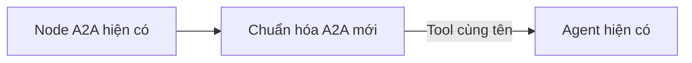
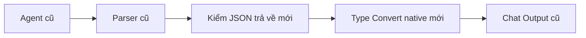

# Ver2: lớp xử lý giao tiếp được thêm bằng node

## Lỗi đã đối chiếu

Trace `959fed03e2b74d658fc71cdff818a9a1`, ngày 18/10/2026:

1. Trung tâm gửi đúng nhu cầu DEMO-P03, 100 cuộn, ngày 20/10/2026.
2. Dữ liệu tra thành công và trả UUID, mã/tên/đơn vị cùng ToolResult thật.
3. ML tiếp tục gọi `hoi_du_lieu` với `task=rank_suppliers`, sau đó với `task=offers`.
   Hai task này không thuộc dependency được phép của ML. Model còn chép lại evidence,
   làm rơi/đổi vị trí trường trong kết quả gốc; phép đối chiếu receipt từ chối gói đó.
4. Vì vậy phát sinh INVALID_HANDOFF_REQUEST; lần thử lại có thêm
   SERVICE_OUTPUT_INVALID/INVALID_DEPENDENCY. Không có lời gọi API
   `prediction_rank_suppliers` trong trace. Bốn A2A/12 lượt model đã dùng cho luồng lỗi.

Bản preflight trước đó xử lý thiếu lượng/ngày. Lượt mới đã đủ dữ kiện nên đi tiếp
và lộ lỗi định dạng/routing ở bước ML giao tiếp với Dữ liệu.

## Sơ đồ được áp dụng

Mỗi đường A2A giữ nguyên node A2A cũ, chỉ chèn adapter vào dây Tools:



Luồng công việc thực tế vẫn là trung tâm → ML → Dữ liệu → ML → trung tâm.
Adapter bọc công cụ A2A; nó kiểm gói tin tại thời điểm agent gọi tool, trước khi
node A2A cũ chạy. Chỉ thêm parser ở đầu/cuối flow sẽ không bắt được task sai vì
BoundedA2AAgent hiện có từ chối gói tin trước khi chạy flow bên nhận.

Mỗi flow con có thêm hai node trên dây trả lời:



| Node thêm | Số lượng | Xử lý |
| --- | ---: | --- |
| Chuẩn hóa A2A | 5 | Trung tâm → 3 nhánh; ML/RAG → Dữ liệu |
| Kiểm JSON trả về | 3 | Đọc khung JSON, kiểm service/schema/handoff, giữ lỗi và chứng cứ |
| Type Convert | 3 | Native Langflow: chuyển text JSON đã kiểm thành Message |

Tổng **11 node**, không thêm model. Parser native đang có tiếp tục được sử dụng.
Type Convert và Parser có sẵn chỉ chuyển kiểu/đóng gói; kiểm task theo vai trò,
receipt và phạm vi lần chạy cần hai loại component nhỏ riêng. Không sửa thư viện
Langflow, runtime Agent/A2A cũ hoặc nguồn code của các node đang có.

## Quy tắc của lớp mới

- Request dùng schema Request hiện có. Null của known/evidence được xử lý theo
  contract; không tự đặt sản phẩm, số lượng, ngày hoặc UUID còn thiếu.
- Với dependency ML/RAG → Dữ liệu, lấy điều kiện từ request cha đã nhận. Rank/score/
  retrieve dùng resolve_entities; order_risk dùng order. Không giao phép xếp hạng
  hoặc xem báo giá cho dependency tra định danh.
- Evidence model gửi lại không được sử dụng. Runtime chọn receipt thật của đúng
  đối tượng trong cùng lần chạy và đính kèm nguyên bản. Không lấy evidence của phiên
  khác, không chép receipt sang sản phẩm/NCC khác, không tạo kết quả ML giả.
- Sau một reply dependency, adapter ngừng xuất hiện trong danh sách tool được
  middleware hiện có đưa cho model ở lần tiếp theo. ML chuyển sang API chuyên môn,
  hoặc trả yêu cầu người dùng chọn/bổ sung khi dependency chưa giải quyết được.
- Receipt đầy đủ nằm trong runtime. Reply tra định danh thành công cho ML/RAG chỉ
  cần resolved và trạng thái; bỏ việc đưa cả receipt dài cho model chép lại. Reply
  nhập nhằng giữ nguyên các lựa chọn và câu hỏi thực.
- Output vẫn theo Reply hiện có. Envelope không biến error/unavailable thành
  success và không phục hồi dữ liệu đã bị validator trong Agent cũ loại bỏ.
- Riêng ML rank/score nhờ Data resolve_entities: câu hỏi con và known chỉ chứa
  nhiệm vụ/selector định danh; lượng/ngày/giá vẫn giữ ở request ML cha. Nếu Data đã
  tra thành công nhưng reply chỉ lỗi INVALID_DEPENDENCY do handoff ngoài nhiệm vụ,
  adapter xác nhận hoàn thành từ receipt thực cùng run: đúng selector, UUID hợp lệ,
  mã/tên/đơn vị, match_count=1, không truncated. Score phải đủ cả sản phẩm và NCC.
  Lỗi API/quyền/schema, thiếu dữ kiện và nhập nhằng vẫn giữ nguyên. Warning gốc
  lưu ở trace. Không áp dụng cho Data gọi trực tiếp, offers/list/PR/PO hoặc RAG.
- Không thêm lượt LLM để sửa JSON, không thêm retry model hoặc nới giới hạn lượt.
  Lớp này kiểm giao tiếp; chất lượng hiểu ý định/trả lời của model cần kiểm riêng.

## Giữ nguyên node cũ và khôi phục

Installer `add_ver2_protocol_nodes.py` chỉ thêm node và thay các dây cần chèn lớp mới.
Trước PATCH nó so cấu hình hiện tại với snapshot để tránh ghi đè bản người dùng vừa
chỉnh. Sau PATCH nó so toàn bộ object của từng node cũ, gồm code, prompt, model,
credential reference, tham số, metadata và vị trí; các flow ngoài ver2 giữ nguyên hash.

Snapshot bốn flow và danh sách hash node cũ được lưu trong thư mục ignored
`data/ver2-before-protocol-nodes-*`. Thay đổi qua API có rollback khi lỗi. Chạy lại
trên flow đã có adapter bị từ chối để tránh tạo node trùng.

```powershell
.\langflow\.venv\Scripts\python.exe langflow/add_ver2_protocol_nodes.py
.\langflow\.venv\Scripts\python.exe langflow/add_ver2_protocol_nodes.py --apply
```

Lệnh đầu chỉ dựng graph/kiểm cấu hình. Cả hai lệnh không chạy workflow hoặc model.
Sau cập nhật, F5 bốn tab ver2 để canvas cũ không ghi đè cấu hình mới.

## Kiểm chứng

- 54 kiểm thử coordination/protocol offline đạt, có luồng native create_agent +
  Internal A2A giả lập từ trung tâm đến Data rồi quay về gọi đúng API rank.
- Ca có task sai/evidence bị sửa được chuẩn hóa; Data không còn được đưa cho model
  sau khi tra xong. Receipt cuối giữ đủ lookup và kết quả rank giả lập.
- Kiểm reply lỗi/nhập nhằng, phân tách phiên và dữ liệu sản phẩm khác; Type Convert
  native xuất JSON hợp lệ và giữ nguyên dữ liệu/errors.
- Bốn graph được Graph.from_payload đọc và kiểm không có chu trình trước khi áp dụng.
- Chưa chạy lại hội thoại bằng model thật; chưa nghiệm thu chất lượng khuyến nghị NCC.

Tham khảo component native: [Type Convert](https://docs.langflow.org/type-convert),
[Parser](https://docs.langflow.org/parser).
