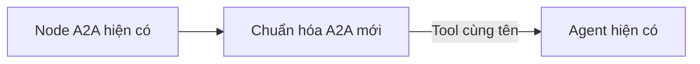
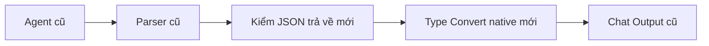

# FlowBridge - ver2

Bản riêng trong project Langflow **FlowBridge - ver2**, gồm bốn flow:

| Flow | Vai trò | Công cụ |
| --- | --- | --- |
| FlowBridge - ver2 | Agent trung tâm, nhận câu hỏi và tổng hợp | 3 A2A Internal |
| FlowBridge - ver2 - Dữ liệu | Agent tra dữ liệu nghiệp vụ | Sản phẩm, NCC, báo giá, PR, PO |
| FlowBridge - ver2 - Dự đoán ML | Agent chọn đúng phép dự đoán | 4 API ML + A2A hỏi Dữ liệu |
| FlowBridge - ver2 - Tri thức RAG | Agent tìm bằng chứng | Retrieve có ACL/JobContext + A2A hỏi Dữ liệu |

Mở `langflow/start.cmd` bằng nhấp đúp trên Windows, chọn project rồi mở flow chính.
Launcher bật tính năng A2A bằng `LANGFLOW_A2A_ENABLED=true`. Nếu Langflow đã chạy từ
trước khi thêm cờ này, đóng server cũ rồi mở lại launcher một lần.

## Thiết kế bằng node chuẩn

Flow chính:

```text
Chat Input ─────────────┐
Current Date (VN) ──────┴─> Prompt Template ─> Agent trung tâm ─> Chat Output
                                               ↑ Tools
                              A2A Dữ liệu / A2A ML / A2A RAG
```

Mỗi flow con:

```text
Chat Input + Current Date ─> Prompt Template ─> Agent chuyên trách
                                                   ↑ API tools
Agent (Structured Response) ─> Parser Stringify ─> Chat Output
```

Dùng 24 node chuẩn hoặc kế thừa node chuẩn, 4 Agent Langflow và 10 node API nghiệp
vụ (38 node/34 edge trong bốn flow). Các node chuẩn là Chat Input,
Chat Output, A2A Agent, Current Date,
Prompt Template và Parser. Không tự viết orchestration hay A2A
client/server. Không thêm node chỉ để trang trí hoặc thêm lượt model định dạng JSON.

Custom API nghiệp vụ có DTO canonical, phân quyền human/AI, endpoint
cố định, pagination có giới hạn, decimal và JSON lỗi thống nhất. HTTP Request node
thuần không thay thế đầy đủ các quy tắc đó. Ba custom service aggregator và custom
Agent/model ở v1 không được dùng trong ver2. Bốn Agent vẫn dùng orchestration, memory,
tool loop và Structured Response upstream. Lớp model truyền tùy chọn vào model
factory; ba Agent con còn có adapter định dạng object động ở nhánh native không có
tool (xem dưới). Không sửa source/runtime/graph của v1 hoặc dependency Langflow.

Agent trung tâm thấy ba action `hoi_du_lieu`, `hoi_du_doan`, `hoi_tri_thuc`. A2A để
**Internal**: chọn đúng flow con trong cùng project bằng ID; không cần HTTP hoặc
Langflow API key giữa các agent. Ba flow con bật Serve as an A2A agent; flow trung
tâm không bật để tránh tự gọi. Session con được A2A native tách namespace; lịch sử
agent con mặc định 0 để tránh lấy nhầm dữ liệu nhiệm vụ trước.

## Phối hợp giữa các agent, có giới hạn thực thi

```text
Người dùng -> Trung tâm -> ML -> Dữ liệu
                       <- ML <- UUID/chứng cứ
                       -> RAG -> Dữ liệu (chỉ khi thiếu định danh NCC)
                       <- RAG <- UUID/chứng cứ
Trung tâm -> trả lời người dùng khi đã có kết quả hoặc cần làm rõ lựa chọn thực sự
```

ML/RAG có thêm đúng một node A2A Internal trỏ tới cùng flow Dữ liệu. Dữ liệu không
có A2A đi tiếp. Không có cạnh con -> trung tâm hoặc ML <-> RAG; agent con trả kết quả
và nhu cầu còn thiếu về bên gọi, trung tâm quyết định bước tiếp theo. Tránh đưa tất
cả agent vào một mạng gọi lẫn nhau. Tên/mã + lượng/ngày đủ cho một yêu cầu ML: trung
tâm gọi ML trực tiếp; ML tự resolve cả product/supplier cùng một lần rồi gọi API ML.
Nếu cần cả ML và RAG cho cùng đối tượng, trung tâm có thể resolve một lần và chia sẻ
cùng evidence. Đã có evidence/UUID thì bỏ bước tra lại.

`CoordinatedCentralAgent`/`CoordinatedServiceAgent` kế thừa Agent hiện có; vẫn dùng
native tool loop, model factory, memory, Structured Response và A2A project ACL.
`BoundedA2AAgent` kế thừa native A2A, không viết lại transport/run-flow hoặc sửa
dependency Langflow. Middleware và context theo lần chạy bổ sung các bảo đảm:

- Cả lượt: tối đa **4 A2A**, **14 model calls**; chuỗi dài nhất trung tâm -> ML/RAG ->
  Dữ liệu. Trung tâm tối đa3 tool calls/4 model calls, Dữ liệu3 tool/4 model, ML/RAG
  một dependency + một API chuyên môn/3 model. SDK retries0; model chọn tool tuần tự.
- Lời gọi lặp cùng tham số trong một lượt dùng kết quả cũ, kể cả kết quả lỗi; không
  tự retry hoặc chia cache danh tính qua các phiên/người dùng.
- Request có task/question/business_date/known/evidence. Evidence chỉ được chuyển
  khi có receipt từ tool thực trong chính lượt này. Reply có request_id/path runtime
  để đối chiếu; nội dung model không được tự đặt lại ngân sách hay đường gọi.
- Container tùy chọn được chuẩn hóa khi model gửi null: evidence -> [], known -> {};
  các list/object tùy chọn của reply cũng vậy. Không nới kiểu của dữ liệu không rỗng,
  không điền task/ngày/định danh còn thiếu. Sai định dạng là error nội bộ, không phải
  bằng chứng dịch vụ unavailable. top_k không nêu thì dùng mặc định node.
- `resolved` được dựng lại từ receipt; `results` chỉ chứa ToolResult thực. Model làm
  rơi UUID thì runtime khôi phục; dựng kết quả ML/tài liệu không có receipt thì error.
  Mới tra được UUID mà chưa gọi API ML/RAG không được coi là hoàn thành nhiệm vụ.
- Nhập nhằng/thiếu quy cách: giữ danh sách lựa chọn/câu hỏi từ Dữ liệu và trả về trung
  tâm. UUID thiếu nhưng có tên/mã phải tự resolve, không yêu cầu UUID từ người dùng.
- Thiếu quantity/ngày nhận trong rank_suppliers hoặc score_supplier: middleware
  chặn trước khi chạy ML. Chưa xác minh sản phẩm thì trả needs_service để trung tâm
  tra Dữ liệu; đã có receipt đúng sản phẩm thì needs_input, giữ tên/mã và hỏi phần
  còn thiếu. Không dùng receipt của sản phẩm khác hoặc cache phản hồi thiếu đầu vào.
- Lỗi chạy agent trả SERVICE_EXECUTION_FAILED; reply sai định dạng trả
  INVALID_SERVICE_REPLY, sai service giữ SERVICE_MISMATCH. Các lỗi này có trace,
  status=error và không chứng minh backend ML ngừng hoạt động; không lộ exception text.
- `handoffs=[{service,task,reason}]`, status=needs_service cho dependency cần trung tâm
  điều phối tiếp; trung tâm chỉ làm việc cần cho yêu cầu gốc, trong ngân sách còn lại.
  Không cần gửi các thông báo trung gian ra chat người dùng.

Receipt kiểm chứng dữ liệu công cụ; không chứng minh model hiểu đúng ý định người
dùng hoặc diễn giải đúng mọi câu trả lời cuối. Lịch sử tiếp nối vẫn dùng memory
native. Mỗi root execution có ngân sách riêng, không phải giới hạn cộng dồn cả phiên.
RAG thiếu AI credential/JobContext trả unavailable trước model, không tra NCC vô ích.

Nâng cấp riêng metadata đang chạy, giữ model, credential, preset API và layout cũ:

```powershell
.\langflow\.venv\Scripts\python.exe langflow/upgrade_ver2_coordination.py --apply
```

Bỏ `--apply` để xem kế hoạch; `--exports-only` cập nhật bốn JSON nguồn. Sao lưu ở
`data/ver2-before-coordination-*`; lỗi khi áp dụng sẽ khôi phục các flow vừa đổi.
Sau nâng cấp F5 bốn tab để bản nháp canvas cũ không ghi đè metadata mới.
Kiểm thử dùng native create_agent/toolkit với model giả lập, không gọi OpenAI;
bao gồm trung tâm -> ML -> Dữ liệu -> ML -> trung tâm, lỗi/nhập nhằng, receipt giả,
ngân sách lồng nhau, cache, cách ly root và giữ cấu hình khi migrate. Hội thoại model
thật được kiểm riêng, không suy từ kết quả test giả lập; xem ghi nhận bên dưới.

## Dữ liệu: nói tên/mã, hệ thống tự lấy UUID

Flow Dữ liệu có 11 node/10 edge. Giữ Chat Input, Current Date, Prompt, Agent,
Structured Response, Parser và Chat Output của Langflow. Năm tool:

| Node | Input của agent | Hành vi |
| --- | --- | --- |
| Nhận diện sản phẩm và NCC | `product`, `supplier` bằng tên/mã/UUID, một hoặc cả hai | Đọc danh mục, chuẩn hóa dấu, tiền tố tên và quy cách; trả UUID thật trong `data.resolved` |
| Duyệt danh mục | `resource=products/suppliers`, `query` tùy chọn, `page`, `page_size` | Không keyword: phân trang trực tiếp bằng API core; có keyword: lọc trên phạm vi quét có giới hạn |
| Báo giá theo tên hoặc mã | `product`, `supplier` tùy chọn | Tự nhận diện rồi đọc supplier-products; trả mã/tên NCC cùng giá, currency, MOQ, lead time |
| Tìm và đọc PR | `identifier` bằng mã đầy đủ/một phần, từ khóa ghi chú/ngày/trạng thái hoặc UUID; null để xem lựa chọn | Nhiều khớp đưa mã để chọn; duy nhất mới đọc chi tiết và dòng hàng |
| Tìm và đọc PO | `identifier` bằng mã đầy đủ/một phần, ngày/trạng thái hoặc UUID; null để xem lựa chọn | Nhiều khớp đưa mã/ngày/trạng thái để chọn; duy nhất mới đọc chi tiết và lịch giao |

Các adapter mới nằm riêng trong `ver2_data.py`/`ver2_data_nodes.py`; không thay tool
v1 và không mở API ghi hay SQL. Chúng tận dụng `GET /api/v1/products`, `/suppliers`,
`/supplier-products`, `/purchase-requests`, `/purchase-orders` và hai API đọc chi tiết
PR/PO. Phạm vi đơn do API core kiểm theo tài khoản. Không thêm model để sửa tên hoặc
chuyển mã sang UUID; không quét nội dung từng đơn bằng hàng loạt request để đoán tên.

Ví dụ `product="băng keo Scotch 371 vàng"`, `supplier="Nhà vật tư Phúc Lâm"` nhận
diện được DEMO-P03 và Vật tư Phúc Lâm — NCC-06 từ danh mục hiện có. `NCC-06` cũng
được tìm trong tên hiển thị dù mã chính thức của bản ghi là DEMO-S06. Viết khác
dấu/cách/ký hiệu kích thước không làm mất kết quả; sai chính tả chỉ tạo gợi ý để
người dùng chọn, không tự gán UUID. Tra trước khi hỏi lượng/ngày: “Băng keo” có hai
màu thì đưa cả hai tên/mã để chọn. Quy tắc lựa chọn áp dụng chung cho sản phẩm, NCC,
PR và PO. Ghi chú/tên không có trong list đơn thì hỏi mã/ngày để thu hẹp.
Quét chưa đủ không xác nhận duy nhất. UUID trả về được kiểm cú pháp trước khi handoff.

Một lần nhận diện lấy được cả hai đối tượng. Node báo giá giữ cache danh mục trong
phạm vi instance/lần chạy để không đọc lại cùng danh mục cho từng NCC; không chia
cache danh tính qua người dùng hoặc phiên. Danh mục có phân trang bình thường dùng
`has_more/next_page`, khác với `truncated` khi chưa quét đủ phạm vi tìm kiếm. Không
có snapshot nhất quán xuyên nhiều trang vì API core hiện chưa hỗ trợ.

Agent trung tâm dùng lịch sử native 12 tin nhắn. Khi người dùng chỉ bổ sung “100
cuộn, 3 ngày nữa” hoặc sửa “NCC-06 á”, prompt yêu cầu giữ sản phẩm, số lượng và ngày
đã chốt của nhiệm vụ; chỉ thay đối tượng vừa được sửa. Lịch sử không còn evidence
UUID thì tự tra lại từ tên/mã, không yêu cầu người dùng UUID. Ngày đã chuyển sang
ngày tuyệt đối không được tính lại khi chỉ bổ sung NCC. Đơn vị phải khớp sản phẩm.
Đây là điều phối bằng model/prompt và lịch sử native, không phải bộ nhớ trạng thái
nghiệp vụ được bảo đảm; đổi chủ đề hoặc history bị cắt có thể cần hỏi lại tên/quy cách.

Nâng cấp một bản ver2 đang tự chỉnh mà vẫn giữ model, credential, PR/PO và kết nối:

```powershell
.\langflow\.venv\Scripts\python.exe langflow/upgrade_ver2_data.py --apply
```

Bỏ `--apply` để kiểm tra kế hoạch. Script chỉ cập nhật Dữ liệu + prompt/A2A description
của trung tâm, sao lưu trong `data/ver2-before-data-upgrade-*`, kiểm các flow khác
giữ nguyên và cập nhật bookkeeping của kết nối test local. F5 cả hai tab sau khi áp
dụng để tránh bản nháp canvas cũ ghi đè metadata mới. Không chạy flow/gọi OpenAI.

## Chỉnh trên giao diện

- Mỗi Agent: **Chọn mô hình**, **API key / biến bí mật**, **System prompt**, giới hạn
  lượt model, output token, số tin nhắn lịch sử. Mặc định `gpt-5.6-luna`/OpenAI.
  Dropdown native có thể mở phần cấu hình provider để chọn/thêm model khác.
- Bốn Agent có **Endpoint OpenAI** và **Mức suy luận OpenAI**. Mặc định Chat
  Completions + none để Luna dùng function tools. Để reasoning low trở lên, chọn
  Responses; cấu hình Luna + Chat Completions + reasoning khác none bị chặn trước
  request. `auto`/không truyền effort có thể dùng mặc định medium từ provider,
  nên không dùng để né lỗi này. SDK retries mặc định0, timeout45s, chỉnh ở advanced.
- API key tham chiếu biến Credential riêng `FLOWBRIDGE_VER2_OPENAI_API_KEY` trong
  Settings → Global Variables. Installer lấy key đã cấu hình local nếu biến chưa
  tồn tại; không ghi key vào JSON/source hoặc thay credential của v1. Thay key của
  ver2 bằng sửa biến riêng, hoặc điền trực tiếp trên từng Agent.
- Launcher nạp `data/agent.env` bằng tùy chọn `--env-file` chuẩn. Langflow nhận diện
  provider OpenAI qua biến `OPENAI_API_KEY` trong môi trường và nhập Credential local;
  giữ credential người dùng đã tự chỉnh theo cơ chế upstream. Bước này không gọi
  endpoint xác minh key/model. Biến key riêng trên bốn Agent vẫn là cấu hình ver2.
- Node API giữ các ô tham số, description, Input JSON `{}`, khóa mặc định, output
  projection và nút xem contract như v1. Các node trong ver2 là bản sao cấu hình;
  chỉnh chúng không đổi node v1. API origin/token/timeout nằm ở cấu hình node/env,
  không phải argument do LLM tự truyền.
- A2A: chọn agent, Tool Mode, mở Actions để chỉnh slug/description. Để Message trống
  cho Agent điền `input_value`. Không chuyển External nếu vẫn dùng flow cùng project.
- Schema output và format instructions nằm ở từng Agent con; Parser chuyển Data
  thành JSON có khung Markdown. A2A đọc đúng một object JSON, chấp nhận duy nhất khung
  ngoài do Parser sinh; không lấy JSON từ văn xuôi hay bỏ kiểm kiểu/correlation.
  Đã bỏ Operations Text Replace: các ô regex của node động bị reset về mặc định
  khi chạy, từng làm kết quả hợp lệ bị đổi thành SERVICE_CALL_FAILED.
  Output đang chọn của Agent con phải là **Structured Response**; chuyển sang
  Response thường sẽ làm Langflow bỏ đường nối vào Parser vì khác kiểu dữ liệu.

## Hợp đồng giữa agent

A2A native nhận một argument `input_value: string`, bên trong là JSON:

```json
{
  "task": "rank_suppliers",
  "question": "Chọn 3 NCC rủi ro thấp, tối đa 18 triệu VND mỗi cái",
  "business_date": "2026-10-18",
  "known": {
    "product_id": null,
    "quantity": null,
    "requested_delivery_date": null,
    "top_k": 3,
    "currency": "VND",
    "max_unit_price": "18000000"
  },
  "evidence": []
}
```

Đây là mẫu giải thích, không phải input đã đủ để chạy ML. Thiếu sản phẩm/số lượng/
ngày nhận: tra tên đã có để làm rõ đối tượng trước, rồi hỏi điều kiện còn thiếu.
ID đã có thì không tra lại. Chỉ gửi các field
cần thiết cho task; không truyền credential, URL hoặc toàn bộ history.

Output sau Structured Response/Parser và bước đọc JSON tại A2A:

```json
{
  "service": "prediction",
  "status": "needs_input",
  "resolved": {},
  "results": [],
  "missing": ["product_id", "quantity", "requested_delivery_date"],
  "questions": ["Bạn cần sản phẩm nào, số lượng và ngày nhận hàng là bao nhiêu?"],
  "warnings": [],
  "handoffs": []
}
```

`results` giữ ToolResult thật `tool/status/input/data/error`, kể cả trace/currency/
warning/reference; `resolved` chỉ chứa ID/tham số xác minh được. Schema table native
kiểm kiểu các field ngoài; không chứng minh nguồn dữ liệu/ý định đúng. Validation
error của native Agent (`error`, `validation_error`, thiếu field, sai service) phải
được trung tâm xử lý như lỗi, không tiếp tục ML với ID đoán.

Ở lớp tương thích cơ sở khi chưa có tool, Langflow dùng nhánh native thay
vì vòng agent/tool. `resolved` và ToolResult có object động, không phù hợp với
`json_schema` strict yêu cầu `additionalProperties=false` tại mọi object. Ba Agent
con giữ `StructuredServiceAgent` bên dưới lớp phối hợp, chỉ bọc model ở nhánh native này để gọi
API LangChain `with_structured_output(method="function_calling", strict=False)`.
Pydantic kiểm cấu trúc đầu ra tại local; không còn cam kết ép strict từ provider.
Giữ nguyên dict/JSON lồng nhau, schema chỉnh trên UI, prompt và Parser; không xóa
trường động, không retry hoặc thêm model call. Nhánh có API tools và schema đóng
vẫn dùng luồng upstream. Không thay orchestration hoặc source Langflow.

Sửa riêng workflow đã có mà giữ preset/connection từ root repo:

```powershell
.\langflow\.venv\Scripts\python.exe langflow/repair_ver2_structured.py
```

Lệnh chỉ thay code/metadata của ba Agent con, backup vào
`data/ver2-before-structured-fix-*` (ignore), không gọi model hoặc chạy flow. F5 tab
workflow trước khi thử. Bản mới của `setup_ver2.py` và `repair_ver2_model.py` cũng
giữ lớp tương thích này. RAG vẫn cần credential/context và backend hỗ trợ thật;
sửa định dạng không cấp quyền hoặc kích hoạt truy hồi.

Nguồn: [OpenAI Docs — Structured Outputs](https://developers.openai.com/api/docs/guides/structured-outputs?api-mode=chat).

Đường dữ liệu được quy định trong prompt:

- Tên sản phẩm → Dữ liệu → `product_id` + `unit` → ML hoặc báo giá.
- Tên NCC → Dữ liệu → `supplier_id` → scenario hoặc RAG có filter NCC.
- Mã PO → Dữ liệu → `data.purchase_order_id` → ML `order_id`; UUID PO có sẵn gọi thẳng.
- PR nhiều item: hỏi chọn dòng trước; preferred supplier không phải NCC đã chốt.
- Rank → kết quả đã có score của từng ứng viên; không gọi scenario chấm lại.
- Rank → RAG chỉ khi người dùng yêu cầu chứng cứ, với NCC cần kiểm tra cụ thể.

Trần đơn giá được agent trung tâm đọc và chuyển vào `known.max_unit_price` rồi agent
ML truyền vào tool rank. Ví dụ 18 triệu VND/cái → `"18000000"`, `currency="VND"`.
Không tự đặt trần cho “giá tốt”; không biến tổng ngân sách thành đơn giá; thiếu tiền
tệ phải hỏi. Tool vẫn áp resolver: giá trị khóa > câu hỏi rõ ràng > mặc định node,
null dùng mặc định, `clear_defaults` chỉ khi người dùng yêu cầu bỏ filter được phép.

## Giới hạn và chi phí

Agent chính/Dữ liệu tối đa 4 model calls; ML/RAG tối đa 3 mỗi lần được giao việc.
Tắt date tool, calculator và tool retry; ngày giờ được node native thêm trực tiếp.
Middleware phối hợp áp giới hạn tool/model/A2A tại runtime như phần trên; không chỉ
dựa vào prompt. SDK retries0 và lời gọi tool tuần tự. Khi đã hết ngân sách phải nêu
phần chưa làm, không coi kết quả thiếu là thành công.

Nhiều agent thường tốn thêm model calls so với v1. Một nhánh đơn giản thường cần
trung tâm chọn service, agent con chọn tool/đọc kết quả, rồi trung tâm tổng hợp;
đó không phải giá hoặc số request được bảo đảm. Chỉ chạy khi muốn thử. Codex chưa
chạy câu hỏi nào và vẫn phải xin phép từng OpenAI request khi test trong chat.

Để kết nối nghiệp vụ thật vẫn cần backend hoạt động và bearer người dùng hợp lệ.
RAG cần AI bearer và JobContext thật; thiếu thì tool RAG không đăng ký, agent báo
unavailable. Chưa nghiệm thu auth/backend/model hoặc độ chính xác chọn tool.

## Chạy cùng hệ thống

Dùng [stack Docker có SSO](../HUONG-DAN-CHAY.md). Backend truyền caller theo request;
Data/ML gọi API chuẩn, RAG dùng AI_SERVICE và JobContext thật. Native serving theo
[backend ↔ Langflow](../docs/LANGFLOW-SSO.md).

## Dựng lại riêng ver2

Từ root repo, khi Langflow đang mở:

```powershell
.\langflow\.venv\Scripts\python.exe langflow/setup_ver2.py --install
```

Lệnh chỉ CRUD metadata Langflow, không chạy flow hoặc gọi OpenAI/backend nghiệp vụ.
Chỉ cập nhật bốn endpoint `flowbridge-ver2-*` trong project đúng tên; không dùng
`setup_agent.py --install` cho ver2 vì lệnh đó cập nhật v1. Export bốn flow nằm ở
`langflow/flows/ver2/`; installer giải quyết ID thực của flow con trước khi nối A2A.
Nếu tự import JSON sang máy khác, phải import ba flow con trước và chọn lại chúng
trên ba node A2A. Sao lưu cấu hình tự chỉnh trước khi dựng lại để khỏi mất preset.

Nếu cần sửa lỗi Luna tool/reasoning trên một bộ ver2 đang tự chỉnh, dùng
`python langflow/repair_ver2_model.py` bằng Python trong venv Langflow. Lệnh chỉ thêm
model options và thay lớp cấu hình Agent; giữ preset/prompt/edge/ID, sao lưu vào
`data/ver2-before-model-fix-*` (ignore) và kiểm hash các workflow ngoài ver2. Không
chạy workflow. Không dùng Update All để ghi đè bốn Agent đã bổ sung tùy chọn bằng
Agent stock chưa có các ô này.

Tài liệu upstream: [A2A](https://docs.langflow.org/a2a-server),
[Tools](https://docs.langflow.org/agents-tools). Cấu hình này đối chiếu source bản
Langflow/lfx 1.12.6 cài local. Code/config nhóm GPL-3.0-or-later; xem LICENSE.


## Chuẩn hóa giao tiếp A2A


Mỗi đường A2A giữ nguyên node A2A cũ, chỉ chèn adapter vào dây Tools:



Luồng công việc thực tế vẫn là trung tâm → ML → Dữ liệu → ML → trung tâm.
Adapter bọc công cụ A2A; nó kiểm gói tin tại thời điểm agent gọi tool, trước khi
node A2A cũ chạy. Chỉ thêm parser ở đầu/cuối flow sẽ không bắt được task sai vì
BoundedA2AAgent hiện có từ chối gói tin trước khi chạy flow bên nhận.

Mỗi flow con có thêm hai node trên dây trả lời:



| Node thêm | Số lượng | Xử lý |
| --- | ---: | --- |
| Chuẩn hóa A2A | 5 | Trung tâm → 3 nhánh; ML/RAG → Dữ liệu |
| Kiểm JSON trả về | 3 | Đọc khung JSON, kiểm service/schema/handoff, giữ lỗi và chứng cứ |
| Type Convert | 3 | Native Langflow: chuyển text JSON đã kiểm thành Message |

Tổng **11 node**, không thêm model. Parser native đang có tiếp tục được sử dụng.
Type Convert và Parser có sẵn chỉ chuyển kiểu/đóng gói; kiểm task theo vai trò,
receipt và phạm vi lần chạy cần hai loại component nhỏ riêng. Không sửa thư viện
Langflow, runtime Agent/A2A cũ hoặc nguồn code của các node đang có.

### Quy tắc của lớp mới

- Request dùng schema Request hiện có. Null của known/evidence được xử lý theo
  contract; không tự đặt sản phẩm, số lượng, ngày hoặc UUID còn thiếu.
- Với dependency ML/RAG → Dữ liệu, lấy điều kiện từ request cha đã nhận. Rank/score/
  retrieve dùng resolve_entities; order_risk dùng order. Không giao phép xếp hạng
  hoặc xem báo giá cho dependency tra định danh.
- Evidence model gửi lại không được sử dụng. Runtime chọn receipt thật của đúng
  đối tượng trong cùng lần chạy và đính kèm nguyên bản. Không lấy evidence của phiên
  khác, không chép receipt sang sản phẩm/NCC khác, không tạo kết quả ML giả.
- Sau một reply dependency, adapter ngừng xuất hiện trong danh sách tool được
  middleware hiện có đưa cho model ở lần tiếp theo. ML chuyển sang API chuyên môn,
  hoặc trả yêu cầu người dùng chọn/bổ sung khi dependency chưa giải quyết được.
- Receipt đầy đủ nằm trong runtime. Reply tra định danh thành công cho ML/RAG chỉ
  cần resolved và trạng thái; bỏ việc đưa cả receipt dài cho model chép lại. Reply
  nhập nhằng giữ nguyên các lựa chọn và câu hỏi thực.
- Output vẫn theo Reply hiện có. Envelope không biến error/unavailable thành
  success và không phục hồi dữ liệu đã bị validator trong Agent cũ loại bỏ.
- Riêng ML rank/score nhờ Data resolve_entities: câu hỏi con và known chỉ chứa
  nhiệm vụ/selector định danh; lượng/ngày/giá vẫn giữ ở request ML cha. Nếu Data đã
  tra thành công nhưng reply chỉ lỗi INVALID_DEPENDENCY do handoff ngoài nhiệm vụ,
  adapter xác nhận hoàn thành từ receipt thực cùng run: đúng selector, UUID hợp lệ,
  mã/tên/đơn vị, match_count=1, không truncated. Score phải đủ cả sản phẩm và NCC.
  Lỗi API/quyền/schema, thiếu dữ kiện và nhập nhằng vẫn giữ nguyên. Warning gốc
  lưu ở trace. Không áp dụng cho Data gọi trực tiếp, offers/list/PR/PO hoặc RAG.
- Không thêm lượt LLM để sửa JSON, không thêm retry model hoặc nới giới hạn lượt.
  Lớp này kiểm giao tiếp; chất lượng hiểu ý định/trả lời của model cần kiểm riêng.

### Giữ nguyên node cũ và khôi phục

Installer `add_ver2_protocol_nodes.py` chỉ thêm node và thay các dây cần chèn lớp mới.
Trước PATCH nó so cấu hình hiện tại với snapshot để tránh ghi đè bản người dùng vừa
chỉnh. Sau PATCH nó so toàn bộ object của từng node cũ, gồm code, prompt, model,
credential reference, tham số, metadata và vị trí; các flow ngoài ver2 giữ nguyên hash.

Snapshot bốn flow và danh sách hash node cũ được lưu trong thư mục ignored
`data/ver2-before-protocol-nodes-*`. Thay đổi qua API có rollback khi lỗi. Chạy lại
trên flow đã có adapter bị từ chối để tránh tạo node trùng.

```powershell
.\langflow\.venv\Scripts\python.exe langflow/add_ver2_protocol_nodes.py
.\langflow\.venv\Scripts\python.exe langflow/add_ver2_protocol_nodes.py --apply
```

Lệnh đầu chỉ dựng graph/kiểm cấu hình. Cả hai lệnh không chạy workflow hoặc model.
Sau cập nhật, F5 bốn tab ver2 để canvas cũ không ghi đè cấu hình mới.
