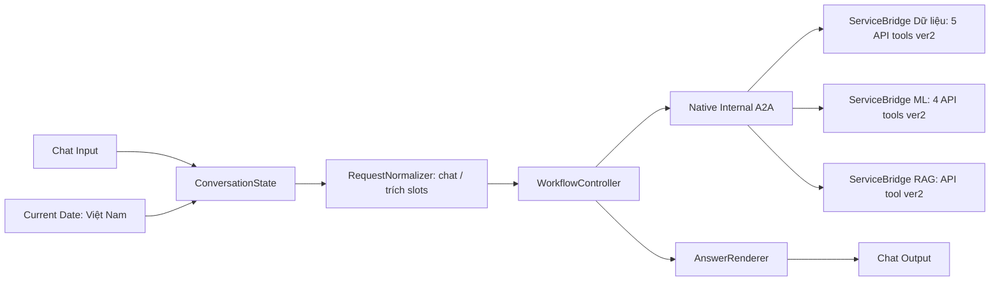

# FlowBridge ver3 — kế thừa ver2, phân tầng xử lý

<!-- SPDX-License-Identifier: GPL-3.0-or-later; FlowBridge, see LICENSE. -->

Ver3 được **clone từ bốn flow ver2 đang lưu trong Langflow**, giữ nguyên các node
API, credential reference, preset, cờ bật/tắt và kết nối backend. Sau khi clone,
installer lưu bản ver3 nguyên trạng rồi mới thay phần điều phối trên ver3. Ver2 và
v1 không bị cập nhật. Không có dependency hay migration backend mới.

## Luồng cuối



Lời chào vẫn đi qua các node state/controller để lưu phiên nhất quán nhưng không
gọi A2A hoặc model. ServiceBridge thay Agent/Structured Response/Parser ở ba flow
con; nhánh Dữ liệu kết thúc bằng ToolResult, không tự tạo handoff. Tổng graph cuối:
29 node, 25 edge; 10 API adapter của ver2 giữ nguyên. Native A2A tiếp tục kiểm
owner/project/publication và tạo sub-session riêng của Langflow.

## Hợp đồng từng node

| Node | Nhận | Trả / giới hạn |
|---|---|---|
| ConversationState | Câu hỏi, Current Date, user/flow/session từ engine | Ticket/version/lease + state riêng; TTL 30 phút |
| RequestNormalizer | State gọn, câu hiện tại, ngày nghiệp vụ | Decision strict: mode, tasks enum, Slots nullable, selection, clear, reply |
| WorkflowController | Decision + ticket + ba A2A tools | Máy trạng thái, tối đa 6 service calls/300 giây; kết quả, trace, lưu CAS |
| ServiceBridge | ServiceRequest do controller tạo; API tools đã nối | Đúng một ToolResult gốc; không gọi LLM |
| AnswerRenderer | Kết quả đã kiểm | Câu hỏi lựa chọn/bảng/số liệu/nguồn thật; 0 LLM |

`ver3_contracts.py` là nguồn chuẩn của enum/schema/routing. Model không có trường
product_id/supplier_id/evidence/handoffs. Nó không viết JSON A2A. Request nội bộ
gồm version/run_id/task_id/service/task/arguments; code tuần tự hóa tại ranh giới.
Schema tác vụ/preset/khóa mặc định vẫn do adapter ver2 và DTO backend kiểm tra.

Ba A2A tool nối vào **ba cổng riêng** trên Controller: `database_tools`,
`prediction_tools`, `knowledge_tools`. Dây nối xác định dịch vụ; Controller không
tìm dịch vụ bằng tên action hoặc metadata tùy biến trong một list tool chung.
Mỗi cổng nhận đúng một tool; request/reply vẫn được runtime kiểm correlation.

Controller cấp mã evidence và lưu ToolResult gốc dưới task_id trong state. Không
chuyển evidence do model viết sang agent khác. Native A2A + ContextVar kiểm đúng
request và đúng receipt do ServiceBridge sinh trong lượt thực thi; gọi trực tiếp
flow con thiếu runtime scope bị từ chối, không cho giả mạo UUID bằng JSON tay.

State ở `langflow/data/ver3-state.sqlite` (ignore), cấu hình bằng
`FLOWBRIDGE_VER3_STATE_PATH`. Khóa gồm authenticated Langflow user + flow + session;
SQLite transaction/lease chống hai lượt cùng session cập nhật chồng chéo. Lease
10 phút tự hết khi process bị dừng; state hết hạn được dọn khi nhận lượt mới.
I/O SQLite chạy qua `asyncio.to_thread`; không dùng lịch sử chat để suy UUID.

Đây là cấu hình Langflow local một người, kế thừa credential backend local của
ver2. Ứng dụng nhiều người cần truyền identity/token backend theo caller, không
chia sẻ auto-login hoặc Credential người vận hành cho các người dùng cuối.

## Chuyển trạng thái

1. `needs_entity`: gọi nhận diện một lần cho các đối tượng còn thiếu.
2. `needs_choice`: giữ danh sách ứng viên thật; chờ số thứ tự/mã/mô tả duy nhất.
   Bổ sung số lượng/ngày khi đang chờ không quét lại catalog. Gợi ý gần đúng hoặc
   quét truncated không chứng nhận UUID; chọn mã sẽ được adapter xác minh lại.
3. `needs_input`: giữ UUID đã xác minh, hỏi lượng/đơn vị/ngày còn thiếu. PR nhiều
   dòng phải chọn dòng trước khi lấy lượng/ngày; không tự lấy dòng đầu.
4. Đủ input và đơn vị khớp: gọi ranking/scenario trực tiếp bằng UUID đã kiểm.
   Đổi sản phẩm xóa UUID/kết quả phụ thuộc; không chuyển thùng/cuộn tự động.
5. `completed`: dựng câu trả lời từ ToolResult. `insufficient_data`/null/unscored
   không thành điểm 0 hoặc thứ hạng bịa; lỗi nội bộ không thành “không có sản phẩm”.

Ngày tương đối được code tính bằng ngày nghiệp vụ của lượt có nhắc ngày. Ngày đã
chốt giữ nguyên ở lượt sau. Lời chào xen giữa không xóa nhiệm vụ. “NCC-06 thì sao?”
giữ sản phẩm/lượng/ngày và chuyển sang scenario, không xếp hạng lại mọi NCC.
Offers được đọc mà không đòi lượng/ngày; ranking không gọi báo giá/chấm lại từng
NCC vì API ranking đã có dữ liệu đó. Danh sách API còn trang hoặc quét chưa đủ
được trình bày rõ. RAG chỉ chạy khi có tác vụ retrieve và giữ từng đoạn với nguồn.

## Model và ngân sách

| Trường hợp | Request model mục tiêu |
|---|---:|
| Lời chào/giới thiệu/cảm ơn khớp toàn câu | 0 |
| Chat tự nhiên, tra cứu, hỏi chọn/bổ sung, ranking/scenario thường | 1 |
| Yêu cầu vượt schema/mâu thuẫn cần phân tích bổ sung | Tối đa 2 |
| Dữ liệu/ML/RAG service, dựng bảng và lỗi chuẩn | 0 |

Cổng mặc định `gpt-4o-mini`, chỉnh được trong node; model phân tích bổ sung kế
thừa model của Agent trung tâm ver2 tại lúc clone. Chỉ gọi khi cổng trả complex;
để trống planner_model để tắt. Không chuyển model mạnh chỉ vì thiếu UUID, lượng,
ngày hoặc nhiều ứng viên. Planner vẫn phải trả đúng Decision/enum; không có vòng
model sửa JSON. SDK retries=0; thiếu schema/refusal/lỗi provider dừng có thông báo.

Structured Outputs dùng API LangChain `with_structured_output`, `json_schema`,
strict; mọi trường object đều khai báo, không object động trong schema model.
Kiểm nghiệp vụ vẫn chạy bằng code. Xem [OpenAI Docs về Structured Outputs](https://developers.openai.com/api/docs/guides/structured-outputs?api-mode=chat).
Khả dụng model/key thật chưa được xác minh bằng request trả phí trong lần triển
khai này; đổi model cổng nếu tài khoản không hỗ trợ ID đã cấu hình.

Trace ở output Controller và `Message.session_metadata.flowbridge_ver3`: số
request model (kể cả lỗi/fallback), usage token do provider trả về, các bước gọi
service và trạng thái ToolResult. `Message.properties.usage` có tổng token.
Embedding/RAG local và HTTP pagination không được tính nhầm thành request OpenAI.
Không cache giá/tồn kho xuyên lượt; chỉ giữ identity/lựa chọn trong nhiệm vụ còn
hạn. Khi nhập lượng/ngày mới, gọi lại ML theo tham số mới.

## Cài và khôi phục

Sửa lỗi `SERVICE_NOT_CONNECTED` khi editor đã đổi ba node A2A về bản native:

```powershell
.\langflow\.venv\Scripts\python.exe langflow/repair_ver3_routes.py
```

Repair chỉ sửa định danh/ba dây A2A và đồng bộ source wrapper với thư viện; giữ
preset, model/key, API tool và mọi flow khác. RuntimeA2A có name/ID riêng, controller
nhận dịch vụ từ ba cổng cố định, không dựa tên action hay metadata toolkit.
Sau cập nhật runtime cần khởi động lại Langflow và F5 canvas. Không có model call
trong repair. Bản vá này chưa chạy kiểm thử hội thoại theo yêu cầu user tự test;
các kết quả kiểm thử phía dưới là của lần triển khai trước bản vá định danh.

Khởi động Langflow bằng `start.cmd`. Để clone từ **ver2 đã lưu hiện tại**:

```powershell
.\langflow\.venv\Scripts\python.exe langflow/setup_ver3.py --install
```

Installer từ chối nếu ver3 đã tồn tại để tránh đè chỉnh sửa. Không dùng
`setup_ver2.py --install` để cập nhật ver3. Trước sửa, backup đầy đủ ở
`langflow/data/ver3-clone-<timestamp>/ver2-originals.json` và
`ver3-exact-clone.json`; manifest/ID/link ở `data/ver3-install.json`. Installer
đối chiếu hash mọi flow đã có; export portable ở `flows/ver3/` không chứa literal
secret. Các custom node có trong thư viện FlowBridge và import runtime dự án.

Khôi phục ver3 về đúng bản clone ban đầu, sau khi kiểm rằng không có chỉnh sửa mới:

```powershell
.\langflow\.venv\Scripts\python.exe langflow/setup_ver3.py --restore-clone
```

Lệnh này chỉ ghi bốn flow ver3 và từ chối nếu khác hash sau install. Nếu ver3 đã
được chỉnh tiếp, export/lưu thay đổi trước rồi đối chiếu backup, không ép ghi đè.
Ver2 luôn có sẵn để mở lại. Không cần chạy backend migration hoặc seed.

Dựng export từ source ver2 khi không có Langflow server:

```powershell
.\langflow\.venv\Scripts\python.exe langflow/setup_ver3.py --source-dir langflow/flows/ver2
```

Đây là metadata offline; muốn chạy A2A ở máy khác cần clone/install để cấp ID flow
đúng trên máy đó. Credential reference phải tồn tại trong Langflow đích.

## Kiểm thử và bằng chứng

```powershell
.\langflow\.venv\Scripts\python.exe -m pytest langflow/tests/test_ver3.py langflow/tests/test_ver2_coordination.py langflow/tests/test_ver2_data.py langflow/tests/test_ver2_model.py langflow/tests/test_ver2_structured.py -q
.\langflow\.venv\Scripts\python.exe langflow/verify_ver3.py --greeting-smoke
```

107 kiểm thử hồi quy đạt (26.48 giây). Suite dùng model/API giả lập, kiểm hợp đồng,
ngày, chọn loại, PR nhiều dòng,
đổi sản phẩm, đơn vị, đổi NCC, evidence, CAS/TTL/isolation và giữ API nodes/cổng
nối. Mock token là dữ liệu kiểm thử; không phải chi phí hay token đo từ OpenAI.

Kiểm engine thật: lời chào trả thành công với 0 model/0 service; chuỗi nhận diện
DEMO-P07 → API ranking chạy qua native A2A với 2 service/0 model (đầu vào ý định
được cấp sẵn trong flow kiểm thử tạm, đã xóa sau kiểm). API ML trả
`insufficient_data`: 6 ứng viên demo thiếu `q_ref`, giao diện hiển thị rõ dữ liệu
còn thiếu; không phải lỗi handoff/evidence. Chưa nghiệm thu chất lượng
hiểu ngôn ngữ hoặc độ chính xác câu trả lời bằng OpenAI thật.

Nhánh RAG thật cũng đạt: resolve NCC-06 → retrieve success, 2 service/0 model,
trả 3 chunk có nguồn bằng backend PostgreSQL và query embedder local hiện có;
không import/reindex hoặc sửa dữ liệu. Flow kiểm thử tạm đã được xóa.

Kết quả kiểm metadata/zero-model smoke được lưu ở ignored
`data/ver3-verification.json`; integration report ở `data/ver3-service-smoke.json`.
Không có thay đổi dữ liệu nghiệp vụ, cấu hình SSO hoặc credential ver2.
